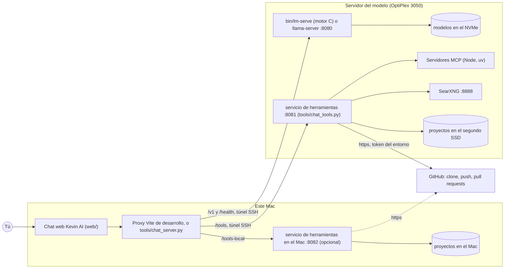
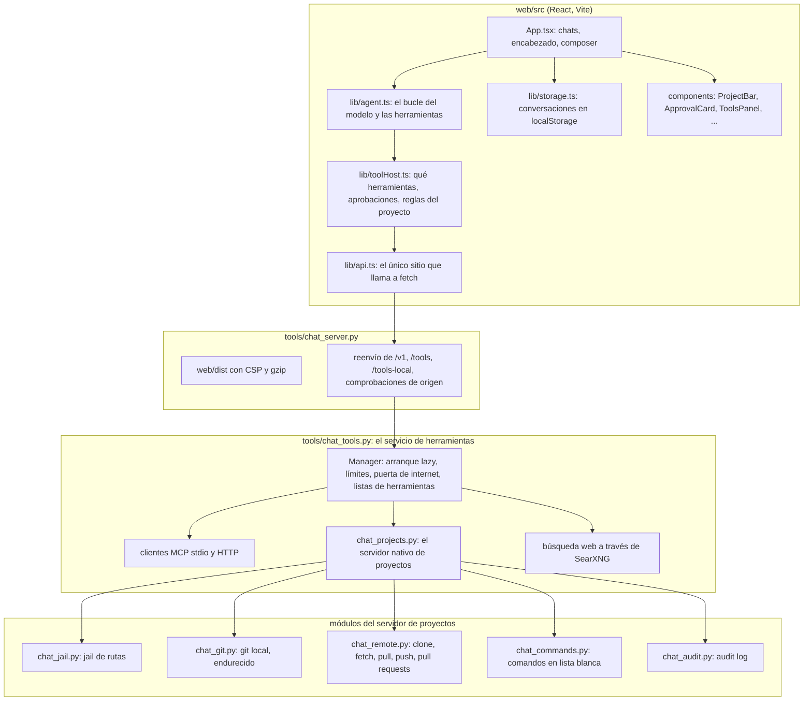
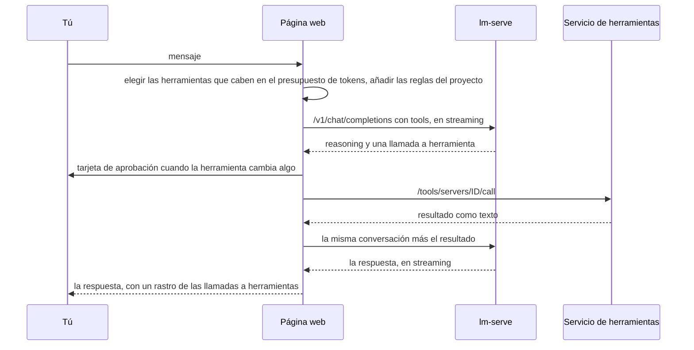
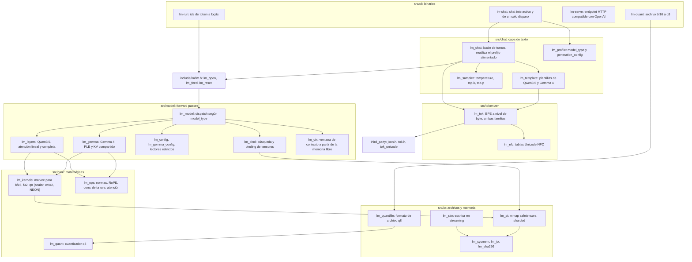
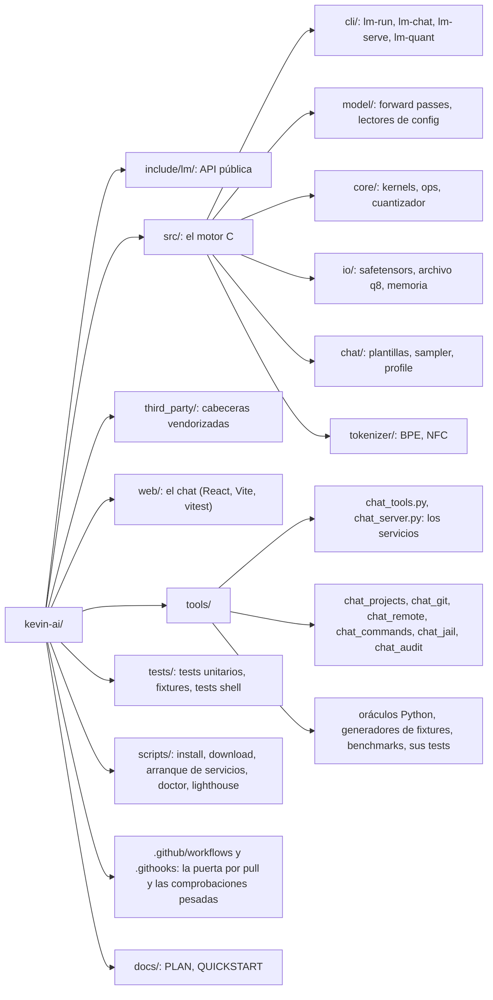
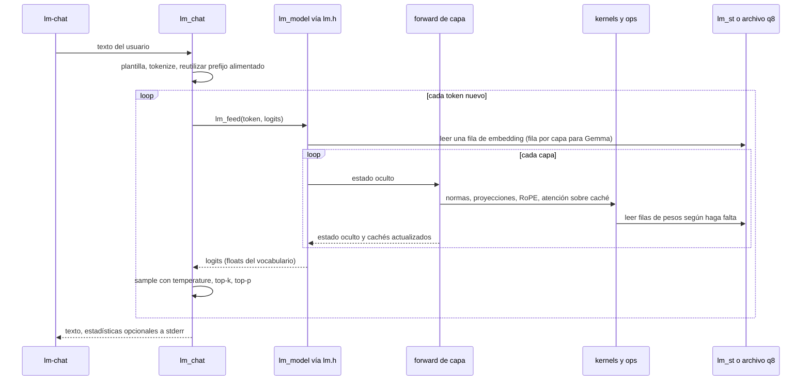

# Kevin AI

[English](README.md)

Creado por **Marc Fors i Soler**.

Un asistente de IA privado y local para una máquina pequeña, en tres partes que trabajan juntas:

- **El motor**: un motor de inferencia en C99 para CPU, para modelos de lenguaje pequeños, escrito desde cero (GGUF de Qwen3.5-4B, Gemma 4 E4B y Qwen2.5-Coder). Sin GPU, sin Python en tiempo de ejecución. `bin/lm-run`, `bin/lm-chat`, `bin/lm-serve` (un endpoint HTTP compatible con OpenAI) y `bin/lm-quant`. El chat arranca quince modelos: los cinco originales y diez GGUF con llama.cpp. Ver [Los cinco modelos](#los-cinco-modelos) y [Diez GGUF más](#diez-gguf-más).
- **El chat web** (`web/`, la app se llama Kevin AI): una página React que habla con `lm-serve`, guarda las conversaciones solo en el navegador, lee archivos e imágenes, y deja que el modelo use herramientas.
- **El servicio de herramientas** (`tools/chat_tools.py`): ejecuta servidores MCP, busca en la web a través de un SearXNG autoalojado, y da al modelo un **proyecto** en el que trabajar: archivos, git, comandos en lista blanca y pull requests de GitHub, cada uno detrás de reglas que fija el propietario y el agente no puede cambiar.

Objetivo: un Dell OptiPlex 3050 (Intel i5-6500T, 4 núcleos, AVX2, sin AVX-512), unos 11 GB de RAM, Ubuntu Server 26.04.1 LTS, con los modelos en el SSD NVMe en `~/models`. Todo se queda en tus máquinas: sin cuentas, sin telemetría, sin scripts ni fuentes remotas en la página.

- [Estado](#estado), [Visión del sistema](#visión-del-sistema), [Máquina objetivo](#máquina-objetivo)
- [Modelos](#los-cinco-modelos), [Herramientas del chat y proyectos](#herramientas-del-chat-en-el-servidor-del-modelo-mcp-y-búsqueda-web)
- [Instalación](#instalación-en-ubuntu-server), [Compilar y probar](#compilar-y-probar), [Arquitectura](#arquitectura)
- [Uso](#uso), [Releases](#releases), [Solución de problemas](#solución-de-problemas)

## Estado

- **El chat web y el servicio de herramientas se usan a diario** (cada pull request fusionado es un release etiquetado; ver [Releases](#releases) y [CHANGELOG.md](CHANGELOG.md)). El chat saca 100 en cada categoría de Lighthouse en escritorio y móvil (`scripts/lighthouse.sh`). El agente puede leer y editar archivos, usar git, ejecutar comandos que hayas puesto en lista blanca y abrir pull requests dentro de un proyecto que registraste; esa parte está probada contra repositorios git reales, un remoto bare local y un servidor falso de GitHub, y **aún no se ha ejecutado contra GitHub real** (hace falta un token que crees tú).
- **Qwen3.5-4B (fase 1) y Gemma 4 E4B (fase 2) están implementados.** Cada uno pasa su golden gate en un modelo sintético diminuto, contrastado con un oráculo float64. El oráculo de Gemma coincide con Hugging Face transformers hasta 5e-9.
- **Qwen3.5-4B corre sobre el checkpoint real** (primera ejecución 2026-11-14, vuelta a medir 2026-11-15 con `tools/bench_fast.py`, en la máquina objetivo). Responde bien. Con los pesos q8: unos **2.3 tokens/s** generando y unos **5.2 tokens/s** en un prompt de 32 tokens, con la CPU fijada a 800 MHz de sus 2.5 GHz por un adaptador de corriente no genuino (ver Solución de problemas, "cpu clock"). Con el adaptador genuino y la CPU a 2.5 GHz (medido 2026-11-20 con `tools/bench_serve.py`): **3.4 a 4.0 tokens/s** generando y 11.6 a 13.5 tokens/s en un prompt; ver "Velocidad a 800 MHz y a 2.5 GHz". La primera ejecución dio 1.7 y 1.9: los kernels AVX2 se compilaban a unas tres veces más instrucciones de las necesarias, y el prompt ahora pasa por lotes cuyas entradas se quedan en la caché L1 (4.6 tokens/s antes de eso; el multiply por lotes en sí fue 1.35x más rápido, con un 73% menos de fallos L1). `--profile` en un prompt de 64 tokens pone el 75% del tiempo del prompt en los multiplies, el 17% en atención lineal, el 4% en atención completa y el 4% en el resto. Las respuestas leen unos 4.75 GB por token, así que a unos 11 GB/s están limitadas por el ancho de banda de memoria.
- **Gemma 4 E4B corre sobre el checkpoint real** (primera ejecución 2026-11-16, en la máquina objetivo). Responde bien. Con los pesos q8 a 800 MHz: unos **1.9 tokens/s** generando y 3.5 a 5.9 tokens/s en un prompt corto, con un pico de 5.7 GiB residentes. A 2.5 GHz (medido 2026-11-20): **2.8 a 3.1 tokens/s** generando y 14 a 22 tokens/s en un prompt, misma memoria.
- **La ventana de contexto se elige a partir de la memoria libre** cuando no se pasa `--ctx`: 81.408 tokens para Qwen q8 y 131.072 (el máximo del modelo) para Gemma q8 en la máquina objetivo. Ver `--ctx` más abajo.
- **Decodificación especulativa MTP** (`lm-run --mtp`, solo Qwen) acepta el 78% de sus borradores, pero corre a 0.91x la velocidad normal en esta CPU, así que sigue siendo opt-in. (Medido a 800 MHz; no se repitió a 2.5 GHz.)

El plan completo, con las ecuaciones normativas del modelo y las puertas de prueba, está en [docs/PLAN.md](docs/PLAN.md).

## Visión del sistema



La página solo habla con su propio origen (una Content-Security-Policy estricta dice `'self'`): el proxy reenvía `/v1/*` al servidor del modelo, `/tools/*` al servicio de herramientas del servidor del modelo y `/tools-local/*` a una segunda copia en el Mac. El servidor del modelo se alcanza por túneles SSH en los puertos 8080 y 8081.

### Sitio de documentación de arquitectura

Una guía VitePress (en inglés) explica Vite frente a `chat_server.py`, cómo están hechas las API y cómo se arrancan los modelos, con diagramas Mermaid:

```bash
cd docs-site && npm ci && npm run docs:dev
```

Mapa interactivo del repositorio: [gitdiagram.com/marcfs31/kevin-ai](https://gitdiagram.com/marcfs31/kevin-ai)
([GitDiagram](https://gitdiagram.com/) — resumen generado por IA; comprueba los detalles con este README y `docs-site/`).

## Máquina objetivo

El motor se desarrolla y se mide en una sola máquina. Cada cifra de este README es para ella.

| parte | especificación |
|---|---|
| sistema | Dell OptiPlex 3050 |
| CPU | Intel Core i5-6500T, 4 núcleos, sin hyper-threading, AVX2 y FMA, sin AVX-512 |
| memoria | unos 11 GB (el SO reporta 11.328 MiB usables; unos 10.8 GiB disponibles en reposo) |
| GPU | Intel HD Graphics 530, no se usa |
| disco del sistema | Samsung MZVLB256HAHQ, SSD NVMe de 238.5 GB (lecturas 1.7 GB/s) |
| disco de reserva | Samsung SSD 850, SSD SATA de 465.8 GB, ext4 en `/mnt/models`, no lo usa el motor (lecturas unos 0.55 GB/s); los proyectos del chat pueden vivir ahí (`/mnt/models/kevin-projects`) |
| red | Realtek RTL8111/8168 Ethernet gigabit, Intel Wireless 8265/8275 (sin usar) |
| SO | Ubuntu Server 26.04.1 LTS, kernel 7.0.0-43-generic, x86-64 |
| toolchain | gcc 15.2.0, GNU make 4.4.1, Python 3.14.4 |

Qué implica esto para el motor:

- **La memoria es el límite de las respuestas.** El archivo q8 de Qwen3.5-4B pesa unos 4.8 GB y se lee una vez por cada token generado, así que la velocidad de respuesta está limitada por el ancho de banda de memoria, no por los cuatro núcleos. Un prompt se procesa en lotes que leen cada peso una vez cada 32 tokens.
- **Sin camino GPU, sin AVX-512.** Los kernels usan AVX2 con FMA (y NEON en ARM, para desarrollar en un Mac). En esta CPU el test de kernels reporta `kernel path: avx2`.
- **Los dos modelos caben en memoria.** Picos medidos: q8 Qwen 5.1 GiB, q8 Gemma 5.7 GiB (su archivo de 8.5 GB incluye una tabla por capa leída una fila por token), bf16 Qwen 8.0 GiB. bf16 Qwen ahora se queda residente en vez de hacer streaming desde disco, pero sigue siendo más lento que q8: unos 1.1 tokens/s generando a 800 MHz y 2.3 a 2.5 GHz.
- **Modelos en el NVMe.** El archivo q8 se lee una vez por arranque y luego se queda en la page cache. El NVMe lee a 1.7 GB/s, así que la primera carga tras un arranque tarda unos 3 s; el SSD SATA tardaría unos 9 s.
- **Verificado en esta máquina (primera ejecución, 2026-11-14):** la compilación, todos los tests unitarios y ambas golden gates pasan con gcc 15, OpenMP y los kernels AVX2. El checkpoint real de Qwen3.5-4B carga y responde; la velocidad está en la sección Estado arriba.

## Los cinco modelos

Se pueden arrancar cinco modelos desde el chat (Settings, o el selector del encabezado) o con `scripts/start-remote-lm-serve.sh --id <id>`. Solo corre uno a la vez: la máquina de 11 GB no puede sostener dos, así que al arrancar uno se para el otro.

| nombre en el chat | `--id` | corre en | archivos en `~/models` | contexto | notas |
|---|---|---|---|---:|---|
| Qwen3.5-4B | `qwen` | `lm-serve` (este motor) | `qwen3.5-4b/model.q8.safetensors` | hasta 131.072 | fase 1: atención lineal Gated DeltaNet, tres capas por una de atención completa; ~4.2 B parámetros de texto; Apache-2.0 |
| Qwen3.5-4B Uncensored | `qwen-uncensored` | `lm-serve` (este motor) | `qwen3.5-4b-uncensored/model.q8.safetensors` | hasta 131.072 | variante uncensored de Qwen3.5-4B en el mismo formato q8; su origen no está fijado en este repositorio, así que `scripts/download-model.sh` no la descarga |
| Gemma 4 E4B | `gemma` | `lm-serve` (este motor) | `gemma-4-e4b/model.q8.safetensors` | hasta 131.072 | fase 2: embeddings por capa, KV compartido entre capas, softcap de logits 30; ~4 B parámetros del núcleo más la tabla por capa |
| WhiteRabbitNeo 2.5 7B | `whiterabbitneo` | llama.cpp `llama-server` | `whiterabbitneo-2.5-7b/*-Q8_0.gguf` | hasta 16.384 | fine-tune de Qwen2.5-Coder-7B, Apache-2.0, solo texto; ver "WhiteRabbitNeo (GGUF)" |
| Gemma 4 E4B Uncensored | `gemma-uncensored` | llama.cpp `llama-server` | `gemma-4-e4b-uncensored/*-Q6_K_P.gguf` y el proyector `mmproj` | hasta 32.768 | fine-tune de Gemma 4 E4B que lee imágenes; Gemma Terms of Use; ver "Gemma 4 E4B Uncensored" |

**Tiempo de carga (medido 2026-11-25).** Arranques en serie con `scripts/start-remote-lm-serve.sh --id <id>`
(con `--no-think` en los ids de llama-server), reloj de pared hasta que `/health` remoto responde ok. Un modelo
a la vez; al arrancar uno se para el otro. El camino seguro más rápido es ese script (el mismo que el chat).

| `--id` | runtime | Carga hasta healthy |
|---|---|---:|
| `qwen-uncensored` | `lm-serve` | **2,7 s** |
| `qwen` | `lm-serve` | 3,3 s |
| `gemma` | `lm-serve` | 3,7 s |
| `gemma-uncensored` | `llama-server` | 7,0 s |
| `whiterabbitneo` | `llama-server` | 8,2 s |

## Diez GGUF más

Se arrancan igual (`--id` o el selector del chat). El loader GGUF nativo sigue siendo solo qwen2. Gemma 4 E2B y Nemotron 3.5 Bolt son gemma4, el mismo `llama-server` que Gemma 4 E4B Uncensored (`~/opt/llama.cpp-v1.0.0`). Granite 4.2 usa la arquitectura granite en ese build. Spark es spark2_5 y necesita llama.cpp b10828 o posterior (`~/opt/llama.cpp-b10828`). LFM3 es lfm3 y necesita llama.cpp b11938 o posterior (`~/opt/llama.cpp-b11938`). El Qwen es el GGUF 2B abliterado, no el Qwen3.5-4B instalado. El proyector se pasa solo cuando la fila tiene uno, y entonces el modelo ve imágenes. `scripts/download-model.sh --model <directorio>` baja los archivos fijados. El mapa está en `src/chat/lm_catalog.c`.

| nombre en el chat | `--id` | directorio y GGUF | build | imágenes |
|---|---|---|---|---|
| Gemma 4 E2B | `gemma-e2b` | `gemma-4-e2b/gemma-4-E2B-it-Q6_K.gguf` + `mmproj-F16.gguf` | v1.0.0 | sí |
| Nemotron 3.5 Bolt E4B | `nemotron` | `nemotron-3.5-bolt-e4b/NVIDIA-Nemotron-3.5-Bolt-E4B-UD-Q4_K_XL.gguf` | v1.0.0 | no hay proyector en ese repo |
| Granite 4.2 3B | `granite` | `granite-4.2-3b/granite-4.2-3b-Q8_0.gguf` | v1.0.0 | no |
| Spark X2.6 4B | `spark` | `spark-x2.6-4b/Spark-X2.6-4B-Q4_K_M.gguf` | b10828 | no |
| LFM3-VL 2B | `lfm3` | `lfm3-vl-2b/LFM3-VL-2B-Q8_0.gguf` + `mmproj-LFM3-VL-2B-F16.gguf` | b11938 | sí |
| Gemma 4 E2B Heretic | `gemma-e2b-heretic` | `gemma-4-e2b-heretic/gemma-4-E2B-it-ultra-uncensored-heretic-Q6_K.gguf` + `gemma-4-E2B-it-mmproj-BF16.gguf` | v1.0.0 | sí |
| Spark X2.6 4B Heretic | `spark-heretic` | `spark-x2.6-4b-heretic/Spark-X2.6-4B-heretic.Q6_K.gguf` | b10828 | no |
| Granite 4.2 3B Heretic | `granite-heretic` | `granite-4.2-3b-heretic/granite-4.2-3b-Heretic.Q8_0.gguf` | v1.0.0 | no |
| Qwen3.5-2B Abliterated | `qwen2b` | `qwen3.5-2b-abliterated/Huihui-Qwen3.5-2B-abliterated.Q8_0.gguf` + `Huihui-Qwen3.5-2B-abliterated.mmproj-f16.gguf` | v1.0.0 | sí |
| LFM3-VL 2B Abliterated | `lfm3-abliterated` | `lfm3-vl-2b-abliterated/LFM3-VL-2B-Surgical-Abliterated.Q8_0.gguf` + `LFM3-VL-2B-Surgical-Abliterated.mmproj-f16.gguf` | b11938 | sí |

En el selector el contexto es 32.768, salvo Granite (16.384, un Q8 denso). llama-server arranca en 8.192 si no se elige un preset. Los cinco con menos filtros de seguridad van marcados.

Las tasas sostenidas al generar están en [Estado](#estado) y en las secciones GGUF de abajo (Gemma Uncensored
unos **4,3–4,9 tok/s** es el camino de respuesta más rápido). Comparación de tiempo de Effort / Speed del chat:
[web/README.md](web/README.md) (Effort High cerca de **2×** Low/Medium en un párrafo corto con thinking).

Checkpoints: Qwen3.5-4B son 9.32 GB en bf16 (2 shards) y Gemma 4 E4B 15.99 GB en bf16 (1 archivo); `bin/lm-quant` escribe los archivos q8 con los que el motor suele correr. El chat marca los dos objetivos uncensored con un aviso: tienen menos filtros de seguridad que los checkpoints de stock.

El motor tiene sus propios loaders para los tres primeros. Los otros dos solo se distribuyen como GGUF, que el motor no puede ejecutar para Gemma 4, así que el chat los arranca con el `llama-server` de llama.cpp en el mismo puerto; los flags de `lm-serve` `--cache-mb` y `--fast` no les aplican. Una tercera familia del motor, `qwen2`, también puede cargar el WhiteRabbitNeo Q4_K_M con `bin/lm-serve --model ~/models/whiterabbitneo-2.5-7b-q4km` (ver su sección).

Qwen3.5 y Gemma 4 son Apache-2.0 y ungated. El audio queda fuera de alcance. El encoder de visión del motor corre por su cuenta (`lm-run --image`), pero el modelo de lenguaje aún no lee imágenes (docs/PLAN.md "Phase 3"), así que las imágenes funcionan en el chat con Gemma 4 E4B Uncensored en `llama-server`. La cabeza multi-token-prediction (MTP) de Qwen se usa para decodificación greedy especulativa en `lm-run --mtp` (ver más abajo).

## WhiteRabbitNeo (GGUF)

`bartowski/WhiteRabbitNeo-2.5-Qwen-2.5-Coder-7B-GGUF` (revisión `4874da7a…`, Apache-2.0 en el fine-tune y en su base Qwen2.5-Coder-7B; el archivo dice `general.license = apache-2.0`) corre desde su archivo GGUF: la tercera familia del motor, `qwen2` (atención grouped-query con bias en q, k y v, SwiGLU, RoPE rotate-half, sin atención lineal). `scripts/download-model.sh --model whiterabbitneo-2.5-7b-q4km` descarga el archivo fijado (4.683.072.032 bytes, sha256 comprobado) en `~/models/whiterabbitneo-2.5-7b-q4km/`; cualquier ruta a un `.gguf`, o un directorio con exactamente uno y sin `config.json`, es un modelo GGUF para `lm-run`, `lm-chat` y `lm-serve`. El archivo lleva el tokenizer y la plantilla de chat (ChatML bare, sin system prompt por defecto); `--weights` no aplica. El objetivo `whiterabbitneo` del selector web hoy arranca el `llama-server` de llama.cpp sobre el archivo Q8_0 en `whiterabbitneo-2.5-7b`; para servir el Q4_K_M con este motor en su lugar ejecuta `bin/lm-serve --model ~/models/whiterabbitneo-2.5-7b-q4km` (el id del modelo es el nombre del directorio).

**Cuantización: Q4_K_M.** La caché KV es f32 (112 KiB por token, 3.5 GiB en la ventana de 32k del modelo) y el decode lee cada peso una vez por token, a unos 11 GB/s aquí. Q6_K (6.25 GB) y Q8_0 (8.10 GB) dejarían 11 GB con poco contexto y leerían 1.3x y 1.7x más por token; Q4_K_M (4.68 GB: matrices Q4_K, Q6_K para la mitad de `attn_v` y `ffn_down` y para la matriz de salida) mantiene la ventana completa de 32k en memoria. Los kernels también leen Q5_K y Q8_0, así que los otros archivos bartowski del mismo modelo cargan (no medidos aquí).

Medido en la máquina objetivo (2026-11-21, 2.5 GHz, 4 hilos, otro `lm-serve` idle al lado):

| | |
|---|---|
| residente tras una petición | 4.35 GiB (4.28 GiB del archivo mapeado, 74 MiB anónimos; la caché KV crece con el contexto) |
| contexto elegido sin `--ctx` | 32.768 (el máximo del modelo; 9.2 GiB disponibles) |
| generando | 1.5 a 1.7 tokens/s (unos 0.6 s por token; la lectura sola es 4.7 GB a 11 GB/s, así que el límite por memoria sería 2.3) |
| prompt | 3.2 a 3.3 tokens/s en 64 a 96 tokens (limitado por cómputo: el ensanchamiento a float de cada bloque) |
| una respuesta de código de 80 tokens por `lm-serve` | 55 s, correcta |

Los kernels mantienen las activaciones en float y son bit-idénticos entre scalar y AVX2. Un camino de activaciones int8 como `--fast` para q8 leería los mismos bytes con muchas menos instrucciones; no está implementado.

## Gemma 4 E4B Uncensored (GGUF, en llama-server)

`HauhauCS/Gemma-4-E4B-Uncensored-HauhauCS-Aggressive` (revisión `45b6a334…`, un fine-tune de `google/gemma-4-e4b-it`; la etiqueta de licencia del repo es `gemma`, ver NOTICE) solo se distribuye en GGUF, y el motor no tiene loader GGUF de Gemma 4, así que el objetivo `gemma-uncensored` del selector web lo corre en el `llama-server` de llama.cpp, con el proyector de visión (`--mmproj`) para que lea imágenes. `scripts/download-model.sh --model gemma-4-e4b-uncensored` descarga los dos archivos fijados (tamaños y sha256 comprobados) en `~/models/gemma-4-e4b-uncensored/`; `scripts/start-remote-lm-serve.sh --id gemma-uncensored` los arranca.

**Cuantización: Q6_K_P** (los quants "K_P" de HauhauCS mantienen los tensores sensibles un nivel más alto, calidad cercana a Q8 a 5.8 GiB). Q8_K_P (7.6 GiB) más el proyector de 0.9 GiB dejan a una máquina de 11 GB poco margen para la ventana, y el archivo q8 propio del motor ya son los mismos 8 bits por peso.

Medido en la máquina objetivo (2026-11-21, 4 hilos, build CPU de llama.cpp v1.0.0):

| | |
|---|---|
| residente tras el arranque | 7.1 GiB con `--ctx 8192`, 7.5 GiB con `--ctx 32768` (la caché KV es pequeña: la mayoría de capas usan una ventana de 512 tokens) |
| generando | 4.3 a 4.9 tokens/s |
| prompt | 15 a 17 tokens/s |
| una imagen de prueba 64x64 | leída correctamente (un degradado rojo, verde y azul se describió como tal), a través del chat web |
| thinking | activado por defecto, así que una respuesta puede tardar minutos a esta velocidad; `--no-think` lo omite (una respuesta con imagen en 9 s) |

## Herramientas del chat en el servidor del modelo (MCP y búsqueda web)

`tools/chat_tools.py` es un servicio pequeño solo con la biblioteca estándar que ejecuta servidores MCP para el chat y hace una búsqueda web opcional (ver el docstring del módulo y `web/README.md` para lo que hace y lo que rechaza). Corre en la máquina del modelo, a su lado, en 127.0.0.1:8081:

```bash
scripts/install-tool-runtimes.sh                 # en el servidor: Node 24.22.1 y uv 0.13.5 en ~/opt, sha256 comprobado
scripts/start-remote-chat-tools.sh --update      # desde el Mac: pull del repo allí y (re)arranque del servicio
ssh -N -L 8081:127.0.0.1:8081 toor@192.168.1.96  # un segundo forward, junto al del modelo
```

El proxy de desarrollo del chat (`LM_TOOLS_URL`, por defecto `http://127.0.0.1:8081`) o `tools/chat_server.py --tools-upstream` reenvía `/tools/*` hacia él. Los servidores se listan en `~/.config/lm-chat/mcp.json` en el servidor o se añaden desde el catálogo en Settings; una entrada del catálogo descarga su paquete npm o PyPI (versión fijada, scripts de instalación desactivados) la primera vez que arranca, lo que necesita el interruptor de internet. El servicio arranca un servidor cuando se usa por primera vez, lo para tras cinco minutos idle, corre como máximo tres a la vez y ninguno mientras haya menos de 700 MiB de memoria disponible. La herramienta de archivos solo puede tocar `~/chat-files`.

### Una segunda copia del servicio de herramientas en este Mac

Para trabajo que tiene que correr en el propio Mac, arranca otra copia aquí, en 127.0.0.1:8082, con su propia configuración y estado (`~/.config/lm-chat/mcp.json` se comparte con otras herramientas, así que no se usa):

```bash
scripts/start-local-chat-tools.sh          # lo arranca (sustituyendo uno que haya arrancado este script); pid file en el directorio de estado
scripts/start-local-chat-tools.sh --stop   # para solo ese
```

Usa `~/.config/kevin-ai/mcp-local.json` y `~/.local/share/kevin-ai` (pid file `chat-tools-local.pid`, log `chat-tools-local.log`); `LM_LOCAL_TOOLS_CONFIG` y `LM_LOCAL_TOOLS_STATE` los cambian y `--port N` el puerto. El chat lo alcanza en `/tools-local/*`: el proxy de desarrollo usa `LM_TOOLS_LOCAL_URL` (por defecto `http://127.0.0.1:8082`) y `tools/chat_server.py --tools-local-upstream http://127.0.0.1:8082` hace lo mismo (sin la opción, esa ruta es un 404). Las comprobaciones son las de `/tools/*`, y el prefijo se convierte en `/tools/` aguas arriba. No hace falta túnel.

### Búsqueda web para el chat (SearXNG)

`scripts/setup-remote-searxng.sh` instala SearXNG en la misma máquina (un commit fijado, en `~/opt/searxng` con su propio virtualenv hecho por `uv`; ajustes en `~/.config/searxng/settings.yml`, escritos una vez, con una clave aleatoria) y lo arranca en 127.0.0.1:8888 con el formato JSON activado. Necesita unos 250 MB. En Settings > Tools and internet, activa internet y pon `http://127.0.0.1:8888` como dirección de búsqueda web: la dirección la usa el servicio de herramientas, que también corre en esa máquina. Las consultas van de SearXNG a los motores que tenga configurados, y a ningún otro sitio. Los paquetes se instalan desde `scripts/searxng-requirements.txt` (versiones exactas del entorno probado). El servicio de herramientas solo busca una dirección loopback distinta de su propio puerto; una dirección privada de la red debe listarse al arrancarlo (`chat_tools.py --search-allow 192.168.1.20:8888`).

### Proyectos, git y pull requests para el agente

`chat_tools.py --projects-base DIR` añade un servidor integrado **project** al servicio de herramientas de ese host: herramientas de archivos (`project_list`, `fs_read`, `fs_list`, `fs_search`, `fs_write`, `fs_edit`) sobre los proyectos listados en un registro editado por el propietario, `~/.config/lm-chat/projects.json` (`--projects-registry` para moverlo):

```json
{"projects": {"demo": {"title": "Demo", "root": "demo"}}}
```

Un `root` debe resolverse a una carpeta dentro de la base, así que el agente solo llega a carpetas que tú pongas ahí. Las rutas que da son relativas al proyecto, nunca absolutas, nunca `..`, nunca a través de un symlink que salga del proyecto, nunca bajo `.git`. Las escrituras se detienen a 2 MB por archivo y cuando el disco bajaría de `--projects-min-free-gb` (por defecto 5; usa 20 en el servidor del modelo, cuyo segundo SSD también guarda los modelos). Hay una copia del servicio por host, el servidor y el Mac, y un proyecto vive en el host cuyo servicio se consulta.

El mismo servidor tiene herramientas git locales: `git_status`, `git_diff`, `git_log`, `git_show`, `git_branches`, `git_branch_create` (con nombre `kevin/<name>`), `git_switch`, `git_add`, `git_commit`, `git_restore` y `git_init`. Git corre como una lista de argumentos sin configuración de usuario ni del sistema, y con hooks, fsmonitor, diff externo, editor, pager y credential helper desactivados, para que un repositorio no pueda ejecutar código por su propia config. Los commits se rechazan en la rama por defecto del proyecto salvo que el registro ponga `"allowMain": true`; el committer es el `identity` del registro (por defecto Kevin AI, developer@marcfors.com). Por proyecto el registro también admite `"defaultBranch"` (por defecto `main`):

```json
{"identity": {"name": "Kevin AI", "email": "developer@marcfors.com"},
 "projects": {"demo": {"title": "Demo", "root": "demo", "defaultBranch": "main", "allowMain": false}}}
```

Los comandos son una lista blanca que escribes en el registro, por proyecto (el agente no puede editarla):

```json
"commands": {"test": {"argv": ["make", "test"], "timeout": 120, "safe": false, "cwd": "web", "env": {"CI": "1"}}}
```

Cada comando se convierte en su propia herramienta, `run_<project>_<name>`, con el argv en su descripción, para que la tarjeta de aprobación diga qué se va a ejecutar y un comando marcado `"safe": true` corra sin preguntar. El argv es fijo (el agente no puede añadir argumentos), se ejecuta sin shell en la carpeta del proyecto, con un entorno mínimo (ningún secreto del servicio), un HOME privado que se elimina después, sin stdin, un límite de tiempo que para todo el process group, y solo la cola de la salida. Es una lista blanca, no un sandbox: un comando sigue teniendo la red y lo que su propio programa pueda alcanzar. Todo lo que el agente cambia (escrituras y ediciones de archivos, git add, commit, restore, ramas, comandos) se añade a `<state-dir>/audit.jsonl` (`--audit-log` para moverlo), un archivo privado con la hora, el proyecto, la herramienta, un resumen corto y las primeras palabras del resultado, nunca el contenido de los archivos.

El git remoto y las pull requests necesitan dos campos más del registro, también fuera del alcance del agente:

```json
"remote": "https://github.com/owner/repo.git", "tokenEnv": "KEVIN_GITHUB_TOKEN"
```

`git_clone` (en la carpeta vacía del proyecto), `git_fetch`, `git_pull` (solo fast-forward, sin cambios sin commitear), `git_push` y `pr_create` hablan solo con ese `remote`: el agente nunca nombra una URL, un remoto ni un token, y las herramientas no admiten force ni delete. `git_push` envía la rama actual con el mismo nombre, nunca forzada, y no la rama por defecto salvo que `allowMain` esté puesto; `pr_create` abre una pull request de GitHub desde la rama actual hacia la rama por defecto. El token se lee de la variable de entorno del servicio nombrada por `tokenEnv` (por defecto `KEVIN_GITHUB_TOKEN`; usa un token de alcance fino, contents y pull requests en ese único repositorio), llega a git solo a través de un helper `GIT_ASKPASS` que se borra después, y se limpia de cada resultado. Un repositorio que reescribe URLs en su propia config se rechaza, y se anulan su proxy, cabeceras y ajustes TLS. Estas herramientas siempre piden aprobación.

**Qué decide el propietario y qué puede hacer el agente**

| | Propietario (archivo de registro, flags del servicio, entorno) | Agente (llamadas a herramientas) |
|---|---|---|
| dónde trabaja | `root` de cada proyecto, dentro de `--projects-base`; `--projects-min-free-gb` | un id de proyecto, nunca una ruta fuera del proyecto |
| archivos | qué proyectos existen | `fs_read`, `fs_list`, `fs_search`, `fs_write`, `fs_edit` dentro de la jail |
| git | `identity`, `defaultBranch`, `allowMain`, `remote` | status, diff, log, ramas con nombre `kevin/...`, add, commit, restore |
| comandos | `commands`: argv fijo, timeout, `safe`, `cwd`, `env` | llamar `run_<project>_<name>`; sin argumentos |
| red | `remote` (https), `tokenEnv` y el token en el entorno del servicio | clone, fetch, pull (fast-forward), push de su rama, abrir una pull request |
| registro | `--audit-log` | nada: cada cambio se añade al audit log |

```mermaid
sequenceDiagram
  participant M as Modelo
  participant P as Página web
  participant U as Tú
  participant S as Servicio de herramientas
  participant G as git, comandos, GitHub
  M->>P: llamada a herramienta, por ejemplo git_commit
  P->>P: las de solo lectura corren; las demás necesitan aprobación
  P->>U: tarjeta de aprobación con el comando o los argumentos
  U-->>P: permitir una vez, siempre, o denegar
  P->>S: POST /tools/servers/project/call con el id de proyecto del chat
  S->>S: jail de rutas, reglas del registro, regla de la rama por defecto
  S->>G: git endurecido o el argv fijo, entorno mínimo
  G-->>S: salida (token limpio, solo la cola)
  S->>S: añadir al audit log
  S-->>P: resultado o texto de error
  P-->>M: el resultado, para que pueda seguir
```

En el chat, un selector **Project** bajo el encabezado (visible mientras el servidor Project está activado en Settings > Tools y el servicio lista proyectos, leídos de `GET /tools/projects`: ids, títulos y reglas, nunca rutas) elige el proyecto en el que trabaja un chat. La página entonces le dice al modelo las reglas y comandos del proyecto, siempre envía el id de ese proyecto a las herramientas de proyecto diga lo que diga el modelo, muestra la rama y el número de archivos cambiados (leídos con `git_status`) y muestra el comando exacto en la tarjeta de aprobación.

Los **Workflows** son recetas de pasos guardadas. Un proyecto las guarda en su propio repositorio, en `.kevin/workflows.json` (son prompts, no permisos: lo que el agente puede hacer lo sigue decidiendo tu registro):

```json
{"workflows": [{"id": "fix-bug", "title": "Fix a bug",
                "steps": ["Reproduce it", "Write a failing test", "Fix it on a kevin/ branch", "Run the tests", "Commit"]}]}
```

Con un proyecto elegido, la barra **Workflow** encima del composer los lista (como máximo 20, 12 pasos de 200 caracteres cada uno). Arranca uno y el chat muestra su checklist; al modelo se le dicen los pasos y marca cada uno con `workflow_step` (done, skipped o blocked, con una nota corta), que nunca pide aprobación porque solo cambia el checklist. Tú puedes marcar o desmarcar un paso, y parar el workflow. El checklist se guarda con el chat. El mensaje de sistema solo lleva los pasos, no cómo están, así que marcar un paso no cambia el inicio del prompt (lo que haría que el servidor leyera todo el chat otra vez); tu siguiente mensaje lleva los estados cuando cambiaron.

#### Configurar proyectos (pasos del propietario)

1. **Arranca el servicio con una base de proyectos.** `scripts/start-remote-chat-tools.sh --update` ahora pasa `--projects-base` (por defecto `/mnt/models/kevin-projects`, se crea si falta, `LM_PROJECTS_BASE` para cambiarlo, vacío para desactivar proyectos) y `--projects-min-free-gb` (por defecto 20, `LM_PROJECTS_MIN_FREE_GB`). En el Mac, `scripts/start-local-chat-tools.sh` hace lo mismo con `~/KevinProjects` (`LM_LOCAL_PROJECTS_BASE`) y su propio registro `~/.config/kevin-ai/projects-local.json` (`LM_LOCAL_PROJECTS_REGISTRY`).
2. **Escribe el registro** en ese host (`~/.config/lm-chat/projects.json` en el servidor): una entrada por proyecto, `root` dentro de la base, y lo que el agente puede hacer (ver los ejemplos de arriba). El servicio lo lee en cada llamada, así que un cambio no necesita reinicio; un error se muestra en el panel Tools.
3. **Dale un token solo si debe hacer push** (clone, push y pull requests; leer y commits locales no necesitan ninguno). Crea un token de GitHub de alcance fino para el único repositorio, con Contents y Pull requests de lectura y escritura, y ponlo donde solo tú puedas leerlo:

   ```bash
   mkdir -p ~/.config/kevin-ai && install -m 600 /dev/null ~/.config/kevin-ai/tool-service.env
   echo 'KEVIN_GITHUB_TOKEN=github_pat_...' >> ~/.config/kevin-ai/tool-service.env
   ```

   Ambos scripts de arranque cargan ese archivo (y lo rechazan salvo que su modo sea 600). Nunca va al repositorio ni al navegador, y el agente nunca lo ve.
4. **Úsalo.** En Settings > Tools activa el servidor Project, luego elige el proyecto bajo el encabezado. Cada cambio que haga el agente está en `<state-dir>/audit.jsonl` en ese host.

Por defecto la página del chat usa solo los proyectos del servidor del modelo. Para trabajar en proyectos de este Mac, arranca su copia del servicio (`scripts/start-local-chat-tools.sh`), asegúrate de que el proxy reenvíe `/tools-local` hacia él, y activa **Also use the tool service on this Mac** en Settings > Tools. El selector entonces lista esos proyectos como "(on this Mac)"; un chat recuerda en qué host está su proyecto, las herramientas y comandos del proyecto vienen del servicio de ese host, el chip de git y los workflows se leen allí, y las tarjetas de aprobación de un proyecto del Mac dicen "Mac". Con el interruptor apagado la página nunca llama a `/tools-local`.

## Instalación en Ubuntu Server

Estas son las elecciones hechas en el OptiPlex durante el instalador de Ubuntu Server. Úsalas tal cual, o adáptalas, pero mantén el layout de discos: el SO en el SSD NVMe y los modelos en el SSD SATA.

### Roles de los discos

Las especificaciones completas de la máquina están en [Máquina objetivo](#máquina-objetivo). Los discos se usan así:

| disco | uso |
|---|---|
| Samsung SSD NVMe 238.5 GB | Ubuntu, `/`, `/boot`, `/boot/efi` |
| Samsung SSD SATA 465.8 GB | reserva: copias de seguridad u otros datos; no lo usa el motor (opcional, ver más abajo) |
| Memoria USB SanDisk | solo medio de instalación; no la particiones ni la uses después |

### Pasos del instalador

1. **Idioma y teclado:** como prefieras.
2. **Configuración de red:**
   - El puerto cableado `enp2s0` (Realtek RTL8111/8168/8211/8411 gigabit) debería mostrar "connected" con DHCPv4 una vez el cable esté enchufado al router. Úsalo: el cable es más fiable para un servidor.
   - La tarjeta Wi-Fi `wlp3s0` (Intel Wireless 8265/8275) arranca desactivada. Actívala solo si el servidor no puede ir por cable. Introduce la contraseña Wi-Fi tú mismo en el prompt; no se guarda en este repositorio.
   - Elige **Done** cuando se muestre una conexión.
3. **Configuración de almacenamiento:**
   - Selecciona el SSD **Samsung** como **boot disk**.
   - Crea tres particiones GPT en él, en este orden:

     | tamaño | formato | montaje |
     |---|---|---|
     | 1 GB | FAT32 | `/boot/efi` |
     | 2 GB | ext4 | `/boot` |
     | resto (unos 235 GB) | ext4 | `/` |

   - No uses LVM. Se puede añadir después un archivo de swap de 2 a 4 GB por seguridad; no hace falta para correr el motor.
   - Deja solo el segundo SSD (modelos) durante la instalación; se configura en "Un disco de reserva" más abajo.
   - El instalador avisa si `/` no está montado o no hay boot disk seleccionado; ambos deben estar puestos.
4. **Perfil:** elige el nombre del servidor, el usuario y una contraseña que recuerdes. Usa el mismo usuario para los pasos SSH de abajo.
5. **SSH:** activa **Install OpenSSH server** para poder trabajar desde tu Mac. Usa una clave SSH más adelante; el login por contraseña puede quedarse para la primera sesión.
6. **Featured server snaps:** no selecciones ninguno. El motor no los necesita, y cada uno añade paquetes que mantener.
7. Elige **Done**, deja que termine la instalación, quita la memoria USB y reinicia.

### Tras el primer arranque

Encuentra la dirección del servidor en el router o con `ip addr`, luego conecta desde el Mac:

```sh
ssh USERNAME@SERVER_ADDRESS
```

Actualiza el sistema (pide tu contraseña; ejecútalo tú):

```sh
sudo apt update && sudo apt full-upgrade -y
```

Luego instala las herramientas de compilación que necesita el motor:

```sh
sudo apt install build-essential python3 curl
```

Opcional, para un archivo de swap de 4 GB en el SSD:

```sh
sudo fallocate -l 4G /swapfile && sudo chmod 600 /swapfile && sudo mkswap /swapfile && sudo swapon /swapfile
echo '/swapfile none swap sw 0 0' | sudo tee -a /etc/fstab
```

### Un disco de reserva (opcional)

El motor no necesita un segundo disco. Para usar el SSD SATA para copias de seguridad u otros datos, configúralo una vez tras el primer arranque. Esto **borra el disco**: comprueba que `/dev/sda` es el SSD SATA (`lsblk -o NAME,SIZE,MODEL,SERIAL`) antes de ejecutarlo.

```sh
sudo sfdisk /dev/sda <<< $'label: gpt\n,,L'
sudo mkfs.ext4 -L models -m 0 /dev/sda1
sudo mkdir -p /mnt/models
echo "UUID=$(sudo blkid -s UUID -o value /dev/sda1) /mnt/models ext4 defaults,noatime,nofail 0 2" | sudo tee -a /etc/fstab
sudo systemctl daemon-reload && sudo mount /mnt/models && sudo chown "$USER:$USER" /mnt/models
```

`nofail` deja arrancar la máquina sin el disco. Los modelos se quedan en `~/models` salvo que pongas `LM_MODELS_DIR` (por ejemplo a `/mnt/models`).

## Instalar el motor

Copia este repositorio al servidor. Desde tu Mac:

```sh
rsync -a --exclude build --exclude bin --exclude .claude --exclude .git \
  "PATH_TO_THIS_REPO/" USERNAME@SERVER_ADDRESS:~/kevin-ai/
```

O clónalo en el servidor: `git clone https://github.com/marcfs31/kevin-ai.git ~/kevin-ai`. Luego en el servidor:

```sh
cd ~/kevin-ai
scripts/install.sh --model qwen3.5-4b
```

`scripts/install.sh` ejecuta, en orden: una comprobación del sistema y las herramientas (rechaza sin AVX2), `make`, `make test`, `make gate`, la descarga del modelo fijado a `<root>/<model>`, el archivo q8, y el informe de solo lectura de `scripts/doctor.sh`. Al final imprime el comando del chat.

| opción | significado |
|---|---|
| `--model qwen3.5-4b` | por defecto; unos 10.3 GB de descarga, archivo q8 de 4.8 GB |
| `--model gemma-4-e4b` | unos 17 GB de descarga, archivo q8 de 8.5 GB |
| `--model both` | los dos de arriba |
| `--model none` | solo compilar y probar |
| `--model-dir DIR` | dónde van los modelos. Por defecto: `$LM_MODELS_DIR`, si no `~/models` (`scripts/models-root.sh` imprime la elección) |
| `--skip-tests` | omite `make test` y `make gate` (no recomendado en la primera ejecución) |
| `--allow-hdd` | permite descargar a un disco rotacional (no recomendado) |

Es seguro volver a ejecutarlo: las descargas terminadas y un archivo q8 existente se saltan.

Para hacer los mismos pasos a mano, sigue [docs/QUICKSTART.md](docs/QUICKSTART.md).

## Compilar y probar

```sh
make            # compila bin/* (un binario por src/cli/*.c)
make test       # compila y ejecuta cada tests/unit/test_*.c y tests/scripts/test_*.sh (lint, typecheck,
                # tests y build del chat web, y los tests Python del servicio de herramientas; necesita Node)
make gate       # golden gates de Qwen3.5 y Gemma 4 contra los fixtures del oráculo
make sanitize   # tests unitarios bajo ASan y UBSan
make portable   # build x86-64 con -mavx2 -mfma en vez de -march=native
```

Requisitos: un compilador C99 (`build-essential`), `make`, Python 3 (solo biblioteca estándar), y `curl` y `sha256sum` para el script de descarga. El chat web necesita Node 24 (`web/.nvmrc`) solo en la máquina donde lo compiles o desarrolles; los servidores solo necesitan Python 3.

Una pull request ejecuta un job (`make test`: tests C, tests shell, los tests Python de los servicios y el lint, typecheck, tests y build del chat). `scripts/ci-heavy.sh` (sanitizers, el build portable) corre desde `.githooks/pre-push` (`git config core.hooksPath .githooks`) y semanalmente en CI. Un cambio bajo `web/`, `tools/chat_server.py` o `index.html` también ejecuta `scripts/lighthouse.sh` (necesita Chrome y red): 100 en cada categoría, escritorio y móvil, sobre el build de producción.

## Cómo funciona

**Pesos: q8 residente, bf16 exacto.**

- `bin/lm-quant` escribe un archivo q8: pesos int8 con una escala f32 cada 32 pesos. El motor lo mapea en memoria y lo mantiene residente. Este es el modo normal en esta máquina.
- Los safetensors bf16 originales también cargan directamente: exactos, pero más lentos. bf16 Qwen (9.3 GB) se queda residente en 11 GB; bf16 Gemma (16 GB) hace streaming por la page cache. La golden gate usa bf16 como referencia para q8.

**Los chats largos se mantienen baratos (Qwen).** Las capas de atención lineal guardan un estado de tamaño fijo en vez de una caché que crece con cada token. Solo las capas de atención completa guardan una caché key/value.

**Memoria de Gemma 4.** Solo las primeras 24 capas tienen su propia caché key/value; las últimas 18 las reutilizan. Las capas de sliding-window guardan un anillo de 512 posiciones. La tabla de embeddings por capa se lee una fila por token desde el archivo mapeado, nunca se carga entera. A 4096 tokens de contexto las cachés suman unos 168 MiB, más unos 8 MiB de buffers de procesamiento del prompt.

**Portabilidad.** El motor está escrito desde cero y porta código archivo a archivo desde [kimi-k3-in-c](https://github.com/FareedKhan-dev/kimi-k3-in-c) (Apache-2.0; ver [NOTICE](NOTICE)): el lector de safetensors, los kernels bf16 e int8, la recurrencia delta-rule, el sampler, y cabeceras de tokenizer vendorizadas.

## Arquitectura

Tres capas se sitúan entre las herramientas de línea de comandos y el archivo de pesos. La API pública en [include/lm/lm.h](include/lm/lm.h) es lo único que llaman las herramientas: ids de token de entrada, logits de salida. El motor no sabe nada de texto; el código de chat y tokenizer lo envuelve.

### El chat y el servicio de herramientas

El motor termina en `lm-serve`. Todo lo que añade el chat está por encima, en dos archivos Python sin dependencias y una app React:



Un mensaje con una llamada a herramienta, de punta a punta:



El bucle se detiene en el límite de pasos (Settings, hasta 50, por defecto 20); la última llamada se hace sin tools.

### Mapa de módulos



### Qué hace cada parte

- **API pública (`lm.h`).** `lm_open` y `lm_close`; `lm_feed` (un token, logits opcionales), `lm_prefill` (un lote de tokens), `lm_reset`, `lm_pos` y las consultas de tamaño. La decodificación especulativa añade `lm_draft`, `lm_verify`, `lm_accept` y `lm_greedy_check` (la cabeza MTP de Qwen). Los errores son códigos enteros pequeños (`LM_ERR_CTX`, `LM_ERR_TOKEN`, `LM_ERR_IO`). Un modelo nunca se trunca, porque el estado de atención lineal no se puede recortar; un llamador que cambia el prompt hace reset y vuelve a alimentar, o restaura un snapshot: `lm_snapshot` copia el estado en la posición actual y `lm_restore` lo pone de vuelta bit a bit. `lm_mark` copia solo el estado que las posiciones siguientes sobrescriben, y restaurarlo rebobina el modelo a ese punto. `lm_times_enable` y `lm_times_get` reportan dónde se fue el tiempo (lo que imprime `--profile`).
- **`src/model`.** `lm_open` lee `config.json` y despacha según `model_type`: `qwen3_5` va a `lm_layers`, `gemma4` a `lm_gemma`. Cada lector es estricto: un campo que falta es un error, nunca un valor por defecto. `lm_bind` busca tensores por nombre, y es el único sitio que decide si un peso es bf16 o q8.
- **`src/core`.** La aritmética. `lm_kernels` tiene los productos matriz-vector de cada formato de peso; los caminos AVX2 y NEON se comprueban bit a bit contra el camino scalar. `lm_ops` tiene las operaciones por token: normalización, embeddings rotatorios, la convolución causal, el paso delta-rule y la atención sobre una caché. `lm_ctx` elige la ventana de contexto a partir de la memoria que la máquina puede dar (una función pura, probada con tamaños sintéticos).
- **`src/io`.** Archivos y memoria. `lm_st` mapea archivos safetensors (incluidos los sharded) sin copiarlos, así que la page cache del SO decide qué se queda en RAM. `lm_quantfile` define el layout q8, y `lm_stw` escribe archivos a medida que se producen en vez de bufferizarlos.
- **`src/chat` y `src/tokenizer`.** Texto de entrada y de salida, fuera del motor. `lm_chat` alarga el prefijo alimentado cuando crece la conversación y solo vuelve a alimentar desde cero cuando debe; luego una caché de prefijos, un snapshot por system prompt, evita volver a alimentar un system prompt compartido. `lm_template` renderiza el formato de chat de cada familia. `lm_tok` hace el BPE a nivel de byte; para Gemma usa un merge ordenado en heap, para que las palabras largas sigan siendo rápidas.
- **`third_party`.** Cabeceras vendorizadas (parser JSON, tokenizer, tablas Unicode) con sus modificaciones registradas en [NOTICE](NOTICE).

### Layout del repositorio



El Makefile descubre fuentes con wildcards, así que un archivo nuevo bajo `src/` o un `tests/unit/test_*.c` no necesita cambiar el Makefile.

### Un token, de punta a punta



Cada token lee los pesos de cada capa una vez, así que la velocidad está limitada por lo rápido que se pueden leer esos bytes (ver la velocidad medida en Estado). Las cachés KV solo existen donde una capa tiene una propia (las capas compartidas de Gemma reutilizan la del productor), así que la memoria crece con el contexto solo a través de esas cachés.

## Releases

Cada pull request fusionada es un release: SemVer (antes de 1.0 un patch por cada cambio, el número minor para un cambio breaking o de fase), una versión en `web/package.json` y `web/package-lock.json`, una sección en [CHANGELOG.md](CHANGELOG.md) y una etiqueta anotada `vX.Y.Z` en el commit fusionado. Las pull requests se fusionan con rebase para que cada commit sobreviva. [AGENTS.md](AGENTS.md) tiene las reglas para agentes de código.

## Uso

### bin/lm-chat

Chatea con el modelo. Con `--prompt` responde una vez y sale. Sin él, abre un chat interactivo; `/reset` limpia la conversación y `/exit` sale.

```
bin/lm-chat --model DIR --weights FILE [--prompt TEXT] [--system TEXT]
            [--think | --no-think] [--show-thinking] [--strict-template]
            [--temperature T] [--top-p P] [--top-k K] [--seed N]
            [--max-tokens N] [--ctx N] [--threads N] [--stats] [--fast]
```

- `--prompt` y `--system` se borran de la lista de procesos tras el arranque.
- Thinking está desactivado por defecto (`--no-think`). Un bloque de thinking cuesta muchos tokens a esta velocidad.
- `--stats` imprime tokens/s a stderr, y la ventana de contexto elegida.
- `--ctx N` fija la ventana de contexto. Sin él, la ventana es la mayor que mantiene los pesos y el estado en la memoria libre (menos 512 MiB), hasta el `max_position_embeddings` del modelo; una ventana explícita cuyo estado no cabe se rechaza con la mayor que sí cabe. Una ventana más grande cuesta memoria por adelantado; la atención solo se ralentiza a medida que el contexto se llena de verdad.
- Sin `--max-tokens` una respuesta corre hasta que el modelo para o se llena el contexto; Ctrl-C la corta antes.
- `--fast` (experimental, necesita un archivo `--weights` q8) redondea las activaciones de cada multiply de matriz a int8 para que la CPU multiplique pares int8 directamente. NO es bit-idéntico al valor por defecto y es un poco menos exacto: el valor por defecto sigue siendo el que comprueba la golden gate. Medido en el Qwen3.5-4B real (96 tokens generados, teacher-forced): el mismo top token que el camino exacto en 96 de 96 posiciones, error de logits 1.0% de media (1.3% en el peor caso). Pero una vez arreglados los kernels exactos solo es 1.05x más rápido en respuestas (2.44 frente a 2.31 tokens/s) y más lento en prompts (3.1 frente a 5.2 tokens/s por lotes), así que **no se recomienda**; el flag se queda para experimentos. `make gate-fast` reporta su distancia al oráculo en los fixtures diminutos (no es una puerta). `python3 tools/bench_fast.py --run bin/lm-run --model DIR --weights FILE` reproduce las cifras de arriba.
- Los valores por defecto de sampling vienen de `generation_config.json` para Gemma; los flags los anulan.

### bin/lm-serve

Un endpoint HTTP compatible con OpenAI, para que otros programas (editores, front ends de chat, scripts) puedan usar el modelo. Una respuesta a la vez: las peticiones de chat esperan su turno, en orden. Cada conexión se lee en su propio hilo (16 como máximo), así que `/health`, `/v1/models` y los rechazos responden al momento aunque se esté generando una respuesta, y un cliente lento nunca retiene el modelo.

```
bin/lm-serve --model DIR [--weights FILE] [--host ADDR] [--port N] [--name ID]
             [--think | --no-think] [--max-tokens N] [--seed N] [--ctx N] [--threads N]
             [--timeout S] [--cache-mb N] [--fast]
```

- `GET /health`, `GET /v1/models`, `POST /v1/chat/completions` (también con `"stream": true`). Las stop strings, `n` > 1, logprobs, penalties, modos JSON y las `functions` legacy reciben un 400 en vez de ignorarse. `stream_options.include_usage` añade un último chunk con `choices` vacío y `usage` (`prompt_tokens`, `completion_tokens`, `total_tokens`, `prompt_tokens_details.cached_tokens`).
- **Tool calling** (forma OpenAI, Qwen3.5 y Gemma 4). `tools` se renderiza como lo hace el `chat_template.jinja` propio de cada modelo; una llamada que escribe el modelo vuelve como `message.tool_calls` (`id`, `type: "function"`, `function.name`, `function.arguments` como string JSON) con `finish_reason: "tool_calls"`, y `content` es `null` cuando no hay texto. En un stream cada llamada es una entrada `delta.tool_calls` (entera, cuando el modelo la ha terminado), luego el chunk de finish. Responde con mensajes `{"role":"tool","tool_call_id":..., "content":...}` tras el mensaje del assistant que tiene `tool_calls`, y envía esa historia de vuelta exactamente: el estado se alarga, no se vuelve a alimentar. `tool_choice` es `"auto"` (por defecto) o `"none"` (las tools se quedan fuera del prompt); `"required"` y una función nombrada son un 400, igual que una definición de tool mal formada (`invalid_tools`), una llamada a tool cuyos `arguments` no son un objeto JSON (`invalid_tool_call`), o un mensaje tool que no responde a ninguna llamada (`invalid_tool_message`). Una llamada que escribió el modelo y no se parsea se devuelve como `content` plano, nunca se descarta. `GET /v1/models` lista `capabilities.tools`.
- Sin `max_tokens` una respuesta corre hasta que el modelo para o se llena el contexto. Una respuesta se para en cuanto su cliente se desconecta, y una cortada por un apagado es un error (503), nunca un `"stop"` que parezca completa.
- Una petición tiene `--timeout` segundos (30) para llegar completa, así que un cliente lento no puede retener el servidor; con una clave puesta, la clave se comprueba antes de leer el cuerpo.
- Escucha en 127.0.0.1:8080. Para alcanzarlo desde la red, pasa `--host 0.0.0.0` y pon `LM_SERVE_API_KEY` en el entorno; `/v1` entonces necesita `Authorization: Bearer <key>`.
- El estado del modelo se reutiliza cuando una petición continúa la última conversación con la respuesta anterior enviada de vuelta sin cambios (lo que hacen los clientes de chat). Entonces solo se alimenta el mensaje nuevo.
- Una petición que vuelve atrás en la última conversación se rebobina en vez de volver a alimentarse: el servidor guarda hasta cuatro marcas (`lm_mark`) al inicio de la parte nueva de cada turno y un token antes del final de su prompt. Regenerar o reintentar la última respuesta alimenta entonces un token, y editar el último mensaje alimenta solo ese mensaje. La línea de log dice `N kept by rewind`, y la respuesta es la misma que alimentando desde cero. Una marca guarda solo el estado que los tokens siguientes sobrescriben, no las filas KV, así que su tamaño no crece con la conversación: unos 50 MiB para Qwen3.5-4B, los anillos de ventana deslizante para Gemma 4, nada para `qwen2`. Las marcas comparten `--cache-mb` con los snapshots de abajo; se tira primero la más antigua.
- Si no, ayuda una caché de prefijos: cuando dos conversaciones seguidas comparten su system prompt (al menos 16 tokens), el servidor guarda un snapshot del estado al final, y una conversación posterior con el mismo system prompt se restaura desde él y solo alimenta el resto. La línea de log dice `N from cache`. La respuesta es la misma que sin la caché. Un snapshot nunca es más largo que el system prompt; para Qwen3.5-4B ocupa unos 50 MiB más 64 KiB por token (unos 82 MiB para un system prompt de 500 tokens). Se guarda un snapshot por system prompt, el usado más recientemente primero, en `--cache-mb` MiB (512 por defecto: unos diez system prompts cortos), así que los clientes que alternan entre system prompts restauran cada uno el suyo. Con `--cache-mb 0` se guarda un snapshot. `POST /v1/chat/reset`, y el `/reset` de `lm-chat`, tiran la conversación y todos los snapshots. Un archivo de log se recorta a 1 MiB (`LM_SERVE_LOG_MAX`).
- `scripts/lm-serve.service` lo corre como servicio de usuario systemd; sus comentarios dicen cómo instalarlo. Su log es `~/logs/lm-serve.log`, modo 600.

```bash
curl -s http://127.0.0.1:8080/v1/chat/completions -H 'Content-Type: application/json' \
  -d '{"messages":[{"role":"user","content":"Hello"}],"max_tokens":64}'
```

### Chat web (`web/`)

Una UI de chat Vite + React para `lm-serve`. El comportamiento completo, el serve de producción y la puerta están en [web/README.md](web/README.md); esto es lo que hace en resumen, y cómo correrlo en local.

- **Chat.** Respuestas en streaming con Stop y Redirect, un bloque de thinking, modelo, effort y speed por chat
  (Effort High cerca de **2×** el tiempo de pared de Low/Medium en un párrafo corto cuando corre el thinking; ver
  [web/README.md](web/README.md)),
  una barra de contexto con compactación automática, retry, rewind (Delete from here, o Edit para devolver uno de tus mensajes a la caja, cambiarlo y enviarlo otra vez), estadísticas de tokens, Markdown con tablas, código y LaTeX, inglés y español. Las conversaciones viven solo en el navegador.
- **Panel de stats.** A la derecha del chat: la ventana de contexto como una franja con leyenda (prompt, tools, última respuesta, libre), los totales del chat, y un visor de tools que agrupa las tools enviadas con la última petición (integradas, luego un grupo por servidor) como chips. Ocúltalo para un chat más ancho y tráelo de vuelta con el botón "Show chat stats" junto a Compact chat; en un teléfono se abre en lugar del chat. La elección se guarda.
- **Modelos.** Settings y el encabezado arrancan cualquiera de los quince modelos (los cinco originales, ver [Los cinco modelos](#los-cinco-modelos), y [diez GGUF más](#diez-gguf-más)) con un tamaño de contexto que cabe en la máquina; cada chat recuerda qué modelo usa.
- **Archivos.** Se pueden adjuntar texto, código, PDFs e imágenes (cuando el modelo puede ver), con vista previa antes y después de enviar.
- **Herramientas.** Una calculadora, la hora, búsqueda web a través de SearXNG, servidores MCP desde un catálogo o tu propia config, y las herramientas de proyecto de arriba. La página solo ofrece las tools que caben en un presupuesto de tokens, le dice a un modelo pequeño cuándo usarlas, y pregunta antes de cualquier cosa que cambie algo; ver Settings > Tools. Un chat mantiene las tools que ya envió, en el mismo orden, y solo añade: las definiciones abren el prompt, así que una lista cambiada haría que el servidor leyera todo el chat otra vez.
- **Proyectos.** Un proyecto por chat, un chip de git con la rama y los archivos cambiados, tarjetas de aprobación que muestran el comando exacto, y workflows: checklists de pasos desde `.kevin/workflows.json` que el modelo va marcando.
- **Privacidad y calidad.** Sin telemetría, sin recursos remotos, un test que falla si el código nombra una URL remota, axe en la suite de tests, Lighthouse 100.

**Prerrequisitos:** Node 24 o más reciente (ver `web/.nvmrc`), y `lm-serve` alcanzable en `127.0.0.1:8080` (o donde apuntes el proxy). La página habla con `/v1` y `/health` en el origen de Vite; Vite los proxifica a `LM_SERVE_URL` (por defecto `http://127.0.0.1:8080`).

```bash
cd web
npm ci
npm run dev
```

Abre [http://127.0.0.1:5173/](http://127.0.0.1:5173/). El repo usa `npm` (`web/package-lock.json`); `ignore-scripts=true` está puesto en `web/.npmrc`. Para proxificar a un túnel SSH u otro host:

```bash
LM_SERVE_URL=http://127.0.0.1:8080 npm run dev
```

`POST /control/serve` (Settings → arrancar un modelo vía `scripts/start-remote-lm-serve.sh`) existe solo en el servidor **dev** de Vite. El build estático de producción y `tools/chat_server.py` no lo ofrecen.

### bin/lm-run

Alimenta ids de token, escribe logits y genera por argmax. La golden gate lo usa; a stdout solo van ids de token.

```
bin/lm-run --model DIR [--weights FILE] --tokens 1,2,3 [--logits-out F]
           [--greedy N] [--ctx N] [--threads N] [--fast] [--no-prefill] [--profile]
           [--mtp [--mtp-out F]]
```

El prompt pasa por `lm_prefill` (trozos de 32 tokens, cada peso leído una vez por trozo) salvo que `--logits-out` quiera una fila por token o se pase `--no-prefill`; los resultados son bit-idénticos de cualquier forma, `--no-prefill` sirve para cronometrar la diferencia. `--profile` imprime en stderr dónde se fue el tiempo, para el prompt y para la generación: multiplies de pesos, atención lineal (conv y delta rule), atención, y el resto (normas, residuales, embeddings). Los ids en stdout no cambian.

`--mtp` (solo Qwen3.5) decodifica de forma greedy con especulación: la cabeza MTP de Qwen propone el siguiente token, y un forward de dos tokens comprueba el token actual y el borrador juntos. Un borrador incorrecto se tira y se rebobina el estado del modelo, así que los ids son exactamente los de `--greedy` plano; stderr reporta cuántos borradores se aceptaron. `--mtp-out F` escribe los logits de borrador de la cabeza para cada posición del prompt excepto la última (la golden gate los comprueba). La cabeza necesita los tensores `mtp.*`: un archivo q8 escrito por un `lm-quant` antiguo no tiene ninguno y hay que volver a escribirlo. Para Qwen3.5-4B la cabeza añade unos 136 MB de pesos q8, 8 KiB de caché por token, y unos 50 MiB para el estado de rollback. Medido en el objetivo: 78% de borradores aceptados, pero 0.91x la velocidad normal, porque un verify de dos tokens cuesta más que un token en esta CPU. No está en `lm-chat` ni en `lm-serve`.

```
bin/lm-run --model DIR [--weights FILE] --image F.ppm --vision-rows-out F
```

`--image` ejecuta solo el encoder de imagen (Qwen3.5 o Gemma 4) sobre un PPM binario que ya está al tamaño de rejilla del encoder: lados en múltiplos de 32 para Qwen3.5 y 48 para Gemma 4. Escribe una fila f32 little-endian del tamaño oculto del texto por cada token de imagen. El redimensionado, otros formatos de imagen y alimentar las filas al modelo de lenguaje vienen en fases posteriores (docs/PLAN.md "Phase 3").

### bin/lm-quant

Escribe el archivo q8 a partir del checkpoint bf16. Se conservan los pesos del encoder de visión: las matrices cuyo ancho es múltiplo de 32 se cuantizan, el resto se copia, y el embedding Conv del patch se guarda aplanado a la matriz por la que multiplica el encoder. Un archivo q8 escrito por un `lm-quant` antiguo no tiene pesos de visión; vuélvelo a escribir para usar imágenes.

```
bin/lm-quant --model DIR --out FILE
```

### tools/bench_serve.py

Mide `lm-serve` a través de su API: arranca el servidor él mismo, envía una petición en streaming por cada longitud de prompt y lo para. Python 3, solo biblioteca estándar.

```
python3 tools/bench_serve.py --model DIR [--weights FILE] [--lens 128,512,1024,2048]
                             [--gen 32] [--cache-test] [--time-budget-min 60] [--out bench_serve.json]
```

- Sin `--weights` corre el checkpoint bf16, el modo que usa más RAM (unos 8 GiB residentes en esta máquina). Corre un modo a la vez: los dos no cabrían en 11 GB.
- Por longitud de prompt reporta el conteo de tokens del prompt del propio servidor, el tiempo hasta el primer token, tokens/s del prompt (incluye decodificar ese primer token), tokens/s de generación, y el RSS pico del servidor y la memoria libre leída de `/proc` (Linux; en otros sitios "unknown").
- También imprime el reloj máximo de la CPU, para que una CPU limitada se vea en los resultados.
- **La memoria pico en la ventana de contexto completa es una estimación**: una recta por el RSS pico de las ejecuciones, extendida a la ventana que imprimió `lm-serve`. La memoria KV solo se toca a medida que llegan tokens, así que el RSS crece con los tokens alimentados, no con la ventana. Llenar la ventana no es práctico (un prompt Qwen q8 se alimenta a unos 12 tokens/s a 2.5 GHz, 4 a 5 a 800 MHz), así que `--time-budget-min` salta longitudes que no terminarían a tiempo. La recta asume que la memoria crece de forma constante con cada token, lo cual se cumple para Qwen (unos 64 KiB por token). Para Gemma imprimió 13.8 GiB en su ventana de 131.072 tokens, lo cual no cuadra con la ventana que eligió `lm-serve` para la memoria libre, así que trata la estimación de Gemma como no verificada.
- `--cache-test` envía tres peticiones con un system prompt largo; la tercera se restaura desde la caché de prefijos, y el informe dice cuántos tokens vinieron de ella.
- Tests: `python3 -m unittest discover -s tools -p 'test_bench_serve.py'` (un `lm-serve` falso, sin modelo).

#### Velocidad a 800 MHz y a 2.5 GHz

La misma máquina (OptiPlex 3050 Micro, i5-6500T, 11 GB) medida dos veces con `bench_serve.py` y 32 tokens de respuesta: primero con un adaptador de corriente no genuino que mantenía la CPU a 800 MHz y luego con el adaptador genuino a 2.5 GHz (2026-11-20). Los prompts son los conteos de tokens del propio servidor, así que las longitudes difieren un poco entre modos.

| mode | prompt tokens | first token, 800 MHz | first token, 2.5 GHz | prompt tok/s, 800 MHz | prompt tok/s, 2.5 GHz | reply tok/s, 800 MHz | reply tok/s, 2.5 GHz |
|---|---:|---:|---:|---:|---:|---:|---:|
| Qwen q8 | 220 | 45.6 s | 17.5 s | 4.83 | 12.54 | 2.48 | 3.98 |
| Qwen q8 | 1001 | 226.4 s | 74.2 s | 4.42 | 13.49 | 2.22 | 3.73 |
| Qwen q8 | 2010 | 517.3 s | 172.9 s | 3.89 | 11.62 | 1.95 | 3.43 |
| Qwen bf16 | 115 | 93.5 s | 45.7 s | 1.23 | 2.52 | 1.07 | 2.38 |
| Qwen bf16 | 485 | 364.9 s | 170.8 s | 1.33 | 2.84 | 1.11 | 2.34 |
| Qwen bf16 | 992 | 760.0 s | 354.0 s | 1.31 | 2.80 | 1.06 | 2.28 |

Gemma q8 a 2.5 GHz (no medido a 800 MHz con esta herramienta; sus cifras anteriores a 800 MHz están en la lista de estado de arriba): 105 tokens de prompt en 7.5 s (13.97 tok/s), 494 en 22.7 s (21.80), 1020 en 51.9 s (19.65), respuestas 3.09, 2.89 y 2.83 tokens/s.

- Los prompts van 2.6 a 3.1x más rápido con Qwen q8 y unas 2.1x más rápido con bf16: leer un prompt está limitado por la CPU, así que sigue el reloj.
- Las respuestas van 1.6 a 1.8x más rápido con q8 y 2.1 a 2.2x con bf16. Una respuesta lee el modelo entero por token, así que el ancho de banda de memoria la limita, pero aún gana con el reloj.
- La memoria no cambia con el reloj: q8 pico a 5.1 a 5.2 GiB, bf16 a 8.0 GiB, unos 64 KiB por token alimentado.
- Las respuestas se ralentizan a medida que se llena el contexto (q8: 3.98 a 3.43 tokens/s de 220 a 2010 tokens de prompt), casi seguro porque la atención lee una caché más larga en cada token.

### scripts/doctor.sh

Informe de solo lectura previo al vuelo: flags de CPU, memoria, compilador, tipo y archivos del modelo, archivo q8, y si el directorio del modelo está en un disco rotacional. `--read-speed` cronometra una lectura directa de los pesos.

```
scripts/doctor.sh [--read-speed] [MODEL_DIR]
```

## Solución de problemas

- **Sin memoria.** Usa el archivo q8, no bf16. Omite `--ctx` (entonces la ventana cabe en la memoria libre) o bájalo. Cierra otros programas y comprueba `scripts/doctor.sh` para la memoria disponible. Un archivo de swap ayuda como margen de seguridad.
- **Lento.** Mantén el directorio del modelo en un SSD. Usa q8 en vez de bf16. Luego mira la línea `cpu clock` de `scripts/doctor.sh` (siguiente entrada).
- **NOTE de `cpu clock` en doctor: la CPU está limitada muy por debajo de su velocidad nominal.** En el OptiPlex 3050 esto mantuvo una vez el i5-6500T a 800 MHz (`cat /sys/devices/system/cpu/cpu0/cpufreq/cpuinfo_max_freq` imprimía 800000, turbo off), lo que hacía cada respuesta unas tres veces más lenta. La causa era un adaptador de corriente no genuino ("Replacement"): el firmware de Dell no puede identificarlo, registra "Unknown AC power adapter, may affect performance" (BIOS setup, F2, Maintenance, System Logs) y limita la CPU. Usa un adaptador Dell genuino del wattaje correcto (65 W para el Micro). Si el log no muestra esa línea, mira en el BIOS SpeedStep, Turbo Boost, C-States y un modo Thermal Management puesto en Quiet, y actualiza el BIOS. No es un problema de calor salvo que `x86_pkg_temp` esté alto. Tras poner el adaptador genuino en esta máquina, `cpuinfo_max_freq` imprimió 2500000 y las respuestas Qwen q8 pasaron de 2.5 a 4.0 tokens/s (tabla bajo `tools/bench_serve.py`).
- **El chat dice que no se puede alcanzar el servicio de herramientas.** El túnel al puerto 8081 está caído (los túneles mueren cuando el Mac duerme; arráncalos con `-o ServerAliveInterval=30 -o ServerAliveCountMax=3`), o el servicio no está corriendo: `scripts/start-remote-chat-tools.sh` lo arranca en el servidor del modelo.
- **No hay selector Project.** El servidor Project debe estar activado en Settings > Tools, el servicio debe haberse arrancado con `--projects-base`, y el registro debe listar al menos un proyecto; un error del registro se muestra en el panel Tools.
- **No hay proyectos "(on this Mac)".** El interruptor en Settings > Tools debe estar activado, `scripts/start-local-chat-tools.sh` debe estar corriendo (`--projects-base` es `~/KevinProjects` salvo que `LM_LOCAL_PROJECTS_BASE` diga otra cosa), el proxy debe reenviar `/tools-local` (`LM_TOOLS_LOCAL_URL` para el servidor de desarrollo, `--tools-local-upstream` para `tools/chat_server.py`), y `~/.config/kevin-ai/projects-local.json` debe listar un proyecto.
- **Se rechaza una herramienta de git o pull request.** El mensaje dice por qué: la rama por defecto está protegida (usa `git_branch_create`), no hay `remote` para el proyecto, falta la variable del token en el entorno del servicio, la carpeta no está vacía para un clone, o la propia config del repositorio reescribe URLs.
- **Un comando "not found" o solo falla a través del chat.** Corre con un entorno mínimo y el `PATH` del servicio; dale al comando una ruta absoluta o ponle `env` en el registro.
- **El instalador muestra "Mount a filesystem at /" o "Select a boot disk".** Ambos deben estar puestos en el SSD Samsung antes de Done.
- **doctor reporta FAIL en un archivo del modelo.** El tamaño o el hash no coinciden con el checkpoint fijado. Vuelve a ejecutar `scripts/download-model.sh`; nunca sobrescribe archivos, así que mueve primero el archivo malo.
- **`install.sh` dice que falta una herramienta.** Ejecuta tú la línea `sudo apt install` que imprime, luego vuelve a ejecutar el script.

## Licencia

Apache-2.0; ver [LICENSE](LICENSE) y [NOTICE](NOTICE). Los pesos de Qwen3.5-4B y Gemma 4 E4B los publican Qwen y Google bajo Apache-2.0; este repositorio no contiene pesos.

## Créditos

- [kimi-k3-in-c](https://github.com/FareedKhan-dev/kimi-k3-in-c), la referencia de la que este motor porta código archivo a archivo.
- [Hugging Face transformers](https://github.com/huggingface/transformers): el `modeling_qwen3_5.py` de Qwen3.5 y el `modeling_gemma4.py` de Gemma 4 son las referencias normativas de los forward passes.
