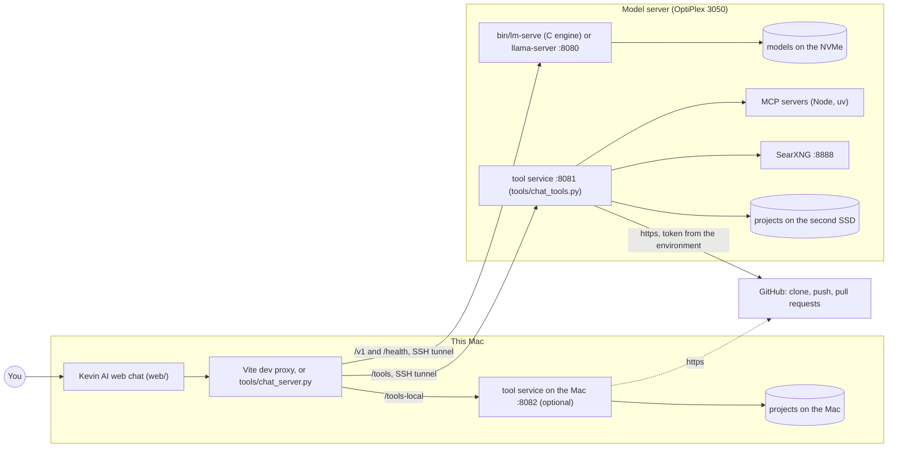
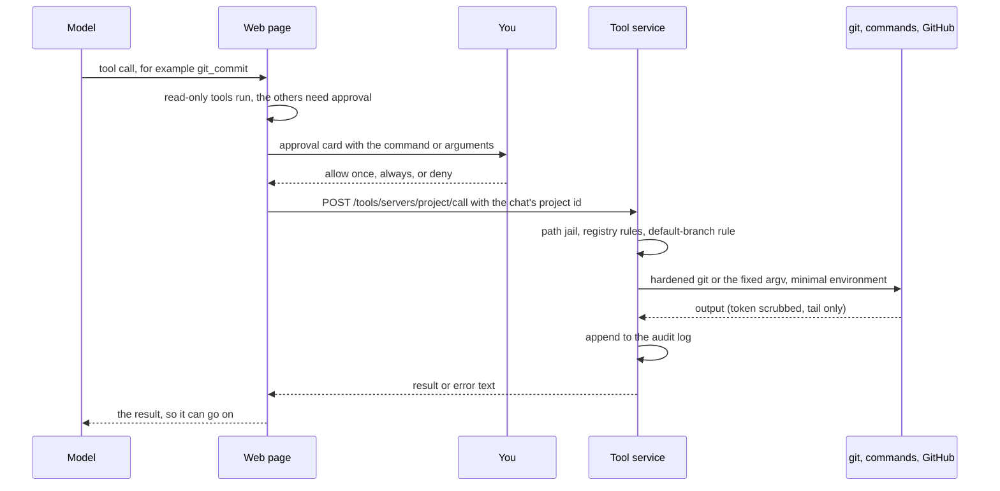
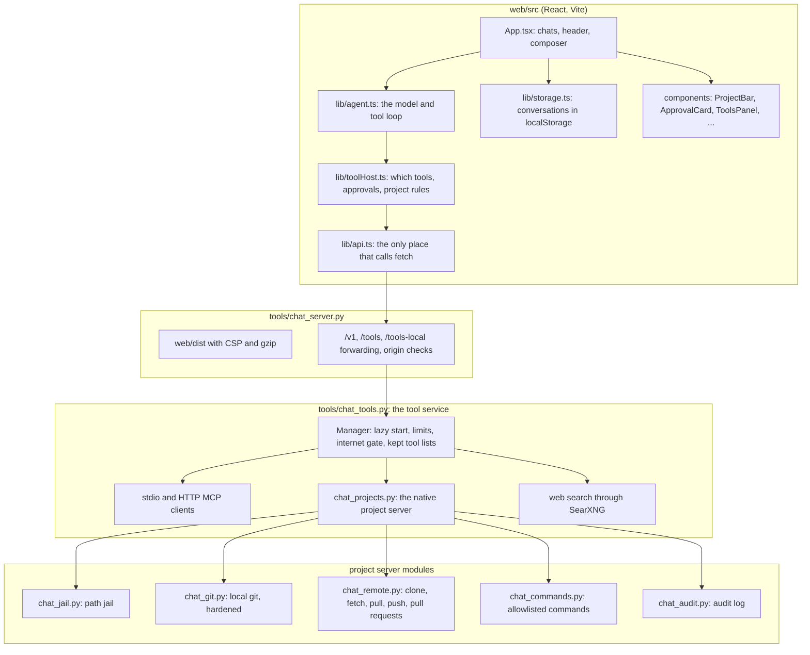
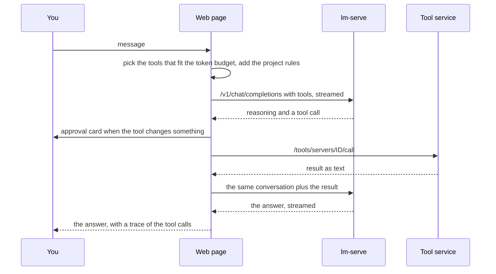
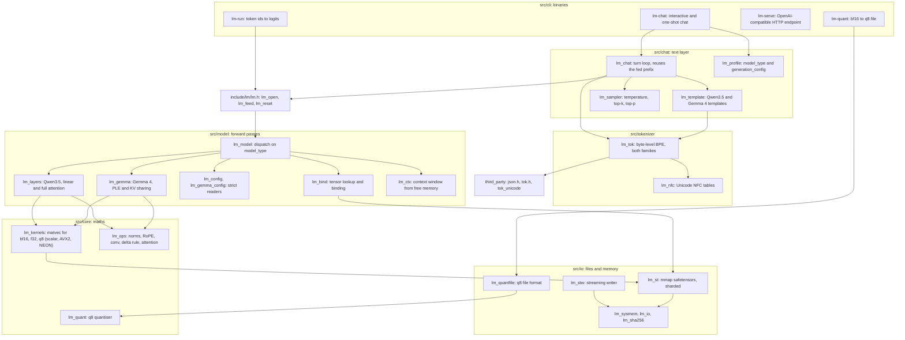
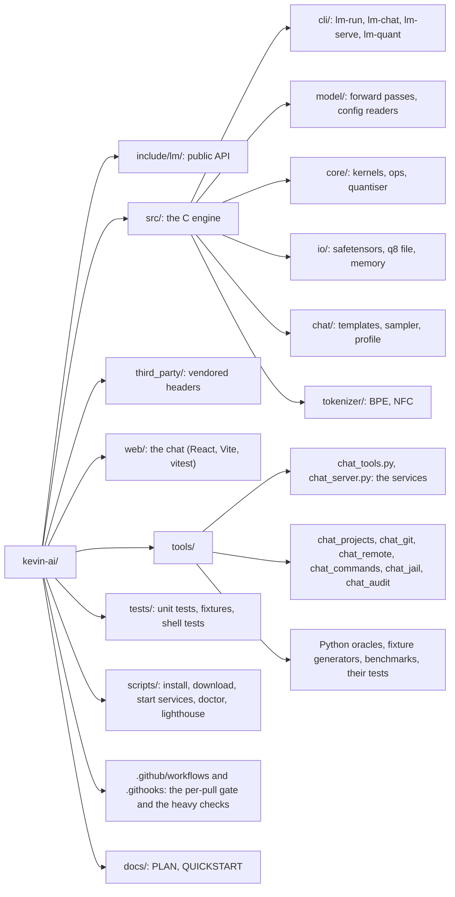
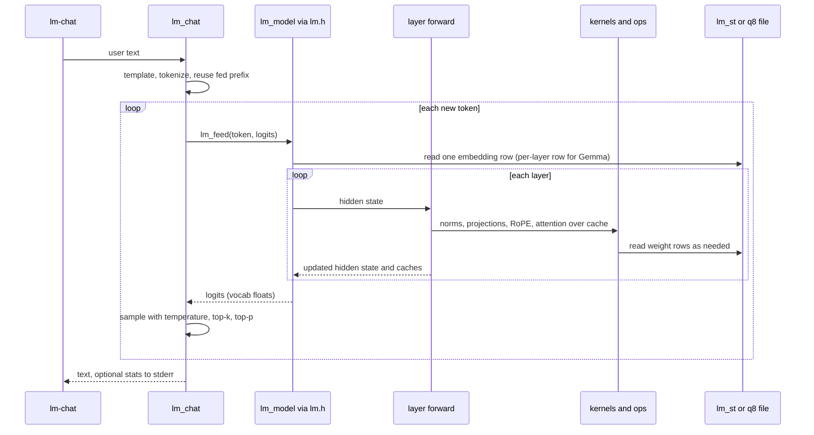

# Kevin AI

Created by **Marc Fors i Soler**.

A private, local AI assistant for one small machine, in three parts that work together:

- **The engine**: a C99 CPU inference engine for small language models, written from scratch (Qwen3.5-4B,
  Gemma 4 E4B and Qwen2.5-Coder GGUFs). No GPU, no Python at run time. `bin/lm-run`, `bin/lm-chat`,
  `bin/lm-serve` (an OpenAI-compatible HTTP endpoint) and `bin/lm-quant`. The chat starts five models in all,
  two of them on llama.cpp: see [The five models](#the-five-models).
- **The web chat** (`web/`, the app is called Kevin AI): a React page that talks to `lm-serve`, keeps
  conversations in the browser only, reads files and images, and lets the model use tools.
- **The tool service** (`tools/chat_tools.py`): runs MCP servers, searches the web through a self-hosted
  SearXNG, and gives the model a **project** to work in: files, git, allowlisted commands and GitHub
  pull requests, each behind rules the owner sets and the agent cannot change.

Target: a Dell OptiPlex 3050 (Intel i5-6500T, 4 cores, AVX2, no AVX-512), about 11 GB RAM,
Ubuntu Server 26.04.1 LTS, with the models on the NVMe SSD in `~/models`. Everything stays on your
machines: no accounts, no telemetry, no remote scripts or fonts in the page.

- [Status](#status), [System overview](#system-overview), [Target machine](#target-machine)
- [Models](#the-five-models), [Chat tools and projects](#chat-tools-on-the-model-server-mcp-and-web-search)
- [Installation](#ubuntu-server-installation), [Build and test](#build-and-test), [Architecture](#architecture)
- [Usage](#usage), [Releases](#releases), [Troubleshooting](#troubleshooting)

## Status

- **The web chat and the tool service are in daily use** (every merged pull
  request is a tagged release, see [Releases](#releases) and [CHANGELOG.md](CHANGELOG.md)). The chat scores
  100 in every Lighthouse category on desktop and mobile (`scripts/lighthouse.sh`). The agent can read and
  edit files, use git, run commands you allowlisted and open pull requests inside a project you registered;
  that part is tested against real git repositories, a local bare remote and a fake GitHub server, and has
  **not yet been run against real GitHub** (it needs a token you create).
- **Qwen3.5-4B (phase 1) and Gemma 4 E4B (phase 2) are both implemented.** Each passes its
  golden gate on a tiny synthetic model, checked against a float64 oracle. The Gemma
  oracle agrees with Hugging Face transformers to 5e-9.
- **Qwen3.5-4B runs on the real checkpoint** (first run 2026-11-14, re-measured 2026-11-15 with
  `tools/bench_fast.py`, on the target machine). It answers correctly. With the q8 weights:
  about **2.3 tokens/s** generating and about **5.2 tokens/s** on a 32-token prompt, with the
  CPU held at 800 MHz of its 2.5 GHz by a non-genuine power adapter (see Troubleshooting,
  "cpu clock"). With the genuine adapter and the CPU at 2.5 GHz (measured 2026-11-20 with
  `tools/bench_serve.py`): **3.4 to 4.0 tokens/s** generating and 11.6 to 13.5 tokens/s on a
  prompt, see "Speed at 800 MHz and at 2.5 GHz". The first run
  gave 1.7 and 1.9: the AVX2 kernels were compiled to about three times more instructions
  than needed, and the prompt now goes through in batches whose inputs stay in the L1 cache
  (4.6 tokens/s before that; the batched multiply itself got 1.35x faster, with 73% fewer L1
  misses). `--profile` on a 64-token prompt puts 75% of the prompt time in the multiplies,
  17% in linear attention, 4% in full attention and 4% elsewhere.
  Replies read about 4.75 GB per token, so at about 11 GB/s they are bounded by memory
  bandwidth.
- **Gemma 4 E4B runs on the real checkpoint** (first run 2026-11-16, on the target machine).
  It answers correctly. With the q8 weights at 800 MHz: about **1.9 tokens/s** generating and
  3.5 to 5.9 tokens/s on a short prompt, at a peak of 5.7 GiB resident. At 2.5 GHz (measured
  2026-11-20): **2.8 to 3.1 tokens/s** generating and 14 to 22 tokens/s on a prompt, same
  memory.
- **The context window is chosen from free memory** when `--ctx` is not given: 81,408 tokens
  for Qwen q8 and 131,072 (the model's maximum) for Gemma q8 on the target. See `--ctx` below.
- **MTP speculative decoding** (`lm-run --mtp`, Qwen only) accepts 78% of its drafts, but it
  runs at 0.91x the plain speed on this CPU, so it stays opt-in. (Measured at 800 MHz; not
  repeated at 2.5 GHz.)

The full plan, with the normative model equations and test gates, is in
[docs/PLAN.md](docs/PLAN.md).

## System overview



The page only ever talks to its own origin (a strict Content-Security-Policy says `'self'`): the proxy forwards
`/v1/*` to the model server, `/tools/*` to the tool service on the model server and `/tools-local/*` to a second
copy of it on the Mac. The model server is reached through SSH tunnels on ports 8080 and 8081.

## Target machine

The engine is developed and measured on one machine. Every number in this README is for it.

| part | spec |
|---|---|
| system | Dell OptiPlex 3050 |
| CPU | Intel Core i5-6500T, 4 cores, no hyper-threading, AVX2 and FMA, no AVX-512 |
| memory | about 11 GB (the OS reports 11,328 MiB usable; about 10.8 GiB available when idle) |
| GPU | Intel HD Graphics 530, not used |
| system disk | Samsung MZVLB256HAHQ, 238.5 GB NVMe SSD (reads 1.7 GB/s) |
| spare disk | Samsung SSD 850, 465.8 GB SATA SSD, ext4 at `/mnt/models`, not used by the engine (reads about 0.55 GB/s); the chat's projects can live there (`/mnt/models/kevin-projects`) |
| network | Realtek RTL8111/8168 gigabit Ethernet, Intel Wireless 8265/8275 (unused) |
| OS | Ubuntu Server 26.04.1 LTS, kernel 7.0.0-43-generic, x86-64 |
| toolchain | gcc 15.2.0, GNU make 4.4.1, Python 3.14.4 |

What this means for the engine:

- **Memory is the limit for replies.** The q8 Qwen3.5-4B file is about 4.8 GB and is read once
  per generated token, so reply speed is bounded by memory bandwidth, not by the four cores.
  A prompt is processed in batches that read each weight once per 32 tokens.
- **No GPU path, no AVX-512.** The kernels use AVX2 with FMA (and NEON on ARM, for
  development on a Mac). On this CPU the kernel test reports `kernel path: avx2`.
- **Both models fit in memory.** Measured peaks: q8 Qwen 5.1 GiB, q8 Gemma 5.7 GiB (its
  8.5 GB file includes a per-layer table read one row per token), bf16 Qwen 8.0 GiB. bf16
  Qwen now stays resident instead of streaming from disk, but it is still slower than q8:
  about 1.1 tokens/s generating at 800 MHz and 2.3 at 2.5 GHz.
- **Models on the NVMe.** The q8 file is read once per boot and then stays in the page cache.
  The NVMe reads at 1.7 GB/s, so the first load after a boot takes about 3 s; the SATA SSD
  would take about 9 s.
- **Verified on this machine (first run, 2026-11-14):** the build, all unit tests and both
  golden gates pass under gcc 15 with OpenMP and the AVX2 kernels. The real Qwen3.5-4B
  checkpoint loads and answers; the speed is in the Status section above.

## The five models

Five models can be started from the chat (Settings, or the header picker) or with
`scripts/start-remote-lm-serve.sh --id <id>`. Only one runs at a time: the 11 GB machine cannot hold two, so
starting one stops the other.

| name in the chat | `--id` | runs on | files in `~/models` | context | notes |
|---|---|---|---|---:|---|
| Qwen3.5-4B | `qwen` | `lm-serve` (this engine) | `qwen3.5-4b/model.q8.safetensors` | up to 131,072 | phase 1: Gated DeltaNet linear attention, three layers to one full attention; ~4.2 B text parameters; Apache-2.0 |
| Qwen3.5-4B Uncensored | `qwen-uncensored` | `lm-serve` (this engine) | `qwen3.5-4b-uncensored/model.q8.safetensors` | up to 131,072 | an uncensored variant of Qwen3.5-4B in the same q8 format; its source is not pinned in this repository, so `scripts/download-model.sh` does not fetch it |
| Gemma 4 E4B | `gemma` | `lm-serve` (this engine) | `gemma-4-e4b/model.q8.safetensors` | up to 131,072 | phase 2: per-layer embeddings, KV sharing across layers, logit softcap 30; ~4 B core parameters plus the per-layer table |
| WhiteRabbitNeo 2.5 7B | `whiterabbitneo` | llama.cpp `llama-server` | `whiterabbitneo-2.5-7b/*-Q8_0.gguf` | up to 16,384 | fine-tune of Qwen2.5-Coder-7B, Apache-2.0, text only; see "WhiteRabbitNeo (GGUF)" |
| Gemma 4 E4B Uncensored | `gemma-uncensored` | llama.cpp `llama-server` | `gemma-4-e4b-uncensored/*-Q6_K_P.gguf` and the `mmproj` projector | up to 32,768 | fine-tune of Gemma 4 E4B that reads images; Gemma Terms of Use; see "Gemma 4 E4B Uncensored" |

Checkpoints: Qwen3.5-4B is 9.32 GB in bf16 (2 shards) and Gemma 4 E4B 15.99 GB in bf16 (1 file); `bin/lm-quant`
writes the q8 files the engine normally runs. The chat marks the two uncensored targets with a warning badge:
they have fewer safety filters than the stock checkpoints.

The engine has its own loaders for the first three. The other two ship only as GGUF files, which the engine cannot
run for Gemma 4, so the chat starts them on llama.cpp's `llama-server` on the same port; `lm-serve`
flags `--cache-mb` and `--fast` do not apply to them. A third engine family, `qwen2`, can also load the
WhiteRabbitNeo Q4_K_M with `bin/lm-serve --model ~/models/whiterabbitneo-2.5-7b-q4km` (see its section).

Qwen3.5 and Gemma 4 are Apache-2.0 and ungated. Audio is out of scope. The engine's vision encoder runs on its
own (`lm-run --image`), but the language model does not read images yet (docs/PLAN.md "Phase 3"), so images
work in the chat with Gemma 4 E4B Uncensored on `llama-server`. Qwen's multi-token-prediction (MTP) head is used
for speculative greedy decoding in `lm-run --mtp` (see below).

## WhiteRabbitNeo (GGUF)

`bartowski/WhiteRabbitNeo-2.5-Qwen-2.5-Coder-7B-GGUF` (revision `4874da7a…`, Apache-2.0 on the
fine-tune and on its base Qwen2.5-Coder-7B; the file says `general.license = apache-2.0`) runs from
its GGUF file: the engine's third family, `qwen2` (grouped-query attention with a bias on q, k and
v, SwiGLU, rotate-half RoPE, no linear attention). `scripts/download-model.sh --model
whiterabbitneo-2.5-7b-q4km` fetches the pinned file (4,683,072,032 bytes, sha256 checked) into
`~/models/whiterabbitneo-2.5-7b-q4km/`; any path to a `.gguf`, or a directory with exactly one and
no `config.json`, is a GGUF model for `lm-run`, `lm-chat` and `lm-serve`. The file carries the
tokenizer and the chat template (bare ChatML, no default system prompt); `--weights` does not apply.
The web picker's `whiterabbitneo` target currently starts llama.cpp's `llama-server` on the Q8_0
file in `whiterabbitneo-2.5-7b`; to serve the Q4_K_M with this engine instead run
`bin/lm-serve --model ~/models/whiterabbitneo-2.5-7b-q4km` (the model id is the directory name).

**Quantisation: Q4_K_M.** The KV cache is f32 (112 KiB per token, 3.5 GiB at the model's 32k
window) and decode reads every weight once per token, at about 11 GB/s here. Q6_K (6.25 GB) and
Q8_0 (8.10 GB) would leave 11 GB with a short context and read 1.3x and 1.7x more per token;
Q4_K_M (4.68 GB: Q4_K matrices, Q6_K for half of `attn_v` and `ffn_down` and for the output matrix)
keeps the full 32k window in memory. The kernels also read Q5_K and Q8_0, so the other bartowski
files of the same model load (not measured here).

Measured on the target machine (2026-11-21, 2.5 GHz, 4 threads, another `lm-serve` idle beside it):

| | |
|---|---|
| resident after a request | 4.35 GiB (4.28 GiB of it the mapped file, 74 MiB anonymous; the KV cache fills as the context does) |
| context chosen with no `--ctx` | 32,768 (the model's maximum; 9.2 GiB available) |
| generating | 1.5 to 1.7 tokens/s (about 0.6 s per token; the read alone is 4.7 GB at 11 GB/s, so memory-bound would be 2.3) |
| prompt | 3.2 to 3.3 tokens/s on 64 to 96 tokens (compute-bound: the float widening of each block) |
| an 80-token code answer through `lm-serve` | 55 s, correct |

The kernels keep activations in float and are bit-identical between scalar and AVX2. An int8-activation
path like `--fast` for q8 would read the same bytes with far fewer instructions; it is not implemented.

## Gemma 4 E4B Uncensored (GGUF, on llama-server)

`HauhauCS/Gemma-4-E4B-Uncensored-HauhauCS-Aggressive` (revision `45b6a334…`, a fine-tune of
`google/gemma-4-e4b-it`; the repo's licence tag is `gemma`, see NOTICE) ships only GGUF files, and the
engine has no Gemma 4 GGUF loader, so the web picker's `gemma-uncensored` target runs it on
llama.cpp's `llama-server`, with the vision projector (`--mmproj`) so it reads images.
`scripts/download-model.sh --model gemma-4-e4b-uncensored` fetches the two pinned files (sizes and
sha256 checked) into `~/models/gemma-4-e4b-uncensored/`; `scripts/start-remote-lm-serve.sh --id
gemma-uncensored` starts them.

**Quantisation: Q6_K_P** (HauhauCS's "K_P" quants keep the sensitive tensors a level higher, about
Q8 quality at 5.8 GiB). Q8_K_P (7.6 GiB) plus the 0.9 GiB projector leaves an 11 GB machine little
for the window, and the engine's own q8 file is the same 8 bits per weight anyway.

Measured on the target machine (2026-11-21, 4 threads, llama.cpp v1.0.0 CPU build):

| | |
|---|---|
| resident after start | 7.1 GiB with `--ctx 8192`, 7.5 GiB with `--ctx 32768` (the KV cache is small: most layers use a 512-token window) |
| generating | 4.3 to 4.9 tokens/s |
| prompt | 15 to 17 tokens/s |
| a 64x64 test image | read correctly (a red, green and blue gradient was described as such), through the web chat |
| thinking | on by default, so an answer can take minutes at this speed; `--no-think` skips it (an image answer in 9 s) |

## Chat tools on the model server (MCP and web search)

`tools/chat_tools.py` is a small stdlib-only service that runs MCP servers for the chat and does an
optional web search (see the module docstring and `web/README.md` for what it does and refuses).
It runs on the machine that runs the model, next to it, on 127.0.0.1:8081:

```bash
scripts/install-tool-runtimes.sh                 # on the server: Node 24.22.1 and uv 0.13.5 into ~/opt, sha256-checked
scripts/start-remote-chat-tools.sh --update      # from the Mac: pull the repo there and (re)start the service
ssh -N -L 8081:127.0.0.1:8081 toor@192.168.1.96  # a second forward, next to the one for the model
```

The chat's dev proxy (`LM_TOOLS_URL`, default `http://127.0.0.1:8081`) or `tools/chat_server.py
--tools-upstream` forwards `/tools/*` to it. Servers are listed in `~/.config/lm-chat/mcp.json` on the
server or added from the catalog in Settings; a catalog entry downloads its npm or PyPI package
(pinned version, install scripts off) the first time it starts, which needs the internet switch.
The service starts a server when it is first used, stops it after five idle minutes, runs at most
three at once and none while less than 700 MiB of memory is available. The files tool may only
touch `~/chat-files`.

### A second copy of the tool service on this Mac

For work that has to run on the Mac itself, run another copy here, on 127.0.0.1:8082, with its own config
and state (`~/.config/lm-chat/mcp.json` is shared with other tools, so it is not used):

```bash
scripts/start-local-chat-tools.sh          # starts it (replacing one this script started); pid file in the state dir
scripts/start-local-chat-tools.sh --stop   # stops that one only
```

It uses `~/.config/kevin-ai/mcp-local.json` and `~/.local/share/kevin-ai` (pid file `chat-tools-local.pid`, log
`chat-tools-local.log`); `LM_LOCAL_TOOLS_CONFIG` and `LM_LOCAL_TOOLS_STATE` change them and `--port N` the port.
The chat reaches it at `/tools-local/*`: the dev proxy uses `LM_TOOLS_LOCAL_URL` (default `http://127.0.0.1:8082`) and
`tools/chat_server.py --tools-local-upstream http://127.0.0.1:8082` does the same (without the option the path is a
404). The checks are those of `/tools/*`, and the prefix becomes `/tools/` upstream. No tunnel is needed.

### Web search for the chat (SearXNG)

`scripts/setup-remote-searxng.sh` installs SearXNG on the same machine (a pinned commit, in `~/opt/searxng`
with its own virtualenv made by `uv`; settings in `~/.config/searxng/settings.yml`, written once, with
a random key) and starts it on 127.0.0.1:8888 with the JSON format on. It needs about 250 MB. In
Settings > Tools and internet, turn the internet on and put `http://127.0.0.1:8888` as the web search
address: the address is used by the tool service, which runs on that machine too. Queries go from
SearXNG to the search engines it is configured for, and nowhere else. The packages are installed from
`scripts/searxng-requirements.txt` (exact versions of the tested environment). The tool service only
searches a loopback address other than its own port; a private address on the network must be listed
when starting it (`chat_tools.py --search-allow 192.168.1.20:8888`).

### Projects, git and pull requests for the agent

`chat_tools.py --projects-base DIR` adds a built-in server **project** to the tool service of that host: file tools
(`project_list`, `fs_read`, `fs_list`, `fs_search`, `fs_write`, `fs_edit`) on the projects listed in an owner-edited
registry, `~/.config/lm-chat/projects.json` (`--projects-registry` to move it):

```json
{"projects": {"demo": {"title": "Demo", "root": "demo"}}}
```

A `root` must resolve to a folder inside the base, so the agent only reaches folders you put there. Paths it gives
are relative to the project, never absolute, never `..`, never through a symlink that leaves the project, never
under `.git`. Writes stop at 2 MB a file and when the disk would drop under `--projects-min-free-gb` (default 5;
use 20 on the model server, whose second SSD also holds the models). One copy of the service runs per host, the
server and the Mac, and a project lives on the host whose service is asked.

The same server has local git tools: `git_status`, `git_diff`, `git_log`, `git_show`, `git_branches`,
`git_branch_create` (named `kevin/<name>`), `git_switch`, `git_add`, `git_commit`, `git_restore` and `git_init`.
Git runs as an argument list with no user or system configuration, and with hooks, fsmonitor, external diff,
editor, pager and credential helper switched off, so a repository cannot run code through its own config.
Commits are refused on the project's default branch unless the registry sets `"allowMain": true`; the committer is
the registry's `identity` (default Kevin AI, developer@marcfors.com). Per project the registry also takes
`"defaultBranch"` (default `main`):

```json
{"identity": {"name": "Kevin AI", "email": "developer@marcfors.com"},
 "projects": {"demo": {"title": "Demo", "root": "demo", "defaultBranch": "main", "allowMain": false}}}
```

Commands are an allowlist you write in the registry, per project (the agent cannot edit it):

```json
"commands": {"test": {"argv": ["make", "test"], "timeout": 120, "safe": false, "cwd": "web", "env": {"CI": "1"}}}
```

Each command becomes its own tool, `run_<project>_<name>`, with the argv in its description, so the approval card
says what will run and a command marked `"safe": true` runs without asking. The argv is fixed (the agent cannot
add arguments), run without a shell in the project folder, with a minimal environment (none of the service's
secrets), a private HOME removed afterwards, no stdin, a time limit that stops the whole process group, and only
the tail of the output. It is an allowlist, not a sandbox: a command still has the network and whatever its own
program can reach. Everything the agent changes (file writes and edits, git add, commit, restore, branches,
commands) is appended to `<state-dir>/audit.jsonl` (`--audit-log` to move it), a private file with the time,
project, tool, a short summary and the first words of the result, never file contents.

Remote git and pull requests need two more registry fields, again out of the agent's reach:

```json
"remote": "https://github.com/owner/repo.git", "tokenEnv": "KEVIN_GITHUB_TOKEN"
```

`git_clone` (into the empty project folder), `git_fetch`, `git_pull` (fast-forward only, no uncommitted changes),
`git_push` and `pr_create` talk only to that `remote`: the agent never names a URL, a remote or a token, and the
tools take no force or delete option. `git_push` sends the current branch under the same name, never forced, and
not the default branch unless `allowMain` is set; `pr_create` opens a GitHub pull request from the current branch
into the default branch. The token is read from the service's environment variable named by `tokenEnv` (default
`KEVIN_GITHUB_TOKEN`; use a fine-scoped token, contents and pull requests on that one repository), reaches git only
through a `GIT_ASKPASS` helper that is deleted afterwards, and is scrubbed from every result. A repository that
rewrites URLs in its own config is refused, and its proxy, header and TLS settings are overridden. These tools
always ask for approval.

**What the owner decides and what the agent can do**

| | Owner (registry file, service flags, environment) | Agent (tool calls) |
|---|---|---|
| where it works | `root` of each project, inside `--projects-base`; `--projects-min-free-gb` | a project id, never a path outside the project |
| files | which projects exist | `fs_read`, `fs_list`, `fs_search`, `fs_write`, `fs_edit` inside the jail |
| git | `identity`, `defaultBranch`, `allowMain`, `remote` | status, diff, log, branches named `kevin/...`, add, commit, restore |
| commands | `commands`: fixed argv, timeout, `safe`, `cwd`, `env` | call `run_<project>_<name>`; no arguments |
| network | `remote` (https), `tokenEnv` and the token in the service's environment | clone, fetch, pull (fast-forward), push its branch, open a pull request |
| record | `--audit-log` | nothing: every change is appended to the audit log |



In the chat, a **Project** picker under the header (shown while the Project server is on in Settings > Tools
and the service lists projects, read from `GET /tools/projects`: ids, titles and rules, never paths) chooses the
project a chat works in. The page then tells the model the project's rules and commands, always sends that
project's id to the project tools whatever the model wrote, shows the branch and the number of changed files
(read with `git_status`) and shows the exact command on the approval card.

#### Setting up projects (owner steps)

1. **Start the service with a projects base.** `scripts/start-remote-chat-tools.sh --update` now passes
   `--projects-base` (default `/mnt/models/kevin-projects`, created if missing, `LM_PROJECTS_BASE` to change it,
   empty to turn projects off) and `--projects-min-free-gb` (default 20, `LM_PROJECTS_MIN_FREE_GB`). On the Mac,
   `scripts/start-local-chat-tools.sh` does the same with `~/KevinProjects` (`LM_LOCAL_PROJECTS_BASE`) and its
   own registry `~/.config/kevin-ai/projects-local.json` (`LM_LOCAL_PROJECTS_REGISTRY`).
2. **Write the registry** on that host (`~/.config/lm-chat/projects.json` on the server): one entry per project,
   `root` inside the base, and what the agent may do (see the examples above). The service reads it on every
   call, so a change needs no restart; a mistake shows as an error in the Tools panel.
3. **Give it a token only if it should push** (clone, push and pull requests; reading and local commits need
   none). Create a fine-grained GitHub token for the one repository, with Contents and Pull requests read and
   write, and put it where only you can read it:

   ```bash
   mkdir -p ~/.config/kevin-ai && install -m 600 /dev/null ~/.config/kevin-ai/tool-service.env
   echo 'KEVIN_GITHUB_TOKEN=github_pat_...' >> ~/.config/kevin-ai/tool-service.env
   ```

   Both start scripts load that file (and refuse it unless its mode is 600). It never goes in the repository or the
   browser, and the agent never sees it.
4. **Use it.** In Settings > Tools turn the Project server on, then pick the project under the header. Every
   change the agent makes is in `<state-dir>/audit.jsonl` on that host.

The chat page uses the model server's projects. The Mac's copy is reachable at `/tools-local`, but the picker
does not switch to it yet.

## Ubuntu Server installation

These are the choices made on the OptiPlex during the Ubuntu Server installer. Use them
as written, or adapt them, but keep the disk layout: the OS on the NVMe SSD and the models
on the SATA SSD.

### Disk roles

Full machine specs are in [Target machine](#target-machine). The disks are used like this:

| disk | use |
|---|---|
| Samsung 238.5 GB NVMe SSD | Ubuntu, `/`, `/boot`, `/boot/efi` |
| Samsung 465.8 GB SATA SSD | spare: backups or other data; not used by the engine (optional, see below) |
| SanDisk USB stick | installer media only; do not partition or use it afterwards |

### Installer steps

1. **Language and keyboard:** as you prefer.
2. **Network configuration:**
   - The wired port `enp2s0` (Realtek RTL8111/8168/8211/8411 gigabit) should show
     "connected" with DHCPv4 once the cable is plugged into the router. Use it: wired is
     more reliable for a server.
   - The Wi-Fi card `wlp3s0` (Intel Wireless 8265/8275) starts disabled. Only enable it
     if the server cannot be wired. Enter the Wi-Fi password yourself at the prompt; it is
     not stored in this repository.
   - Choose **Done** once a connection is shown.
3. **Storage configuration:**
   - Select the **Samsung** SSD as the **boot disk**.
   - Create three GPT partitions on it, in this order:

     | size | format | mount |
     |---|---|---|
     | 1 GB | FAT32 | `/boot/efi` |
     | 2 GB | ext4 | `/boot` |
     | remaining (about 235 GB) | ext4 | `/` |

   - Do not use LVM. A swap file of 2 to 4 GB can be added later for safety; it is not needed
     to run the engine.
   - Leave the second (models) SSD alone during installation; it is set up under
     "A spare disk" below.
   - The installer warns if `/` is not mounted or no boot disk is selected; both must be set.
4. **Profile:** choose the server name, username and a password you will remember. Use the
   same username for the SSH steps below.
5. **SSH:** enable **Install OpenSSH server** so you can work from your Mac. Use an SSH key
   later; password login can stay on for the first session.
6. **Featured server snaps:** select none. The engine does not need them, and each one adds
   packages to maintain.
7. Choose **Done**, let the install finish, remove the USB stick and reboot.

### After the first boot

Find the server's address on the router or with `ip addr`, then connect from the Mac:

```sh
ssh USERNAME@SERVER_ADDRESS
```

Update the system (requires your password; run it yourself):

```sh
sudo apt update && sudo apt full-upgrade -y
```

Then install the build tools the engine needs:

```sh
sudo apt install build-essential python3 curl
```

Optional, for a 4 GB swap file on the SSD:

```sh
sudo fallocate -l 4G /swapfile && sudo chmod 600 /swapfile && sudo mkswap /swapfile && sudo swapon /swapfile
echo '/swapfile none swap sw 0 0' | sudo tee -a /etc/fstab
```

### A spare disk (optional)

The engine does not need a second disk. To use the SATA SSD for backups or other data, set it
up once after the first boot. This **erases the disk**: check that `/dev/sda` is the SATA SSD
(`lsblk -o NAME,SIZE,MODEL,SERIAL`) before running it.

```sh
sudo sfdisk /dev/sda <<< $'label: gpt\n,,L'
sudo mkfs.ext4 -L models -m 0 /dev/sda1
sudo mkdir -p /mnt/models
echo "UUID=$(sudo blkid -s UUID -o value /dev/sda1) /mnt/models ext4 defaults,noatime,nofail 0 2" | sudo tee -a /etc/fstab
sudo systemctl daemon-reload && sudo mount /mnt/models && sudo chown "$USER:$USER" /mnt/models
```

`nofail` lets the machine boot without the disk. The models stay in `~/models` unless you set
`LM_MODELS_DIR` (for example to `/mnt/models`).

## Install the engine

Copy this repository to the server. From your Mac:

```sh
rsync -a --exclude build --exclude bin --exclude .claude --exclude .git \
  "PATH_TO_THIS_REPO/" USERNAME@SERVER_ADDRESS:~/kevin-ai/
```

Or clone it on the server: `git clone https://github.com/marcfs31/kevin-ai.git
~/kevin-ai`. Then on the server:

```sh
cd ~/kevin-ai
scripts/install.sh --model qwen3.5-4b
```

`scripts/install.sh` runs, in order: a system and tools check (refuses without AVX2),
`make`, `make test`, `make gate`, the pinned model download to `<root>/<model>`, the q8
file, and the read-only `scripts/doctor.sh` report. It prints the chat command at the end.

| option | meaning |
|---|---|
| `--model qwen3.5-4b` | default; about 10.3 GB download, 4.8 GB q8 file |
| `--model gemma-4-e4b` | about 17 GB download, 8.5 GB q8 file |
| `--model both` | both of the above |
| `--model none` | build and test only |
| `--model-dir DIR` | where models go. Default: `$LM_MODELS_DIR`, else `~/models` (`scripts/models-root.sh` prints the choice) |
| `--skip-tests` | skip `make test` and `make gate` (not recommended on the first run) |
| `--allow-hdd` | allow downloading to a rotational disk (not recommended) |

It is safe to re-run: finished downloads and an existing q8 file are skipped.

To do the same steps by hand, follow [docs/QUICKSTART.md](docs/QUICKSTART.md).

## Build and test

```sh
make            # build bin/* (one binary per src/cli/*.c)
make test       # build and run every tests/unit/test_*.c and tests/scripts/test_*.sh (the web chat's
                # lint, typecheck, tests and build, and the tool service's Python tests; needs Node)
make gate       # golden gates for Qwen3.5 and Gemma 4 against the oracle fixtures
make sanitize   # unit tests under ASan and UBSan
make portable   # x86-64 build with -mavx2 -mfma instead of -march=native
```

Requirements: a C99 compiler (`build-essential`), `make`, Python 3 (stdlib only), and
`curl` and `sha256sum` for the download script. The web chat needs Node 24 (`web/.nvmrc`) only on the machine
where you build or develop it; the servers need Python 3 only.

A pull request runs one job (`make test`: C tests, shell tests, the Python tests of the services and
the chat's lint, typecheck, tests and build). `scripts/ci-heavy.sh` (sanitizers, the portable build) runs
from `.githooks/pre-push` (`git config core.hooksPath .githooks`) and weekly in CI. A change under `web/`,
`tools/chat_server.py` or `index.html` also runs `scripts/lighthouse.sh` (needs Chrome and the network): 100 in
every category, desktop and mobile, on the production build.

## How it works

**Weights: q8 resident, bf16 exact.**

- `bin/lm-quant` writes a q8 file: int8 weights with one f32 scale per 32 weights. The
  engine memory-maps it and keeps it resident. This is the normal mode on this machine.
- The original bf16 safetensors also load directly: exact, but slower. bf16 Qwen (9.3 GB)
  stays resident in 11 GB; bf16 Gemma (16 GB) streams through the page cache. The golden
  gate uses bf16 as the reference for q8.

**Long chats stay cheap (Qwen).** Linear-attention layers keep a fixed-size state instead
of a cache that grows with every token. Only the full-attention layers keep a key/value
cache.

**Gemma 4 memory.** Only the first 24 layers own a key/value cache; the last 18 reuse
them. Sliding-window layers keep a ring of 512 positions. The per-layer embedding table is
read one row per token from the mapped file, never loaded whole. At 4096 tokens of context
the caches come to about 168 MiB, plus about 8 MiB of prompt-processing buffers.

**Porting.** The engine is written from scratch and ports code by file from
[kimi-k3-in-c](https://github.com/FareedKhan-dev/kimi-k3-in-c) (Apache-2.0; see
[NOTICE](NOTICE)): the safetensors reader, bf16 and int8 kernels, the delta-rule
recurrence, the sampler, and vendored tokenizer headers.

## Architecture

Three layers sit between the command-line tools and the weights file. The public API in
[include/lm/lm.h](include/lm/lm.h) is the only thing the tools call: token ids in, logits
out. The engine knows nothing about text; the chat and tokenizer code wrap it.

### The chat and the tool service

The engine ends at `lm-serve`. Everything the chat adds sits above it, in two Python files with no
dependencies and one React app:



One message with a tool call, end to end:



The loop stops at the steps limit (Settings, up to 50, default 20); the last call is made without tools.

### Module map



### What each part does

- **Public API (`lm.h`).** `lm_open` and `lm_close`; `lm_feed` (one token, optional logits),
  `lm_prefill` (a batch of tokens), `lm_reset`, `lm_pos` and the size queries. Speculative
  decoding adds `lm_draft`, `lm_verify`, `lm_accept` and `lm_greedy_check` (Qwen's MTP head).
  Errors are small integer codes (`LM_ERR_CTX`, `LM_ERR_TOKEN`, `LM_ERR_IO`). A model is
  never truncated, because linear-attention state cannot be rewound; a caller that changes
  the prompt resets and re-feeds, or restores a snapshot: `lm_snapshot` copies the state at
  the current position and `lm_restore` puts it back bit-identically. `lm_times_enable` and
  `lm_times_get` report where the time went (what `--profile` prints).
- **`src/model`.** `lm_open` reads `config.json` and dispatches on `model_type`: `qwen3_5`
  goes to `lm_layers`, `gemma4` to `lm_gemma`. Each reader is strict: a missing field is an
  error, never a default. `lm_bind` looks up tensors by name, and it is the only place that
  decides whether a weight is bf16 or q8.
- **`src/core`.** The arithmetic. `lm_kernels` holds the matrix-vector products for each
  weight format; the AVX2 and NEON paths are checked bit-for-bit against the scalar path.
  `lm_ops` holds the per-token operations: normalisation, rotary embeddings, the causal
  convolution, the delta-rule step and attention over a cache. `lm_ctx` picks the context
  window from the memory the machine can hand out (a pure function, tested with synthetic
  sizes).
- **`src/io`.** Files and memory. `lm_st` maps safetensors files (including sharded ones)
  without copying them, so the OS page cache decides what stays in RAM. `lm_quantfile`
  defines the q8 layout, and `lm_stw` writes files as they are produced rather than
  buffering them.
- **`src/chat` and `src/tokenizer`.** Text in and text out, kept outside the engine.
  `lm_chat` extends the fed prefix when the conversation grows and only re-feeds from
  scratch when it must; then a prefix cache, one snapshot per system prompt, saves feeding
  a shared system prompt again. `lm_template` renders each family's chat format. `lm_tok` does the
  byte-level BPE; for Gemma it uses a heap-ordered merge, so long words stay fast.
- **`third_party`.** Vendored headers (JSON parser, tokenizer, Unicode tables) with their
  modifications recorded in [NOTICE](NOTICE).

### Repository layout



The Makefile discovers sources with wildcards, so a new file under `src/` or a
`tests/unit/test_*.c` needs no Makefile change.

### One token, end to end



Every token reads each layer's weights once, so speed is bounded by how fast those bytes
can be read (see the measured speed in Status). KV caches exist only where a layer owns one
(Gemma's shared layers reuse their producer's cache), so memory grows with context only
through those caches.

## Releases

Every merged pull request is a release: SemVer (before 1.0 a patch for each change, the minor number
for a breaking or phase change), one version in `web/package.json` and `web/package-lock.json`, a section in
[CHANGELOG.md](CHANGELOG.md) and an annotated tag `vX.Y.Z` on the merged commit. Pull requests are
rebase-merged so each commit survives. [AGENTS.md](AGENTS.md) has the rules for coding agents.

## Usage

### bin/lm-chat

Chat with the model. With `--prompt` it answers once and exits. Without it, it opens an
interactive chat; `/reset` clears the conversation and `/exit` quits.

```
bin/lm-chat --model DIR --weights FILE [--prompt TEXT] [--system TEXT]
            [--think | --no-think] [--show-thinking] [--strict-template]
            [--temperature T] [--top-p P] [--top-k K] [--seed N]
            [--max-tokens N] [--ctx N] [--threads N] [--stats] [--fast]
```

- `--prompt` and `--system` are wiped from the process list after startup.
- Thinking is off by default (`--no-think`). A thinking block costs many tokens at this speed.
- `--stats` prints tokens/s to stderr, and the context window chosen.
- `--ctx N` sets the context window. Without it the window is the largest that keeps the
  weights and the state in free memory (less 512 MiB), up to the model's
  `max_position_embeddings`; an explicit window whose state does not fit is refused with the
  largest that does. A bigger window costs memory up front; attention slows down only as the context actually fills.
- Without `--max-tokens` an answer runs until the model stops or the context fills; Ctrl-C
  ends it early.
- `--fast` (experimental, needs a q8 `--weights` file) rounds the activations of every matrix
  multiply to int8 so the CPU can multiply int8 pairs directly. It is NOT bit-identical to
  the default and slightly less exact: the default stays the one the golden gate checks.
  Measured on the real Qwen3.5-4B (96 generated tokens, teacher-forced): the same top token
  as the exact path at 96 of 96 positions, logit error 1.0% on average (1.3% worst). But
  once the exact kernels were fixed it is only 1.05x faster for replies (2.44 against 2.31
  tokens/s) and slower for prompts (3.1 against 5.2 tokens/s batched), so it is **not
  recommended**; the flag stays for experiments. `make gate-fast` reports its distance from
  the oracle on the tiny fixtures (not a gate). `python3 tools/bench_fast.py --run bin/lm-run
  --model DIR --weights FILE` reproduces the numbers above.
- Sampling defaults come from `generation_config.json` for Gemma; flags override them.

### bin/lm-serve

An OpenAI-compatible HTTP endpoint, so other programs (editors, chat front ends, scripts) can
use the model. One request at a time; others wait their turn.

```
bin/lm-serve --model DIR [--weights FILE] [--host ADDR] [--port N] [--name ID]
             [--think | --no-think] [--max-tokens N] [--seed N] [--ctx N] [--threads N]
             [--timeout S] [--cache-mb N] [--fast]
```

- `GET /health`, `GET /v1/models`, `POST /v1/chat/completions` (with `"stream": true` too).
  Stop strings, `n` > 1, logprobs, penalties, JSON modes and the legacy `functions` get a 400
  instead of being ignored. `stream_options.include_usage` adds a last chunk with empty
  `choices` and `usage` (`prompt_tokens`, `completion_tokens`, `total_tokens`,
  `prompt_tokens_details.cached_tokens`).
- **Tool calling** (OpenAI shape, Qwen3.5 and Gemma 4). `tools` is rendered the way each
  model's own `chat_template.jinja` does it; a call the model writes comes back as
  `message.tool_calls` (`id`, `type: "function"`, `function.name`, `function.arguments` as a
  JSON string) with `finish_reason: "tool_calls"`, and `content` is `null` when there is no
  text. In a stream each call is one `delta.tool_calls` entry (whole, when the model has
  finished it), then the finish chunk. Answer with `{"role":"tool","tool_call_id":...,
  "content":...}` messages after the assistant message that holds `tool_calls`, and send
  that history back exactly: the state is extended, not re-fed. `tool_choice` is `"auto"`
  (default) or `"none"` (tools stay out of the prompt); `"required"` and a named function
  are a 400, as is a malformed tool definition (`invalid_tools`), a tool call whose
  `arguments` is not a JSON object (`invalid_tool_call`), or a tool message that answers no
  call (`invalid_tool_message`). A call the model wrote that does not parse is returned as
  plain `content`, never dropped. `GET /v1/models` lists `capabilities.tools`.
- Without `max_tokens` a reply runs until the model stops or the context fills. A reply
  stops as soon as its client disconnects, and one cut short by a shutdown is an error
  (503), never a `"stop"` that looks complete.
- A request has `--timeout` seconds (30) to arrive in full, so a slow client cannot hold the
  server; with a key set, the key is checked before the body is read.
- It listens on 127.0.0.1:8080. To reach it from the network, pass `--host 0.0.0.0` and set
  `LM_SERVE_API_KEY` in the environment; `/v1` then needs `Authorization: Bearer <key>`.
- The model state cannot be rewound, so it is reused only when a request continues the last
  conversation with the previous answer sent back unchanged (what chat clients do). Then only
  the new message is fed.
- Otherwise a prefix cache helps: when two conversations in a row share their system prompt
  (at least 16 tokens), the server keeps a snapshot of the state at its end, and a later
  conversation with the same system prompt is restored from it and feeds only the rest. The
  log line says `N from cache`. The answer is the same as without the cache. A snapshot is
  never longer than the system prompt; for Qwen3.5-4B it takes about 50 MiB plus 64 KiB per
  token (about 82 MiB for a 500-token system prompt). One snapshot per system prompt is kept,
  most recently used first, in `--cache-mb` MiB (512 by default: about ten short system
  prompts), so clients that alternate between system prompts each restore their own. With
  `--cache-mb 0` one snapshot is kept. `POST /v1/chat/reset`, and `lm-chat`'s `/reset`, drop
  the conversation and every snapshot. A log file is cut back to 1 MiB (`LM_SERVE_LOG_MAX`).
- `scripts/lm-serve.service` runs it as a systemd user service; its comments say how to install it.
  Its log is `~/logs/lm-serve.log`, mode 600.

```bash
curl -s http://127.0.0.1:8080/v1/chat/completions -H 'Content-Type: application/json' \
  -d '{"messages":[{"role":"user","content":"Hello"}],"max_tokens":64}'
```

### Web chat (`web/`)

A Vite + React chat UI for `lm-serve`. Full behaviour, production serve, and the gate are in
[web/README.md](web/README.md); this is what it does in short, and how to run it locally.

- **Chat.** Streaming replies with Stop and Redirect, a thinking block, per-chat model, effort and speed,
  a context bar with automatic compaction, retry, rewind, token statistics, Markdown with tables, code
  and LaTeX, English and Spanish. Conversations live in the browser only.
- **Models.** Settings and the header start any of the five models (Qwen3.5-4B, Qwen3.5-4B Uncensored, Gemma 4
  E4B, WhiteRabbitNeo 2.5 7B, Gemma 4 E4B Uncensored; see [The five models](#the-five-models)) with a context
  size that fits the machine; each chat remembers which model it uses.
- **Files.** Text, code, PDFs and images (when the model can see) can be attached, previewed before and
  after sending.
- **Tools.** A calculator, the time, web search through SearXNG, MCP servers from a catalog or your own
  config, and the project tools above. The page offers only the tools that fit a token budget, tells a small
  model when to use them, and asks before anything that changes something; see Settings > Tools.
- **Projects.** A project per chat, a git chip with the branch and the changed files, approval cards that
  show the exact command.
- **Privacy and quality.** No telemetry, no remote resources, a test that fails if the code names a remote
  URL, axe in the test suite, Lighthouse 100.

**Prerequisites:** Node 24 or newer (see `web/.nvmrc`), and `lm-serve` reachable on
`127.0.0.1:8080` (or wherever you point the proxy). The page talks to `/v1` and `/health` on
the Vite origin; Vite proxies those to `LM_SERVE_URL` (default `http://127.0.0.1:8080`).

```bash
cd web
npm ci
npm run dev
```

Open [http://127.0.0.1:5173/](http://127.0.0.1:5173/). The repo uses `npm` (`web/package-lock.json`);
`ignore-scripts=true` is set in `web/.npmrc`. To proxy at an SSH tunnel or another host:

```bash
LM_SERVE_URL=http://127.0.0.1:8080 npm run dev
```

`POST /control/serve` (Settings → start a model via `scripts/start-remote-lm-serve.sh`) exists
only on the Vite **dev** server. The production static build and `tools/chat_server.py` do not
offer it.

### bin/lm-run

Feeds token ids, writes logits, and generates by argmax. The golden gate uses it; nothing
but token ids goes to stdout.

```
bin/lm-run --model DIR [--weights FILE] --tokens 1,2,3 [--logits-out F]
           [--greedy N] [--ctx N] [--threads N] [--fast] [--no-prefill] [--profile]
           [--mtp [--mtp-out F]]
```

The prompt goes through `lm_prefill` (chunks of 32 tokens, each weight read once per chunk)
unless `--logits-out` wants a row per token or `--no-prefill` is given; the results are
bit-identical either way, `--no-prefill` is for timing the difference. `--profile` prints on
stderr where the time went, for the prompt and for the generation: weight multiplies, linear
attention (conv and delta rule), attention, and the rest (norms, residuals, embeddings). The
ids on stdout are unchanged.

`--mtp` (Qwen3.5 only) decodes greedily with speculation: Qwen's MTP head drafts the next
token, and one two-token forward checks the current token and the draft together. A wrong
draft is thrown away and the model state rolled back, so the ids are exactly those of plain
`--greedy`; stderr reports how many drafts were accepted. `--mtp-out F` writes the head's
draft logits for every prompt position but the last (the golden gate checks them). The head
needs the `mtp.*` tensors: a q8 file written by an older `lm-quant` has none and must be
written again. For Qwen3.5-4B the head adds about 136 MB of q8 weights, 8 KiB of cache per
token, and about 50 MiB for the rollback state. Measured on the target: 78% of drafts
accepted, but 0.91x the plain speed, because a two-token verify costs more than one token on
this CPU. It is not in `lm-chat` or `lm-serve`.

```
bin/lm-run --model DIR [--weights FILE] --image F.ppm --vision-rows-out F
```

`--image` runs only the image encoder (Qwen3.5 or Gemma 4) on a binary PPM that is already at
the encoder's grid size: sides in multiples of 32 for Qwen3.5 and 48 for Gemma 4. It writes one
little-endian f32 row of the text hidden size per image token. Resizing, other image formats,
and feeding the rows to the language model come in later phases (docs/PLAN.md "Phase 3").

### bin/lm-quant

Writes the q8 file from the bf16 checkpoint. The vision encoder's weights are kept: matrices
whose width is a multiple of 32 are quantised, the rest are copied, and the Conv patch
embedding is stored flattened to the matrix the encoder multiplies by. A q8 file written by an
older `lm-quant` has no vision weights; write it again to use images.

```
bin/lm-quant --model DIR --out FILE
```

### tools/bench_serve.py

Measures `lm-serve` through its API: it starts the server itself, sends one streamed request
per prompt length and stops it. Python 3, standard library only.

```
python3 tools/bench_serve.py --model DIR [--weights FILE] [--lens 128,512,1024,2048]
                             [--gen 32] [--cache-test] [--time-budget-min 60] [--out bench_serve.json]
```

- Without `--weights` it runs the bf16 checkpoint, the mode that uses the most RAM (about
  8 GiB resident on this machine). Run one mode at a time: both would not fit in 11 GB.
- Per prompt length it reports the server's own prompt token count, the time to first token,
  prompt tokens/s (it includes decoding that first token), generation tokens/s, and the server's
  peak RSS and the free memory read from `/proc` (Linux; elsewhere "unknown").
- It also prints the CPU's maximum clock, so a capped CPU shows in the results.
- **Peak memory at the full context window is an estimate**: a line through the runs' peak RSS,
  extended to the window `lm-serve` printed. KV memory is only touched as tokens arrive, so RSS
  grows with the tokens fed, not with the window. Filling the window is not practical (a
  Qwen q8 prompt feeds at about 12 tokens/s at 2.5 GHz, 4 to 5 at 800 MHz), so
  `--time-budget-min` skips lengths that would not finish in time. The line assumes memory
  grows steadily with each token, which holds for Qwen (about 64 KiB per token). For Gemma it
  printed 13.8 GiB at its 131,072-token window, which disagrees with the window `lm-serve`
  chose for the free memory, so treat the Gemma estimate as unverified.
- `--cache-test` sends three requests with one long system prompt; the third is restored from
  the prefix cache, and the report says how many tokens came from it.
- Tests: `python3 -m unittest discover -s tools -p 'test_bench_serve.py'` (a fake `lm-serve`, no
  model needed).

#### Speed at 800 MHz and at 2.5 GHz

The same machine (OptiPlex 3050 Micro, i5-6500T, 11 GB) measured twice with `bench_serve.py`
and 32 reply tokens: first with a non-genuine power adapter that held the CPU at 800 MHz
then with the genuine adapter at 2.5 GHz (2026-11-20). Prompts are the server's
own token counts, so the lengths differ slightly between modes.

| mode | prompt tokens | first token, 800 MHz | first token, 2.5 GHz | prompt tok/s, 800 MHz | prompt tok/s, 2.5 GHz | reply tok/s, 800 MHz | reply tok/s, 2.5 GHz |
|---|---:|---:|---:|---:|---:|---:|---:|
| Qwen q8 | 220 | 45.6 s | 17.5 s | 4.83 | 12.54 | 2.48 | 3.98 |
| Qwen q8 | 1001 | 226.4 s | 74.2 s | 4.42 | 13.49 | 2.22 | 3.73 |
| Qwen q8 | 2010 | 517.3 s | 172.9 s | 3.89 | 11.62 | 1.95 | 3.43 |
| Qwen bf16 | 115 | 93.5 s | 45.7 s | 1.23 | 2.52 | 1.07 | 2.38 |
| Qwen bf16 | 485 | 364.9 s | 170.8 s | 1.33 | 2.84 | 1.11 | 2.34 |
| Qwen bf16 | 992 | 760.0 s | 354.0 s | 1.31 | 2.80 | 1.06 | 2.28 |

Gemma q8 at 2.5 GHz (not measured at 800 MHz with this tool; its earlier 800 MHz figures are
in the status list above): 105 prompt tokens in 7.5 s (13.97 tok/s), 494 in 22.7 s (21.80),
1020 in 51.9 s (19.65), replies 3.09, 2.89 and 2.83 tokens/s.

- Prompts go 2.6 to 3.1x faster with Qwen q8 and about 2.1x faster with bf16: reading a prompt
  is bound by the CPU, so it follows the clock.
- Replies go 1.6 to 1.8x faster with q8 and 2.1 to 2.2x with bf16. A reply reads the whole
  model per token, so memory bandwidth limits it, yet it still gains from the clock.
- Memory does not change with the clock: q8 peaks at 5.1 to 5.2 GiB, bf16 at 8.0 GiB, about
  64 KiB per token fed.
- Replies slow as the context fills (q8: 3.98 to 3.43 tokens/s from 220 to 2010 prompt
  tokens), most likely because attention reads a longer cache for every token.

### scripts/doctor.sh

Read-only pre-flight report: CPU flags, memory, compiler, model type and files, q8 file, and
whether the model directory is on a rotational disk. `--read-speed` times a direct read of
the weights.

```
scripts/doctor.sh [--read-speed] [MODEL_DIR]
```

## Troubleshooting

- **Out of memory.** Use the q8 file, not bf16. Leave out `--ctx` (the window then fits free
  memory) or lower it. Close other programs and check `scripts/doctor.sh` for available
  memory. A swap file helps as a safety margin.
- **Slow.** Keep the model directory on an SSD. Use q8 rather than bf16. Then check the
  `cpu clock` line of `scripts/doctor.sh` (next entry).
- **`cpu clock` NOTE in doctor: the CPU is capped far below its rated speed.** On the
  OptiPlex 3050 this once held the i5-6500T at 800 MHz (`cat
  /sys/devices/system/cpu/cpu0/cpufreq/cpuinfo_max_freq` printed 800000, turbo off), which
  made every reply about three times slower. The cause was a non-genuine ("Replacement")
  power adapter: Dell firmware cannot identify it, logs "Unknown AC power adapter, may
  affect performance" (BIOS setup, F2, Maintenance, System Logs) and limits the CPU. Use a
  genuine Dell adapter of the right wattage (65 W for the Micro). If the log shows no such
  line, look in the BIOS for SpeedStep, Turbo Boost, C-States and a Thermal Management mode
  set to Quiet, and update the BIOS. It is not a heat problem unless `x86_pkg_temp` is high.
  After the genuine adapter went in on this machine, `cpuinfo_max_freq` printed 2500000 and
  Qwen q8 replies went from 2.5 to 4.0 tokens/s (table under `tools/bench_serve.py`).
- **The chat says the tool service cannot be reached.** The tunnel to port 8081 is down (tunnels die when
  the Mac sleeps; start them with `-o ServerAliveInterval=30 -o ServerAliveCountMax=3`), or the service is not
  running: `scripts/start-remote-chat-tools.sh` starts it on the model server.
- **No Project picker.** The Project server must be on in Settings > Tools, the service must be started with
  `--projects-base`, and the registry must list at least one project; a registry error shows in the Tools panel.
- **A git or pull request tool is refused.** The message says why: the default branch is protected (use
  `git_branch_create`), no `remote` is set for the project, the token variable is missing from the service's
  environment, the folder is not empty for a clone, or the repository's own config rewrites URLs.
- **A command is "not found" or fails only through the chat.** It runs with a minimal environment and the
  service's `PATH`; give the command an absolute path or set `env` for it in the registry.
- **Installer shows "Mount a filesystem at /" or "Select a boot disk".** Both must be set
  on the Samsung SSD before Done.
- **doctor reports FAIL on a model file.** The size or hash does not match the pinned
  checkpoint. Re-run `scripts/download-model.sh`; it never overwrites files, so move the
  bad file aside first.
- **`install.sh` says a tool is missing.** Run the `sudo apt install` line it prints
  yourself, then re-run the script.

## License

Apache-2.0; see [LICENSE](LICENSE) and [NOTICE](NOTICE). The Qwen3.5-4B and Gemma 4 E4B
weights are published by Qwen and Google under Apache-2.0; this repository contains no
weights.

## Credits

- [kimi-k3-in-c](https://github.com/FareedKhan-dev/kimi-k3-in-c), the reference this engine
  ports code from by file.
- [Hugging Face transformers](https://github.com/huggingface/transformers): the Qwen3.5
  `modeling_qwen3_5.py` and Gemma 4 `modeling_gemma4.py` are the normative references for
  the forward passes.
