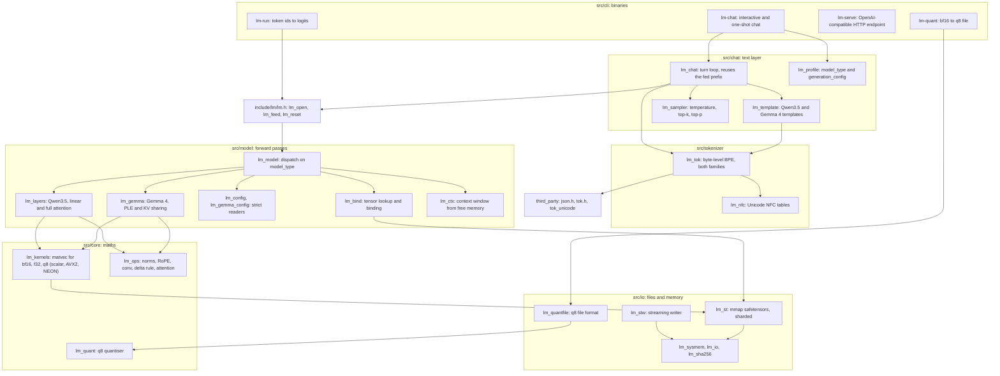
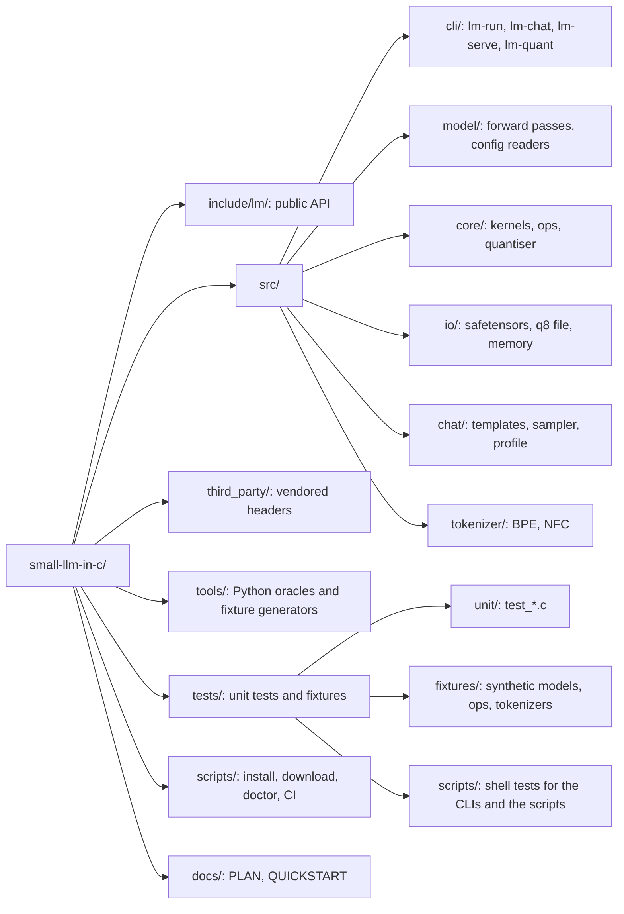
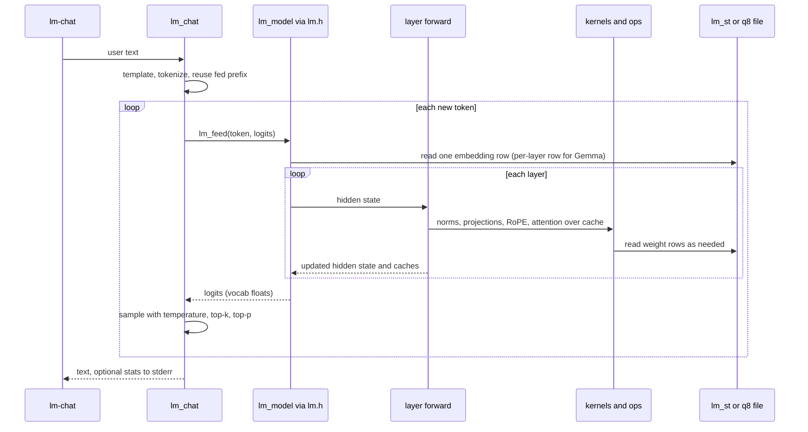

# small-llm-in-c

A C99 CPU inference engine for small language models, written from scratch for a small
machine. Target: a Dell OptiPlex 3050 (Intel i5-6500T, 4 cores, AVX2, no AVX-512), about
11 GB RAM, Ubuntu Server 26.04.1 LTS, with the models on the NVMe SSD in `~/models`.

## Status

- **Qwen3.5-4B (phase 1) and Gemma 4 E4B (phase 2) are both implemented.** Each passes its
  golden gate on a tiny synthetic model, checked against a float64 oracle. The Gemma
  oracle agrees with Hugging Face transformers to 5e-9.
- **Qwen3.5-4B runs on the real checkpoint** (first run 2026-11-14, re-measured 2026-11-15 with
  `tools/bench_fast.py`, on the target machine). It answers correctly. With the q8 weights:
  about **2.3 tokens/s** generating and about **5.2 tokens/s** on a 32-token prompt, with the
  CPU still held at 800 MHz of its 2.5 GHz (see Troubleshooting, "cpu clock"). The first run
  gave 1.7 and 1.9: the AVX2 kernels were compiled to about three times more instructions
  than needed, and the prompt now goes through in batches whose inputs stay in the L1 cache
  (4.6 tokens/s before that; the batched multiply itself got 1.35x faster, with 73% fewer L1
  misses). `--profile` on a 64-token prompt puts 75% of the prompt time in the multiplies,
  17% in linear attention, 4% in full attention and 4% elsewhere.
  Replies read about 4.75 GB per token, so at about 11 GB/s they are bounded by memory
  bandwidth.
- **Gemma 4 E4B runs on the real checkpoint** (first run 2026-11-16, on the target machine).
  It answers correctly. With the q8 weights: about **1.9 tokens/s** generating and 3.5 to 5.9
  tokens/s on a short prompt, at a peak of 5.7 GiB resident.
- **The context window is chosen from free memory** when `--ctx` is not given: 81,408 tokens
  for Qwen q8 and 131,072 (the model's maximum) for Gemma q8 on the target. See `--ctx` below.
- **MTP speculative decoding** (`lm-run --mtp`, Qwen only) accepts 78% of its drafts, but it
  runs at 0.91x the plain speed on this CPU, so it stays opt-in.

The full plan, with the normative model equations and test gates, is in
[docs/PLAN.md](docs/PLAN.md).

## Target machine

The engine is developed and measured on one machine. Every number in this README is for it.

| part | spec |
|---|---|
| system | Dell OptiPlex 3050 |
| CPU | Intel Core i5-6500T, 4 cores, no hyper-threading, AVX2 and FMA, no AVX-512 |
| memory | about 11 GB (the OS reports 11,328 MiB usable; about 10.8 GiB available when idle) |
| GPU | Intel HD Graphics 530, not used |
| system disk | Samsung MZVLB256HAHQ, 238.5 GB NVMe SSD (reads 1.7 GB/s) |
| spare disk | Samsung SSD 850, 465.8 GB SATA SSD, ext4 at `/mnt/models`, not used by the engine (reads about 0.55 GB/s) |
| network | Realtek RTL8111/8168 gigabit Ethernet, Intel Wireless 8265/8275 (unused) |
| OS | Ubuntu Server 26.04.1 LTS, kernel 7.0.0-43-generic, x86-64 |
| toolchain | gcc 15.2.0, GNU make 4.4.1, Python 3.14.4 |

What this means for the engine:

- **Memory is the limit for replies.** The q8 Qwen3.5-4B file is about 4.8 GB and is read once
  per generated token, so reply speed is bounded by memory bandwidth, not by the four cores.
  A prompt is processed in batches that read each weight once per 32 tokens.
- **No GPU path, no AVX-512.** The kernels use AVX2 with FMA (and NEON on ARM, for
  development on a Mac). On this CPU the kernel test reports `kernel path: avx2`.
- **Both models fit in memory.** Measured peaks: q8 Qwen 5.1 GiB, q8 Gemma 5.7 GiB (its
  8.5 GB file includes a per-layer table read one row per token), bf16 Qwen 8.0 GiB. bf16
  Qwen now stays resident instead of streaming from disk, but it is still slower than q8:
  about 1.1 tokens/s generating.
- **Models on the NVMe.** The q8 file is read once per boot and then stays in the page cache.
  The NVMe reads at 1.7 GB/s, so the first load after a boot takes about 3 s; the SATA SSD
  would take about 9 s.
- **Verified on this machine (first run, 2026-11-14):** the build, all unit tests and both
  golden gates pass under gcc 15 with OpenMP and the AVX2 kernels. The real Qwen3.5-4B
  checkpoint loads and answers; the speed is in the Status section above.

## The two models

| model | params (text) | checkpoint | status | notes |
|---|---:|---:|---|---|
| Qwen3.5-4B | ~4.2 B | 9.32 GB bf16, 2 shards | phase 1, implemented | Gated DeltaNet linear attention, three layers to one full attention |
| Gemma 4 E4B | ~4 B core + per-layer embeddings | 15.99 GB bf16, 1 file | phase 2, implemented | per-layer embeddings, KV sharing across layers, logit softcap 30 |

Both are Apache-2.0 and ungated. Vision and audio are out of scope; the engine is text only.
Qwen's multi-token-prediction (MTP) head is used for speculative greedy decoding in `lm-run
--mtp` (see below).

## Ubuntu Server installation

These are the choices made on the OptiPlex during the Ubuntu Server installer. Use them
as written, or adapt them, but keep the disk layout: the OS on the NVMe SSD and the models
on the SATA SSD.

### Disk roles

Full machine specs are in [Target machine](#target-machine). The disks are used like this:

| disk | use |
|---|---|
| Samsung 238.5 GB NVMe SSD | Ubuntu, `/`, `/boot`, `/boot/efi` |
| Samsung 465.8 GB SATA SSD | spare: backups or other data; not used by the engine (optional, see below) |
| SanDisk USB stick | installer media only; do not partition or use it afterwards |

### Installer steps

1. **Language and keyboard:** as you prefer.
2. **Network configuration:**
   - The wired port `enp2s0` (Realtek RTL8111/8168/8211/8411 gigabit) should show
     "connected" with DHCPv4 once the cable is plugged into the router. Use it: wired is
     more reliable for a server.
   - The Wi-Fi card `wlp3s0` (Intel Wireless 8265/8275) starts disabled. Only enable it
     if the server cannot be wired. Enter the Wi-Fi password yourself at the prompt; it is
     not stored in this repository.
   - Choose **Done** once a connection is shown.
3. **Storage configuration:**
   - Select the **Samsung** SSD as the **boot disk**.
   - Create three GPT partitions on it, in this order:

     | size | format | mount |
     |---|---|---|
     | 1 GB | FAT32 | `/boot/efi` |
     | 2 GB | ext4 | `/boot` |
     | remaining (about 235 GB) | ext4 | `/` |

   - Do not use LVM. A swap file of 2 to 4 GB can be added later for safety; it is not needed
     to run the engine.
   - Leave the second (models) SSD alone during installation; it is set up under
     "A spare disk" below.
   - The installer warns if `/` is not mounted or no boot disk is selected; both must be set.
4. **Profile:** choose the server name, username and a password you will remember. Use the
   same username for the SSH steps below.
5. **SSH:** enable **Install OpenSSH server** so you can work from your Mac. Use an SSH key
   later; password login can stay on for the first session.
6. **Featured server snaps:** select none. The engine does not need them, and each one adds
   packages to maintain.
7. Choose **Done**, let the install finish, remove the USB stick and reboot.

### After the first boot

Find the server's address on the router or with `ip addr`, then connect from the Mac:

```sh
ssh USERNAME@SERVER_ADDRESS
```

Update the system (requires your password; run it yourself):

```sh
sudo apt update && sudo apt full-upgrade -y
```

Then install the build tools the engine needs:

```sh
sudo apt install build-essential python3 curl
```

Optional, for a 4 GB swap file on the SSD:

```sh
sudo fallocate -l 4G /swapfile && sudo chmod 600 /swapfile && sudo mkswap /swapfile && sudo swapon /swapfile
echo '/swapfile none swap sw 0 0' | sudo tee -a /etc/fstab
```

### A spare disk (optional)

The engine does not need a second disk. To use the SATA SSD for backups or other data, set it
up once after the first boot. This **erases the disk**: check that `/dev/sda` is the SATA SSD
(`lsblk -o NAME,SIZE,MODEL,SERIAL`) before running it.

```sh
sudo sfdisk /dev/sda <<< $'label: gpt\n,,L'
sudo mkfs.ext4 -L models -m 0 /dev/sda1
sudo mkdir -p /mnt/models
echo "UUID=$(sudo blkid -s UUID -o value /dev/sda1) /mnt/models ext4 defaults,noatime,nofail 0 2" | sudo tee -a /etc/fstab
sudo systemctl daemon-reload && sudo mount /mnt/models && sudo chown "$USER:$USER" /mnt/models
```

`nofail` lets the machine boot without the disk. The models stay in `~/models` unless you set
`LM_MODELS_DIR` (for example to `/mnt/models`).

## Install the engine

Copy this repository to the server. From your Mac:

```sh
rsync -a --exclude build --exclude bin --exclude .claude --exclude .git \
  "PATH_TO_THIS_REPO/" USERNAME@SERVER_ADDRESS:~/small-llm-in-c/
```

Or clone it on the server: `git clone https://github.com/marcfs31/small-llm-in-c.git
~/small-llm-in-c`. Then on the server:

```sh
cd ~/small-llm-in-c
scripts/install.sh --model qwen3.5-4b
```

`scripts/install.sh` runs, in order: a system and tools check (refuses without AVX2),
`make`, `make test`, `make gate`, the pinned model download to `<root>/<model>`, the q8
file, and the read-only `scripts/doctor.sh` report. It prints the chat command at the end.

| option | meaning |
|---|---|
| `--model qwen3.5-4b` | default; about 10.3 GB download, 4.8 GB q8 file |
| `--model gemma-4-e4b` | about 17 GB download, 8.5 GB q8 file |
| `--model both` | both of the above |
| `--model none` | build and test only |
| `--model-dir DIR` | where models go. Default: `$LM_MODELS_DIR`, else `~/models` (`scripts/models-root.sh` prints the choice) |
| `--skip-tests` | skip `make test` and `make gate` (not recommended on the first run) |
| `--allow-hdd` | allow downloading to a rotational disk (not recommended) |

It is safe to re-run: finished downloads and an existing q8 file are skipped.

To do the same steps by hand, follow [docs/QUICKSTART.md](docs/QUICKSTART.md).

## Build and test

```sh
make            # build bin/* (one binary per src/cli/*.c)
make test       # build and run every tests/unit/test_*.c
make gate       # golden gates for Qwen3.5 and Gemma 4 against the oracle fixtures
make sanitize   # unit tests under ASan and UBSan
make portable   # x86-64 build with -mavx2 -mfma instead of -march=native
```

Requirements: a C99 compiler (`build-essential`), `make`, Python 3 (stdlib only), and
`curl` and `sha256sum` for the download script.

## How it works

**Weights: q8 resident, bf16 exact.**

- `bin/lm-quant` writes a q8 file: int8 weights with one f32 scale per 32 weights. The
  engine memory-maps it and keeps it resident. This is the normal mode on this machine.
- The original bf16 safetensors also load directly: exact, but slower. bf16 Qwen (9.3 GB)
  stays resident in 11 GB; bf16 Gemma (16 GB) streams through the page cache. The golden
  gate uses bf16 as the reference for q8.

**Long chats stay cheap (Qwen).** Linear-attention layers keep a fixed-size state instead
of a cache that grows with every token. Only the full-attention layers keep a key/value
cache.

**Gemma 4 memory.** Only the first 24 layers own a key/value cache; the last 18 reuse
them. Sliding-window layers keep a ring of 512 positions. The per-layer embedding table is
read one row per token from the mapped file, never loaded whole. At 4096 tokens of context
the caches come to about 168 MiB, plus about 8 MiB of prompt-processing buffers.

**Porting.** The engine is written from scratch and ports code by file from
[kimi-k3-in-c](https://github.com/FareedKhan-dev/kimi-k3-in-c) (Apache-2.0; see
[NOTICE](NOTICE)): the safetensors reader, bf16 and int8 kernels, the delta-rule
recurrence, the sampler, and vendored tokenizer headers.

## Architecture

Three layers sit between the command-line tools and the weights file. The public API in
[include/lm/lm.h](include/lm/lm.h) is the only thing the tools call: token ids in, logits
out. The engine knows nothing about text; the chat and tokenizer code wrap it.

### Generated overview (GitDiagram)

Generated by [GitDiagram](https://gitdiagram.com/marcfs31/small-llm-in-c) from the file tree,
README and sampled source. It is an AI-made overview: check details against the source.
Each box links to its file on GitHub, and the interactive version is on the site.

small-llm-in-c is a CPU inference engine for Qwen3.5 and Gemma 4, accepting either bf16 safetensors or quantized q8 weights. The main workflow is CLI input → tokenization and chat formatting → token-by-token model inference → sampled, decoded response; separate commands run token IDs directly or convert weights to q8. The graph preserves both model families, shared numeric and weight-loading layers, and the documented quantization capability. Edges reflect shown calls or documented responsibilities; unsampled implementations are represented only where the index or README supports them.

```mermaid
flowchart TD

subgraph group_interaction["Text interaction"]
  node_chat_cli["Chat CLI<br/>[lm-chat.c]"]
  node_chat_loop["Chat generation<br/>[lm_chat.c]"]
  node_templates["Chat templates<br/>[lm_template.c]"]
  node_profiles["Model profiles<br/>[lm_profile.c]"]
  node_sampler["Token sampler<br/>[lm_sampler.c]"]
  node_tokenizer["Tokenizer<br/>[lm_tok.c]"]
  node_normalizer["Unicode normalization<br/>[lm_nfc.c]"]
  node_run_cli["Token-ID runner<br/>[lm-run.c]"]
end

subgraph group_inference["Model inference"]
  node_api["Inference API<br/>[lm.h]"]
  node_qwen_model["Qwen3.5 model<br/>[lm_model.c]"]
  node_gemma_model["Gemma 4 model<br/>[lm_gemma.c]"]
  node_qwen_config["Qwen configuration<br/>[lm_config.c]"]
  node_gemma_config["Gemma configuration<br/>[lm_gemma_config.c]"]
  node_layers["Layer definitions<br/>[lm_layers.c]"]
end

subgraph group_numeric["Numeric kernels"]
  node_ops["Model operations<br/>[lm_ops.c]"]
  node_kernels["Matrix kernels<br/>[lm_kernels.c]"]
  node_quant_kernels["Quantization math<br/>[lm_quant.c]"]
end

subgraph group_weights["Weight handling"]
  node_binding["Tensor binding<br/>[lm_bind.c]"]
  node_safetensors["Safetensors reader<br/>[lm_st.c]"]
  node_quant_cli["Quantization CLI<br/>[lm-quant.c]"]
  node_quantfile["Q8 weight files<br/>[lm_quantfile.c]"]
  node_writer["Safetensors writer<br/>[lm_stw.c]"]
end

node_user(("User"))

node_user -->|"provides prompt"| node_chat_cli
node_chat_cli -->|"starts chat"| node_chat_loop
node_chat_cli -->|"loads profile"| node_profiles
node_chat_cli -->|"selects template"| node_templates
node_chat_loop -->|"feeds tokens"| node_api
node_chat_loop -->|"renders and parses"| node_templates
node_chat_loop -->|"samples tokens"| node_sampler
node_chat_loop -->|"encodes and decodes"| node_tokenizer
node_templates -->|"uses token IDs"| node_tokenizer
node_tokenizer -->|"normalizes text"| node_normalizer
node_run_cli -->|"feeds token IDs"| node_api
node_api -->|"dispatches inference"| node_qwen_model
node_qwen_model -->|"dispatches Gemma"| node_gemma_model
node_qwen_model -->|"loads configuration"| node_qwen_config
node_qwen_model -->|"binds tensors"| node_binding
node_qwen_model -->|"runs model operations"| node_ops
node_qwen_model -->|"computes projections"| node_kernels
node_gemma_model -->|"loads configuration"| node_gemma_config
node_gemma_model -->|"binds tensors"| node_binding
node_gemma_model -->|"runs model operations"| node_ops
node_gemma_model -->|"computes projections"| node_kernels
node_qwen_model -->|"uses layer definitions"| node_layers
node_gemma_model -->|"uses layer definitions"| node_layers
node_binding -->|"reads checkpoint tensors"| node_safetensors
node_quant_cli -->|"writes q8 weights"| node_quantfile
node_quantfile -->|"reads source weights"| node_safetensors
node_quantfile -->|"writes converted tensors"| node_writer
node_quantfile -->|"quantizes weights"| node_quant_kernels
node_quantfile -.->|"supplies q8 weights"| node_qwen_model
node_quantfile -.->|"supplies q8 weights"| node_gemma_model
node_ops -->|"uses matrix kernels"| node_kernels

click node_chat_cli "https://github.com/marcfs31/small-llm-in-c/blob/main/src/cli/lm-chat.c"
click node_chat_loop "https://github.com/marcfs31/small-llm-in-c/blob/main/src/chat/lm_chat.c"
click node_templates "https://github.com/marcfs31/small-llm-in-c/blob/main/src/chat/lm_template.c"
click node_profiles "https://github.com/marcfs31/small-llm-in-c/blob/main/src/chat/lm_profile.c"
click node_sampler "https://github.com/marcfs31/small-llm-in-c/blob/main/src/chat/lm_sampler.c"
click node_tokenizer "https://github.com/marcfs31/small-llm-in-c/blob/main/src/tokenizer/lm_tok.c"
click node_normalizer "https://github.com/marcfs31/small-llm-in-c/blob/main/src/tokenizer/lm_nfc.c"
click node_run_cli "https://github.com/marcfs31/small-llm-in-c/blob/main/src/cli/lm-run.c"
click node_api "https://github.com/marcfs31/small-llm-in-c/blob/main/include/lm/lm.h"
click node_qwen_model "https://github.com/marcfs31/small-llm-in-c/blob/main/src/model/lm_model.c"
click node_gemma_model "https://github.com/marcfs31/small-llm-in-c/blob/main/src/model/lm_gemma.c"
click node_qwen_config "https://github.com/marcfs31/small-llm-in-c/blob/main/src/model/lm_config.c"
click node_gemma_config "https://github.com/marcfs31/small-llm-in-c/blob/main/src/model/lm_gemma_config.c"
click node_layers "https://github.com/marcfs31/small-llm-in-c/blob/main/src/model/lm_layers.c"
click node_binding "https://github.com/marcfs31/small-llm-in-c/blob/main/src/model/lm_bind.c"
click node_safetensors "https://github.com/marcfs31/small-llm-in-c/blob/main/src/io/lm_st.c"
click node_quant_cli "https://github.com/marcfs31/small-llm-in-c/blob/main/src/cli/lm-quant.c"
click node_quantfile "https://github.com/marcfs31/small-llm-in-c/blob/main/src/io/lm_quantfile.c"
click node_writer "https://github.com/marcfs31/small-llm-in-c/blob/main/src/io/lm_stw.c"
click node_ops "https://github.com/marcfs31/small-llm-in-c/blob/main/src/core/lm_ops.c"
click node_kernels "https://github.com/marcfs31/small-llm-in-c/blob/main/src/core/lm_kernels.c"
click node_quant_kernels "https://github.com/marcfs31/small-llm-in-c/blob/main/src/core/lm_quant.c"

classDef toneNeutral fill:#f8fafc,stroke:#334155,stroke-width:1.5px,color:#0f172a
classDef toneBlue fill:#dbeafe,stroke:#2563eb,stroke-width:1.5px,color:#172554
classDef toneAmber fill:#fef3c7,stroke:#d97706,stroke-width:1.5px,color:#78350f
classDef toneMint fill:#dcfce7,stroke:#16a34a,stroke-width:1.5px,color:#14532d
classDef toneRose fill:#ffe4e6,stroke:#e11d48,stroke-width:1.5px,color:#881337
classDef toneIndigo fill:#e0e7ff,stroke:#4f46e5,stroke-width:1.5px,color:#312e81
classDef toneTeal fill:#ccfbf1,stroke:#0f766e,stroke-width:1.5px,color:#134e4a
class node_chat_cli,node_chat_loop,node_templates,node_profiles,node_sampler,node_tokenizer,node_normalizer,node_run_cli,node_user toneBlue
class node_api,node_qwen_model,node_gemma_model,node_qwen_config,node_gemma_config,node_layers toneAmber
class node_ops,node_kernels,node_quant_kernels toneMint
class node_binding,node_safetensors,node_quant_cli,node_quantfile,node_writer toneRose
```



### Module map



### What each part does

- **Public API (`lm.h`).** `lm_open` and `lm_close`; `lm_feed` (one token, optional logits),
  `lm_prefill` (a batch of tokens), `lm_reset`, `lm_pos` and the size queries. Speculative
  decoding adds `lm_draft`, `lm_verify`, `lm_accept` and `lm_greedy_check` (Qwen's MTP head).
  Errors are small integer codes (`LM_ERR_CTX`, `LM_ERR_TOKEN`, `LM_ERR_IO`). A model is
  never truncated, because linear-attention state cannot be rewound; a caller that changes
  the prompt resets and re-feeds, or restores a snapshot: `lm_snapshot` copies the state at
  the current position and `lm_restore` puts it back bit-identically. `lm_times_enable` and
  `lm_times_get` report where the time went (what `--profile` prints).
- **`src/model`.** `lm_open` reads `config.json` and dispatches on `model_type`: `qwen3_5`
  goes to `lm_layers`, `gemma4` to `lm_gemma`. Each reader is strict: a missing field is an
  error, never a default. `lm_bind` looks up tensors by name, and it is the only place that
  decides whether a weight is bf16 or q8.
- **`src/core`.** The arithmetic. `lm_kernels` holds the matrix-vector products for each
  weight format; the AVX2 and NEON paths are checked bit-for-bit against the scalar path.
  `lm_ops` holds the per-token operations: normalisation, rotary embeddings, the causal
  convolution, the delta-rule step and attention over a cache. `lm_ctx` picks the context
  window from the memory the machine can hand out (a pure function, tested with synthetic
  sizes).
- **`src/io`.** Files and memory. `lm_st` maps safetensors files (including sharded ones)
  without copying them, so the OS page cache decides what stays in RAM. `lm_quantfile`
  defines the q8 layout, and `lm_stw` writes files as they are produced rather than
  buffering them.
- **`src/chat` and `src/tokenizer`.** Text in and text out, kept outside the engine.
  `lm_chat` extends the fed prefix when the conversation grows and only re-feeds from
  scratch when it must; then a prefix cache, one snapshot per system prompt, saves feeding
  a shared system prompt again. `lm_template` renders each family's chat format. `lm_tok` does the
  byte-level BPE; for Gemma it uses a heap-ordered merge, so long words stay fast.
- **`third_party`.** Vendored headers (JSON parser, tokenizer, Unicode tables) with their
  modifications recorded in [NOTICE](NOTICE).

### Repository layout



The Makefile discovers sources with wildcards, so a new file under `src/` or a
`tests/unit/test_*.c` needs no Makefile change.

### One token, end to end



Every token reads each layer's weights once, so speed is bounded by how fast those bytes
can be read (see the measured speed in Status). KV caches exist only where a layer owns one
(Gemma's shared layers reuse their producer's cache), so memory grows with context only
through those caches.

## Usage

### bin/lm-chat

Chat with the model. With `--prompt` it answers once and exits. Without it, it opens an
interactive chat; `/reset` clears the conversation and `/exit` quits.

```
bin/lm-chat --model DIR --weights FILE [--prompt TEXT] [--system TEXT]
            [--think | --no-think] [--show-thinking] [--strict-template]
            [--temperature T] [--top-p P] [--top-k K] [--seed N]
            [--max-tokens N] [--ctx N] [--threads N] [--stats] [--fast]
```

- Thinking is off by default (`--no-think`). A thinking block costs many tokens at this speed.
- `--stats` prints tokens/s to stderr, and the context window chosen.
- `--ctx N` sets the context window. Without it the window is the largest that keeps the
  weights and the state in free memory (less 512 MiB), up to the model's
  `max_position_embeddings`; an explicit window whose state does not fit is refused with the
  largest that does. A bigger window costs memory up front; attention slows down only as the context actually fills.
- Without `--max-tokens` an answer runs until the model stops or the context fills; Ctrl-C
  ends it early.
- `--fast` (experimental, needs a q8 `--weights` file) rounds the activations of every matrix
  multiply to int8 so the CPU can multiply int8 pairs directly. It is NOT bit-identical to
  the default and slightly less exact: the default stays the one the golden gate checks.
  Measured on the real Qwen3.5-4B (96 generated tokens, teacher-forced): the same top token
  as the exact path at 96 of 96 positions, logit error 1.0% on average (1.3% worst). But
  once the exact kernels were fixed it is only 1.05x faster for replies (2.44 against 2.31
  tokens/s) and slower for prompts (3.1 against 5.2 tokens/s batched), so it is **not
  recommended**; the flag stays for experiments. `make gate-fast` reports its distance from
  the oracle on the tiny fixtures (not a gate). `python3 tools/bench_fast.py --run bin/lm-run
  --model DIR --weights FILE` reproduces the numbers above.
- Sampling defaults come from `generation_config.json` for Gemma; flags override them.

### bin/lm-serve

An OpenAI-compatible HTTP endpoint, so other programs (editors, chat front ends, scripts) can
use the model. One request at a time; others wait their turn.

```
bin/lm-serve --model DIR [--weights FILE] [--host ADDR] [--port N] [--name ID]
             [--think | --no-think] [--max-tokens N] [--seed N] [--ctx N] [--threads N]
             [--timeout S] [--cache-mb N] [--fast]
```

- `GET /health`, `GET /v1/models`, `POST /v1/chat/completions` (with `"stream": true` too).
  Text chat only: tools, stop strings, `n` > 1, logprobs, penalties and JSON modes get a 400
  instead of being ignored.
- Without `max_tokens` a reply runs until the model stops or the context fills. A reply
  stops as soon as its client disconnects, and one cut short by a shutdown or a tool call is
  an error (503 or 500), never a `"stop"` that looks complete.
- A request has `--timeout` seconds (30) to arrive in full, so a slow client cannot hold the
  server; with a key set, the key is checked before the body is read.
- It listens on 127.0.0.1:8080. To reach it from the network, pass `--host 0.0.0.0` and set
  `LM_SERVE_API_KEY` in the environment; `/v1` then needs `Authorization: Bearer <key>`.
- The model state cannot be rewound, so it is reused only when a request continues the last
  conversation with the previous answer sent back unchanged (what chat clients do). Then only
  the new message is fed.
- Otherwise a prefix cache helps: when two conversations in a row share their system prompt
  (at least 16 tokens), the server keeps a snapshot of the state at its end, and a later
  conversation with the same system prompt is restored from it and feeds only the rest. The
  log line says `N from cache`. The answer is the same as without the cache. A snapshot is
  never longer than the system prompt; for Qwen3.5-4B it takes about 50 MiB plus 64 KiB per
  token (about 82 MiB for a 500-token system prompt). One snapshot per system prompt is kept,
  most recently used first, in `--cache-mb` MiB (512 by default: about ten short system
  prompts), so clients that alternate between system prompts each restore their own. With
  `--cache-mb 0` one snapshot is kept. `lm-chat` uses the same cache after `/reset`.
- `scripts/lm-serve.service` runs it as a systemd user service; its comments say how to install it.

```bash
curl -s http://127.0.0.1:8080/v1/chat/completions -H 'Content-Type: application/json' \
  -d '{"messages":[{"role":"user","content":"Hello"}],"max_tokens":64}'
```

### bin/lm-run

Feeds token ids, writes logits, and generates by argmax. The golden gate uses it; nothing
but token ids goes to stdout.

```
bin/lm-run --model DIR [--weights FILE] --tokens 1,2,3 [--logits-out F]
           [--greedy N] [--ctx N] [--threads N] [--fast] [--no-prefill] [--profile]
           [--mtp [--mtp-out F]]
```

The prompt goes through `lm_prefill` (chunks of 32 tokens, each weight read once per chunk)
unless `--logits-out` wants a row per token or `--no-prefill` is given; the results are
bit-identical either way, `--no-prefill` is for timing the difference. `--profile` prints on
stderr where the time went, for the prompt and for the generation: weight multiplies, linear
attention (conv and delta rule), attention, and the rest (norms, residuals, embeddings). The
ids on stdout are unchanged.

`--mtp` (Qwen3.5 only) decodes greedily with speculation: Qwen's MTP head drafts the next
token, and one two-token forward checks the current token and the draft together. A wrong
draft is thrown away and the model state rolled back, so the ids are exactly those of plain
`--greedy`; stderr reports how many drafts were accepted. `--mtp-out F` writes the head's
draft logits for every prompt position but the last (the golden gate checks them). The head
needs the `mtp.*` tensors: a q8 file written by an older `lm-quant` has none and must be
written again. For Qwen3.5-4B the head adds about 136 MB of q8 weights, 8 KiB of cache per
token, and about 50 MiB for the rollback state. Measured on the target: 78% of drafts
accepted, but 0.91x the plain speed, because a two-token verify costs more than one token on
this CPU. It is not in `lm-chat` or `lm-serve`.

```
bin/lm-run --model DIR [--weights FILE] --image F.ppm --vision-rows-out F
```

`--image` runs only the image encoder (Qwen3.5 or Gemma 4) on a binary PPM that is already at
the encoder's grid size: sides in multiples of 32 for Qwen3.5 and 48 for Gemma 4. It writes one
little-endian f32 row of the text hidden size per image token. Resizing, other image formats,
come in later phases (docs/PLAN.md "Phase 3").

```
bin/lm-run --model DIR [--weights FILE] --tokens 5,6,img,7,img,8 --image A.ppm --image B.ppm
           [--logits-out F] [--greedy N] [--mtp]
```

With `--tokens`, each `img` stands for the next `--image` file (same grid-size rule as above) and
is fed to the language model as the model's start token, the image rows and its end token
(`lm_prefill_image`). The prompt is a list of items (a run of ids, or one image) and
`--logits-out` gets one logits row per item. For Qwen3.5 the rows take M-RoPE positions
(`mrope_section` from `config.json`, required), so the position after an image is not the
cache position; Gemma 4 keeps sequential positions and takes the image row unscaled. The model
must have its vision weights (a q8 file from an `lm-quant` of this version, or the bf16
checkpoint); `lm-run` says why when it does not. `--no-prefill` and `--mtp-out` do not apply.

### bin/lm-quant

Writes the q8 file from the bf16 checkpoint. The vision encoder's weights are kept: matrices
whose width is a multiple of 32 are quantised, the rest are copied, and the Conv patch
embedding is stored flattened to the matrix the encoder multiplies by. A q8 file written by an
older `lm-quant` has no vision weights; write it again to use images.

```
bin/lm-quant --model DIR --out FILE
```

### scripts/doctor.sh

Read-only pre-flight report: CPU flags, memory, compiler, model type and files, q8 file, and
whether the model directory is on a rotational disk. `--read-speed` times a direct read of
the weights.

```
scripts/doctor.sh [--read-speed] [MODEL_DIR]
```

## Troubleshooting

- **Out of memory.** Use the q8 file, not bf16. Leave out `--ctx` (the window then fits free
  memory) or lower it. Close other programs and check `scripts/doctor.sh` for available
  memory. A swap file helps as a safety margin.
- **Slow.** Keep the model directory on an SSD. Use q8 rather than bf16. Then check the
  `cpu clock` line of `scripts/doctor.sh` (next entry).
- **`cpu clock` NOTE in doctor: the CPU is capped far below its rated speed.** On the
  OptiPlex 3050 this once held the i5-6500T at 800 MHz (`cat
  /sys/devices/system/cpu/cpu0/cpufreq/cpuinfo_max_freq` printed 800000, turbo off), which
  made every reply about three times slower. The cause was a non-genuine ("Replacement")
  power adapter: Dell firmware cannot identify it, logs "Unknown AC power adapter, may
  affect performance" (BIOS setup, F2, Maintenance, System Logs) and limits the CPU. Use a
  genuine Dell adapter of the right wattage (65 W for the Micro). If the log shows no such
  line, look in the BIOS for SpeedStep, Turbo Boost, C-States and a Thermal Management mode
  set to Quiet, and update the BIOS. It is not a heat problem unless `x86_pkg_temp` is high.
- **Installer shows "Mount a filesystem at /" or "Select a boot disk".** Both must be set
  on the Samsung SSD before Done.
- **doctor reports FAIL on a model file.** The size or hash does not match the pinned
  checkpoint. Re-run `scripts/download-model.sh`; it never overwrites files, so move the
  bad file aside first.
- **`install.sh` says a tool is missing.** Run the `sudo apt install` line it prints
  yourself, then re-run the script.

## License

Apache-2.0; see [LICENSE](LICENSE) and [NOTICE](NOTICE). The Qwen3.5-4B and Gemma 4 E4B
weights are published by Qwen and Google under Apache-2.0; this repository contains no
weights.

## Credits

- [kimi-k3-in-c](https://github.com/FareedKhan-dev/kimi-k3-in-c), the reference this engine
  ports code from by file.
- [Hugging Face transformers](https://github.com/huggingface/transformers): the Qwen3.5
  `modeling_qwen3_5.py` and Gemma 4 `modeling_gemma4.py` are the normative references for
  the forward passes.
