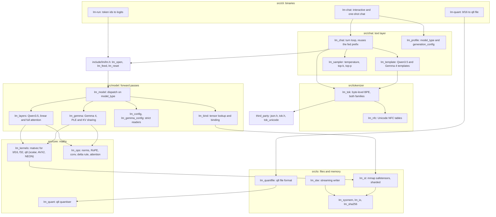
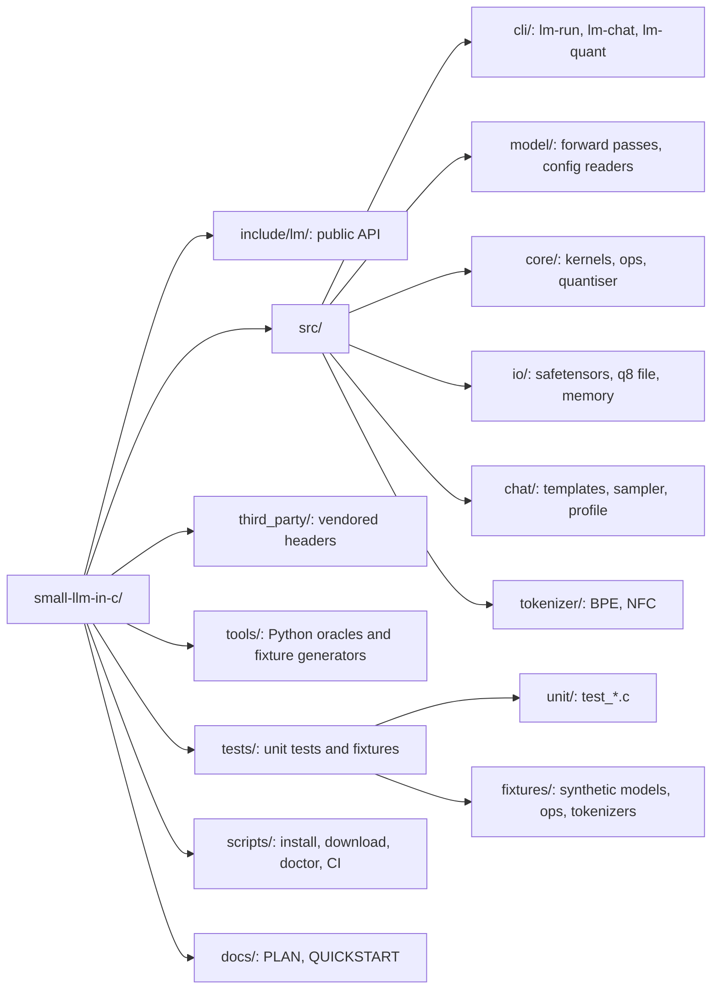
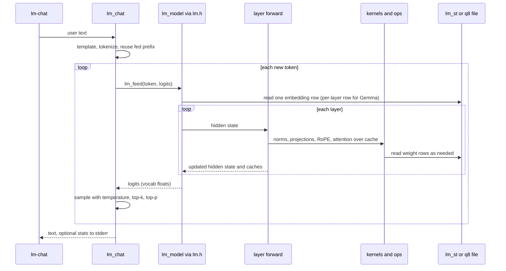

# small-llm-in-c

A C99 CPU inference engine for small language models, written from scratch for an
8 GB machine. Target: a Dell OptiPlex 3050 (Intel i5-6500T, 4 cores, AVX2, no AVX-512),
8 GB RAM, Ubuntu Server, with the model weights on the NVMe SSD.

## Status

- **Qwen3.5-4B (phase 1) and Gemma 4 E4B (phase 2) are both implemented.** Each passes its
  golden gate on a tiny synthetic model, checked against a float64 oracle. The Gemma
  oracle agrees with Hugging Face transformers to 5e-9.
- **Nothing has run on a real checkpoint yet.** The AVX2 build and the speed numbers are
  not measured. The first server run is the measurement.
- **Speed is an estimate.** Roughly 2 to 4 tokens/s for Qwen q8, bounded by memory
  bandwidth (about 4.75 GB read per token).

The full plan, with the normative model equations and test gates, is in
[docs/PLAN.md](docs/PLAN.md).

## The two models

| model | params (text) | checkpoint | status | notes |
|---|---:|---:|---|---|
| Qwen3.5-4B | ~4.2 B | 9.32 GB bf16, 2 shards | phase 1, implemented | Gated DeltaNet linear attention, three layers to one full attention |
| Gemma 4 E4B | ~4 B core + per-layer embeddings | 15.99 GB bf16, 1 file | phase 2, implemented | per-layer embeddings, KV sharing across layers, logit softcap 30 |

Both are Apache-2.0 and ungated. Vision, audio and Qwen's MTP head are out of scope; the
engine is text only.

## Ubuntu Server installation

These are the choices made on the OptiPlex during the Ubuntu Server installer. Use them
as written, or adapt them, but keep the disk layout: the OS and model weights on the SSD,
the HDD free.

### Hardware

| part | device | use |
|---|---|---|
| system and weights | Samsung MZVLB256HAHQ, 238.5 GB NVMe SSD | Ubuntu, `/`, `/boot`, `/boot/efi`, `~/models` |
| bulk storage | Toshiba MQ04ABF100, 931.5 GB 5400 rpm HDD | not used by the engine; keep for backups or other data |
| installer | SanDisk USB stick | boot media only; do not partition or use it afterwards |

The Intel HD 530 graphics is not used by the engine.

### Installer steps

1. **Language and keyboard:** as you prefer.
2. **Network configuration:**
   - The wired port `enp2s0` (Realtek RTL8111/8168/8211/8411 gigabit) should show
     "connected" with DHCPv4 once the cable is plugged into the router. Use it: wired is
     more reliable for a server.
   - The Wi-Fi card `wlp3s0` (Intel Wireless 8265/8275) starts disabled. Only enable it
     if the server cannot be wired. Enter the Wi-Fi password yourself at the prompt; it is
     not stored in this repository.
   - Choose **Done** once a connection is shown.
3. **Storage configuration:**
   - Select the **Samsung** SSD as the **boot disk**.
   - Create three GPT partitions on it, in this order:

     | size | format | mount |
     |---|---|---|
     | 1 GB | FAT32 | `/boot/efi` |
     | 2 GB | ext4 | `/boot` |
     | remaining (about 235 GB) | ext4 | `/` |

   - Do not use LVM. A swap file of 2 to 4 GB can be added later for safety; it is not needed
     to run the engine.
   - Leave the **Toshiba** unformatted during installation.
   - The installer warns if `/` is not mounted or no boot disk is selected; both must be set.
4. **Profile:** choose the server name, username and a password you will remember. Use the
   same username for the SSH steps below.
5. **SSH:** enable **Install OpenSSH server** so you can work from your Mac. Use an SSH key
   later; password login can stay on for the first session.
6. **Featured server snaps:** select none. The engine does not need them, and each one adds
   packages to maintain.
7. Choose **Done**, let the install finish, remove the USB stick and reboot.

### After the first boot

Find the server's address on the router or with `ip addr`, then connect from the Mac:

```sh
ssh USERNAME@SERVER_ADDRESS
```

Update the system (requires your password; run it yourself):

```sh
sudo apt update && sudo apt full-upgrade -y
```

Then install the build tools the engine needs:

```sh
sudo apt install build-essential python3 curl
```

Optional, for a 4 GB swap file on the SSD:

```sh
sudo fallocate -l 4G /swapfile && sudo chmod 600 /swapfile && sudo mkswap /swapfile && sudo swapon /swapfile
echo '/swapfile none swap sw 0 0' | sudo tee -a /etc/fstab
```

## Install the engine

Copy this repository to the server. From your Mac:

```sh
rsync -a --exclude build --exclude bin --exclude .claude --exclude .git \
  "PATH_TO_THIS_REPO/" USERNAME@SERVER_ADDRESS:~/small-llm-in-c/
```

Then on the server:

```sh
cd ~/small-llm-in-c
scripts/install.sh --model qwen3.5-4b
```

`scripts/install.sh` runs, in order: a system and tools check (refuses without AVX2),
`make`, `make test`, `make gate`, the pinned model download to `~/models/<model>`, the q8
file, and the read-only `scripts/doctor.sh` report. It prints the chat command at the end.

| option | meaning |
|---|---|
| `--model qwen3.5-4b` | default; about 10.3 GB download, 4.8 GB q8 file |
| `--model gemma-4-e4b` | about 17 GB download, 8.5 GB q8 file |
| `--model both` | both of the above |
| `--model none` | build and test only |
| `--model-dir DIR` | where models go (default `~/models`) |
| `--skip-tests` | skip `make test` and `make gate` (not recommended on the first run) |
| `--allow-hdd` | allow downloading to the HDD (not recommended) |

It is safe to re-run: finished downloads and an existing q8 file are skipped.

To do the same steps by hand, follow [docs/QUICKSTART.md](docs/QUICKSTART.md).

## Build and test

```sh
make            # build bin/* (one binary per src/cli/*.c)
make test       # build and run every tests/unit/test_*.c
make gate       # golden gates for Qwen3.5 and Gemma 4 against the oracle fixtures
make sanitize   # unit tests under ASan and UBSan
make portable   # x86-64 build with -mavx2 -mfma instead of -march=native
```

Requirements: a C99 compiler (`build-essential`), `make`, Python 3 (stdlib only), and
`curl` and `sha256sum` for the download script.

## How it works

**Weights: q8 resident, bf16 exact.**

- `bin/lm-quant` writes a q8 file: int8 weights with one f32 scale per 32 weights. The
  engine memory-maps it and keeps it resident. This is the normal mode on this machine.
- The original bf16 safetensors also load directly. On 8 GB they stream through the page
  cache: slow, but exact. The golden gate uses it as the reference for q8.

**Long chats stay cheap (Qwen).** Linear-attention layers keep a fixed-size state instead
of a cache that grows with every token. Only the full-attention layers keep a key/value
cache.

**Gemma 4 memory.** Only the first 24 layers own a key/value cache; the last 18 reuse
them. Sliding-window layers keep a ring of 512 positions. The per-layer embedding table is
read one row per token from the mapped file, never loaded whole. At 4096 tokens of context
the caches come to about 168 MiB.

**Porting.** The engine is written from scratch and ports code by file from
[kimi-k3-in-c](https://github.com/FareedKhan-dev/kimi-k3-in-c) (Apache-2.0; see
[NOTICE](NOTICE)): the safetensors reader, bf16 and int8 kernels, the delta-rule
recurrence, the sampler, and vendored tokenizer headers.

## Architecture

Three layers sit between the command-line tools and the weights file. The public API in
[include/lm/lm.h](include/lm/lm.h) is the only thing the tools call: token ids in, logits
out. The engine knows nothing about text; the chat and tokenizer code wrap it.

### Module map



### What each part does

- **Public API (`lm.h`).** Six calls: `lm_open`, `lm_close`, `lm_feed` (one token, optional
  logits), `lm_reset`, `lm_pos` and the two size queries. Errors are small integer codes
  (`LM_ERR_CTX`, `LM_ERR_TOKEN`, `LM_ERR_IO`). A model is never truncated, because
  linear-attention state cannot be rewound; a caller that changes the prompt resets and
  re-feeds.
- **`src/model`.** `lm_open` reads `config.json` and dispatches on `model_type`: `qwen3_5`
  goes to `lm_layers`, `gemma4` to `lm_gemma`. Each reader is strict: a missing field is an
  error, never a default. `lm_bind` looks up tensors by name, and it is the only place that
  decides whether a weight is bf16 or q8.
- **`src/core`.** The arithmetic. `lm_kernels` holds the matrix-vector products for each
  weight format; the AVX2 and NEON paths are checked bit-for-bit against the scalar path.
  `lm_ops` holds the per-token operations: normalisation, rotary embeddings, the causal
  convolution, the delta-rule step and attention over a cache.
- **`src/io`.** Files and memory. `lm_st` maps safetensors files (including sharded ones)
  without copying them, so the OS page cache decides what stays in RAM. `lm_quantfile`
  defines the q8 layout, and `lm_stw` writes files as they are produced rather than
  buffering them.
- **`src/chat` and `src/tokenizer`.** Text in and text out, kept outside the engine.
  `lm_chat` extends the fed prefix when the conversation grows and only re-feeds from
  scratch when it must. `lm_template` renders each family's chat format. `lm_tok` does the
  byte-level BPE; for Gemma it uses a heap-ordered merge, so long words stay fast.
- **`third_party`.** Vendored headers (JSON parser, tokenizer, Unicode tables) with their
  modifications recorded in [NOTICE](NOTICE).

### Repository layout



The Makefile discovers sources with wildcards, so a new file under `src/` or a
`tests/unit/test_*.c` needs no Makefile change.

### One token, end to end



Every token reads each layer's weights once, so speed is bounded by how fast those bytes
can be read (see the speed estimate above). KV caches exist only where a layer owns one
(Gemma's shared layers reuse their producer's cache), so memory grows with context only
through those caches.

## Usage

### bin/lm-chat

Chat with the model. With `--prompt` it answers once and exits. Without it, it opens an
interactive chat; `/reset` clears the conversation and `/exit` quits.

```
bin/lm-chat --model DIR --weights FILE [--prompt TEXT] [--system TEXT]
            [--think | --no-think] [--show-thinking] [--strict-template]
            [--temperature T] [--top-p P] [--top-k K] [--seed N]
            [--max-tokens N] [--ctx N] [--threads N] [--stats]
```

- Thinking is off by default (`--no-think`). A thinking block costs many tokens at this speed.
- `--stats` prints tokens/s to stderr. Please record it: it is the first real speed number.
- Sampling defaults come from `generation_config.json` for Gemma; flags override them.

### bin/lm-run

Feeds token ids, writes logits, and generates by argmax. The golden gate uses it; nothing
but token ids goes to stdout.

```
bin/lm-run --model DIR [--weights FILE] --tokens 1,2,3 [--logits-out F]
           [--greedy N] [--ctx N] [--threads N]
```

### bin/lm-quant

Writes the q8 file from the bf16 checkpoint.

```
bin/lm-quant --model DIR --out FILE
```

### scripts/doctor.sh

Read-only pre-flight report: CPU flags, memory, compiler, model type and files, q8 file, and
whether the model directory is on a rotational disk. `--read-speed` times a direct read of
the weights.

```
scripts/doctor.sh [--read-speed] [MODEL_DIR]
```

## Troubleshooting

- **Out of memory.** Use the q8 file, not bf16. Lower `--ctx`. Close other programs and
  check `scripts/doctor.sh` for available memory. A swap file helps as a safety margin.
- **Slow.** Keep the model directory on the SSD, not the HDD. Use q8 rather than bf16.
- **Installer shows "Mount a filesystem at /" or "Select a boot disk".** Both must be set
  on the Samsung SSD before Done.
- **doctor reports FAIL on a model file.** The size or hash does not match the pinned
  checkpoint. Re-run `scripts/download-model.sh`; it never overwrites files, so move the
  bad file aside first.
- **`install.sh` says a tool is missing.** Run the `sudo apt install` line it prints
  yourself, then re-run the script.

## License

Apache-2.0; see [LICENSE](LICENSE) and [NOTICE](NOTICE). The Qwen3.5-4B and Gemma 4 E4B
weights are published by Qwen and Google under Apache-2.0; this repository contains no
weights.

## Credits

- [kimi-k3-in-c](https://github.com/FareedKhan-dev/kimi-k3-in-c), the reference this engine
  ports code from by file.
- [Hugging Face transformers](https://github.com/huggingface/transformers): the Qwen3.5
  `modeling_qwen3_5.py` and Gemma 4 `modeling_gemma4.py` are the normative references for
  the forward passes.
