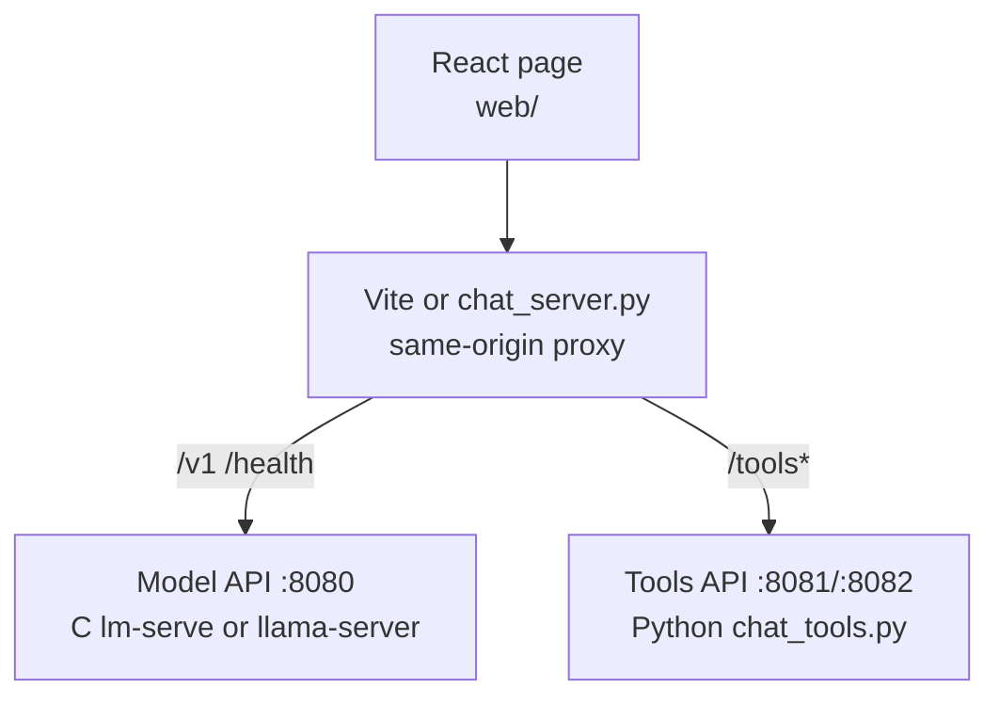

# How the APIs are built

There is no Express, FastAPI, or Flask app for the chat stack. Three **hand-rolled** HTTP layers sit behind the same-origin proxy.

## 1. Model API (`:8080`)

- **Engines:** `bin/lm-serve` (C, Kevin’s engine) or **llama-server** (llama.cpp) for GGUFs the C engine does not load.
- **Shape:** OpenAI-compatible — `/v1/chat/completions`, `/v1/models`, `/health`.
- **On the Mac:** SSH tunnel `ssh -N -L 8080:127.0.0.1:8080 toor@…` — leave this up when restarting the UI.

## 2. Tools API (`:8081` remote, `:8082` local)

- **Implementation:** `tools/chat_tools.py` — Python 3 **stdlib only** (`ThreadingHTTPServer` + `BaseHTTPRequestHandler`).
- **JSON routes** (all under `/tools/`):

| Method | Path | Role |
| --- | --- | --- |
| GET | `/tools/status` | Servers, catalog, limits |
| GET | `/tools/projects` | Owner-registered projects |
| GET | `/tools/servers/<id>/tools` | List tools (may start the MCP server) |
| POST | `/tools/servers/<id>/call` | Call a tool |
| POST | `/tools/servers/<id>/stop` | Stop a server |
| POST | `/tools/catalog/<id>/add` | Add a catalog entry to config |
| POST | `/tools/search` | SearXNG web search |

Projects and git helpers live in sibling modules (`chat_projects.py`, `chat_git.py`, …) and are registered as a native `"project"` server. The model never receives a free-form shell or token.

## 3. Proxy layer

| Proxy | Built with | Forwards |
| --- | --- | --- |
| Vite (`web/vite.config.ts`) | Node | `/v1`, `/health`, `/tools`, `/tools-local` |
| `tools/chat_server.py` | Python stdlib | Same paths (+ static `web/dist`) |

Environment defaults:

- `LM_SERVE_URL` → `http://127.0.0.1:8080`
- `LM_TOOLS_URL` → `http://127.0.0.1:8081`
- `LM_TOOLS_LOCAL_URL` → `http://127.0.0.1:8082`

## Security posture (API)

- Listen on **127.0.0.1** by default.
- Non-loopback bind requires `CHAT_PASSWORD` (HTTP Basic).
- Tool POSTs need JSON + loopback Origin (or none); CSP stays `'self'`.
- Secrets (e.g. GitHub token) live in `~/.config/kevin-ai/tool-service.env` mode `600`, never in the repo.
