# Repository map (GitDiagram)

Interactive: [gitdiagram.com/marcfs31/kevin-ai](https://gitdiagram.com/marcfs31/kevin-ai).

AI-generated overview of the public tree (verify against this guide and the source). Regenerated 2026-11-25.

```mermaid
flowchart TD

subgraph group_web["Browser chat"]
  node_app["Chat app<br/>[App.tsx]"]
  node_web_api["Chat API<br/>[api.ts]"]
  node_browser_state[("Conversation storage<br/>[storage.ts]")]
  node_attachments["File and image input<br/>[attachments.ts]"]
  node_agent["Agent workflow<br/>[agent.ts]"]
end

subgraph group_engine["Inference engine"]
  node_serve["HTTP endpoint<br/>[lm-serve.c]"]
  node_chat_loop["Chat generation<br/>[lm_chat.c]"]
  node_templates["Prompt templates<br/>[lm_template.c]"]
  node_tokenizer["Tokenizer<br/>[lm_tok.c]"]
  node_model_dispatch["Model dispatch<br/>[lm_model.c]"]
  node_qwen["Qwen model<br/>[lm_model.c]"]
  node_gemma["Gemma model<br/>[lm_gemma.c]"]
  node_qwen2["Qwen2 model<br/>[lm_qwen2.c]"]
  node_vision["Vision encoder<br/>[lm_vision.c]"]
  node_kernels["CPU kernels<br/>[lm_kernels.c]"]
  node_ops["Tensor operations<br/>[lm_ops.c]"]
  node_safetensors["Safetensors reader<br/>[lm_st.c]"]
  node_gguf["GGUF reader<br/>[lm_gguf.c]"]
  node_quant["Model quantization<br/>[lm_gguf_quant.c]"]
end

subgraph group_tools["Tool service"]
  node_tool_service["Tool service<br/>[chat_tools.py]"]
  node_projects["Project operations<br/>[chat_projects.py]"]
  node_tool_server["Tool HTTP server<br/>[chat_server.py]"]
end

node_user(("User"))
node_mcp["MCP servers"]
node_search["SearXNG search"]
node_github["GitHub"]
node_models[("Model files")]

node_user -->|"uses"| node_app
node_app -->|"loads state"| node_browser_state
node_app -->|"fetches server info"| node_web_api
node_app -->|"runs agent"| node_agent
node_app -.->|"prepares inputs"| node_attachments
node_web_api -->|"sends requests"| node_serve
node_web_api -->|"routes tool calls"| node_tool_service
node_serve -->|"dispatches generation"| node_chat_loop
node_chat_loop -->|"renders prompts"| node_templates
node_chat_loop -->|"encodes text"| node_tokenizer
node_chat_loop -->|"feeds tokens"| node_model_dispatch
node_model_dispatch -->|"dispatches family"| node_qwen
node_model_dispatch -->|"dispatches family"| node_gemma
node_model_dispatch -->|"dispatches GGUF"| node_qwen2
node_qwen -->|"uses compute"| node_kernels
node_gemma -->|"uses compute"| node_kernels
node_qwen -->|"uses operations"| node_ops
node_gemma -->|"uses operations"| node_ops
node_model_dispatch -->|"binds weights"| node_safetensors
node_model_dispatch -->|"locates GGUF"| node_gguf
node_serve -->|"handles images"| node_vision
node_models -.->|"loads weights"| node_safetensors
node_models -.->|"reads model"| node_gguf
node_quant -.->|"writes quantized weights"| node_models
node_tool_service -->|"uses server"| node_tool_server
node_tool_service -->|"delegates project work"| node_projects
node_tool_service -->|"runs MCP"| node_mcp
node_tool_service -->|"searches web"| node_search
node_tool_service -->|"opens pull requests"| node_github

click node_app "https://github.com/marcfs31/kevin-ai/blob/main/web/src/App.tsx"
click node_web_api "https://github.com/marcfs31/kevin-ai/blob/main/web/src/lib/api.ts"
click node_browser_state "https://github.com/marcfs31/kevin-ai/blob/main/web/src/lib/storage.ts"
click node_attachments "https://github.com/marcfs31/kevin-ai/blob/main/web/src/lib/attachments.ts"
click node_agent "https://github.com/marcfs31/kevin-ai/blob/main/web/src/lib/agent.ts"
click node_serve "https://github.com/marcfs31/kevin-ai/blob/main/src/cli/lm-serve.c"
click node_chat_loop "https://github.com/marcfs31/kevin-ai/blob/main/src/chat/lm_chat.c"
click node_templates "https://github.com/marcfs31/kevin-ai/blob/main/src/chat/lm_template.c"
click node_tokenizer "https://github.com/marcfs31/kevin-ai/blob/main/src/tokenizer/lm_tok.c"
click node_model_dispatch "https://github.com/marcfs31/kevin-ai/blob/main/src/model/lm_model.c"
click node_qwen "https://github.com/marcfs31/kevin-ai/blob/main/src/model/lm_model.c"
click node_gemma "https://github.com/marcfs31/kevin-ai/blob/main/src/model/lm_gemma.c"
click node_qwen2 "https://github.com/marcfs31/kevin-ai/blob/main/src/model/lm_qwen2.c"
click node_vision "https://github.com/marcfs31/kevin-ai/blob/main/src/model/lm_vision.c"
click node_kernels "https://github.com/marcfs31/kevin-ai/blob/main/src/core/lm_kernels.c"
click node_ops "https://github.com/marcfs31/kevin-ai/blob/main/src/core/lm_ops.c"
click node_safetensors "https://github.com/marcfs31/kevin-ai/blob/main/src/io/lm_st.c"
click node_gguf "https://github.com/marcfs31/kevin-ai/blob/main/src/io/lm_gguf.c"
click node_quant "https://github.com/marcfs31/kevin-ai/blob/main/src/core/lm_gguf_quant.c"
click node_tool_service "https://github.com/marcfs31/kevin-ai/blob/main/tools/chat_tools.py"
click node_projects "https://github.com/marcfs31/kevin-ai/blob/main/tools/chat_projects.py"
click node_tool_server "https://github.com/marcfs31/kevin-ai/blob/main/tools/chat_server.py"

classDef toneNeutral fill:#f8fafc,stroke:#334155,stroke-width:1.5px,color:#0f172a
classDef toneBlue fill:#dbeafe,stroke:#2563eb,stroke-width:1.5px,color:#172554
classDef toneAmber fill:#fef3c7,stroke:#d97706,stroke-width:1.5px,color:#78350f
classDef toneMint fill:#dcfce7,stroke:#16a34a,stroke-width:1.5px,color:#14532d
classDef toneRose fill:#ffe4e6,stroke:#e11d48,stroke-width:1.5px,color:#881337
classDef toneIndigo fill:#e0e7ff,stroke:#4f46e5,stroke-width:1.5px,color:#312e81
classDef toneTeal fill:#ccfbf1,stroke:#0f766e,stroke-width:1.5px,color:#134e4a
class node_app,node_web_api,node_browser_state,node_attachments,node_agent,node_user toneBlue
class node_serve,node_chat_loop,node_templates,node_tokenizer,node_model_dispatch,node_qwen,node_gemma,node_qwen2,node_vision,node_kernels,node_ops,node_safetensors,node_gguf,node_quant,node_models toneAmber
class node_tool_service,node_projects,node_tool_server,node_mcp toneMint
class node_search,node_github toneIndigo
```

