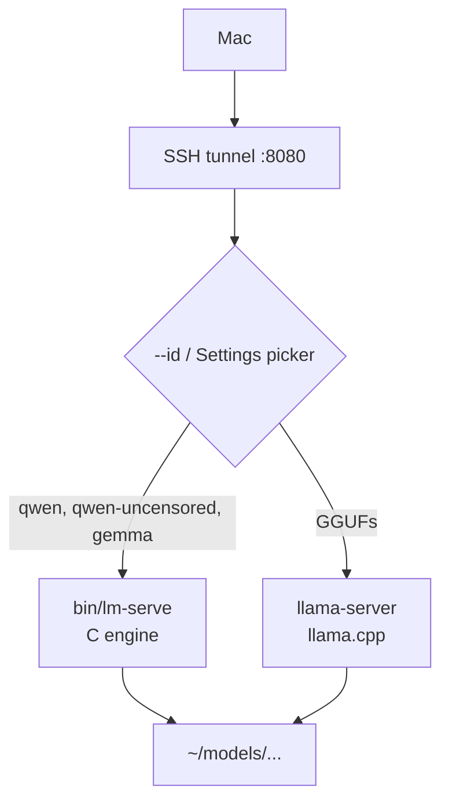
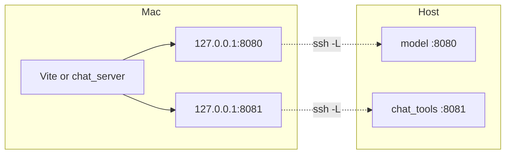

# How models run

Only **one** model process holds port **8080** on the OptiPlex at a time (~11 GB RAM). Starting another replaces the previous one. Do **not** stop the tunnel or the running server when you only restart Vite or `chat_server`.

## Two engines



| Engine | Used for | Binary on host |
| --- | --- | --- |
| **lm-serve** (C) | `qwen`, `qwen-uncensored`, `gemma` | `~/kevin-ai/bin/lm-serve` (typical) |
| **llama-server** | All GGUF targets (WhiteRabbitNeo, Gemma uncensored E4B/E2B, Nemotron, Granite, Spark, LFM3, heretic/abliterated variants, Qwen2B GGUF, …) | Builds under `~/opt/llama.cpp-*` (v1.0.0, b10828 for Spark, b11938 for LFM3) |

Script that stops the old process and starts the new one: [`scripts/start-remote-lm-serve.sh`](https://github.com/marcfs31/kevin-ai/blob/main/scripts/start-remote-lm-serve.sh).

## Start / switch from the Mac

```bash
# From the Mac checkout — replaces whatever holds :8080 on the host
./scripts/start-remote-lm-serve.sh --id gemma-uncensored
```

From the **Vite** UI only: Settings → start a model → `POST /control/serve` (Vite plugin). Production `chat_server` does not expose that control endpoint.

## Model IDs (v1.0.0 picker)

| `--id` | Engine | Alias / folder under `~/models` |
| --- | --- | --- |
| `qwen` | lm-serve | `qwen3.5-4b` |
| `qwen-uncensored` | lm-serve | `qwen3.5-4b-uncensored` |
| `gemma` | lm-serve | `gemma-4-e4b` |
| `whiterabbitneo` | llama-server | `whiterabbitneo-2.5-7b` |
| `gemma-uncensored` | llama-server | `gemma-4-e4b-uncensored` |
| `gemma-e2b` | llama-server | `gemma-4-e2b` |
| `nemotron` | llama-server | `nemotron-3.5-bolt-e4b` |
| `granite` | llama-server | `granite-4.2-3b` |
| `spark` | llama-server (b10828) | `spark-x2.6-4b` |
| `lfm3` | llama-server (b11938) | `lfm3-vl-2b` |
| `gemma-e2b-heretic` | llama-server | `gemma-4-e2b-heretic` |
| `spark-heretic` | llama-server (b10828) | `spark-x2.6-4b-heretic` |
| `granite-heretic` | llama-server | `granite-4.2-3b-heretic` |
| `qwen2b` | llama-server | `qwen3.5-2b-abliterated` |
| `lfm3-abliterated` | llama-server (b11938) | `lfm3-vl-2b-abliterated` |

Source of truth for labels and context caps: `web/src/lib/serveModels.ts`.

## Tunnels (Mac ↔ host)



```bash
ssh -N -L 8080:127.0.0.1:8080 toor@192.168.1.96   # model — leave alone
ssh -N -L 8081:127.0.0.1:8081 toor@192.168.1.96   # tools
./scripts/start-remote-chat-tools.sh --update
```

Check: `curl -s http://127.0.0.1:8080/health` → `{"status":"ok"}`.
