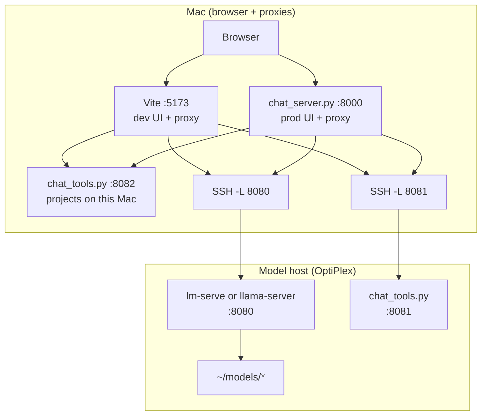

# System overview

Kevin AI is split so the heavy model stays on a small Linux box while the Mac only runs the browser UI and optional local tools.

## Big picture

## What talks to what

| From | Path on the page origin | Upstream |
| --- | --- | --- |
| Chat UI | `/v1/*`, `/health` | Model on `127.0.0.1:8080` (tunnel) |
| Chat UI | `/tools/*` | Remote tools on `127.0.0.1:8081` (tunnel) |
| Chat UI | `/tools-local/*` | Local tools on `127.0.0.1:8082` (rewritten to `/tools/`) |

The browser never opens those upstream ports directly. Vite or `chat_server.py` proxy same-origin so the CSP can stay `'self'`.

## Repository map (where to edit)

| Change | Where |
| --- | --- |
| Chat UI, styles, i18n | `web/src` |
| Tools, MCP, search, projects | `tools/chat_tools.py`, `tools/chat_projects.py`, … |
| Static proxy + CSP + gzip | `tools/chat_server.py` |
| Start model / tools | `scripts/start-remote-lm-serve.sh`, `start-*-chat-tools.sh` |
| C engine | `src/`, `bin/lm-serve` |

GitDiagram of the tree: [marcfs31/kevin-ai](https://gitdiagram.com/marcfs31/kevin-ai).
