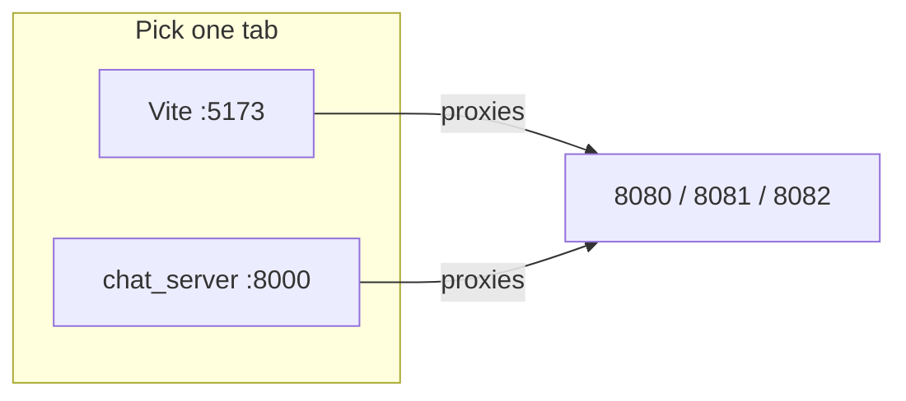

# Vite vs chat_server

They serve the **same React chat**. They are **not** the same process.

## Side by side

| | **Vite** (dev) | **chat_server** (prod) |
| --- | --- | --- |
| Command | `cd web && npm run dev` | `python3 tools/chat_server.py …` |
| Default URL | [http://127.0.0.1:5173/](http://127.0.0.1:5173/) | [http://127.0.0.1:8000/](http://127.0.0.1:8000/) |
| What it serves | Live TypeScript/React via Vite | Built files from `web/dist` |
| Built with | Node + Vite 8 | **Python 3 stdlib** (`http.server`) |
| Hot reload | Yes | No |
| Gzip static assets | Dev server | Yes (in `chat_server.py`) |
| Start a model from Settings | Yes — `POST /control/serve` (Vite plugin only) | **No** |
| Lighthouse target | Do **not** score the Vite server | Yes — production path |

## When to use which

- **Demo / develop / switch models from the UI** → open **Vite**. Only the Vite plugin exposes `POST /control/serve`, which runs `scripts/start-remote-lm-serve.sh` on the model host.
- **Day-to-day “shipped” chat / Lighthouse** → open **chat_server** after `cd web && npm run build`.

There is **no** Makefile target or script that starts both. Start them separately (see [Run the demo on the Mac](/guide/run-on-mac)).

## chat_server in one sentence

`tools/chat_server.py` is a small Python reverse proxy + static file server: HTML/JS/CSS from `web/dist`, `/v1` and `/health` to the model, `/tools` to the remote tool service, optional `/tools-local` to the Mac tool service.
